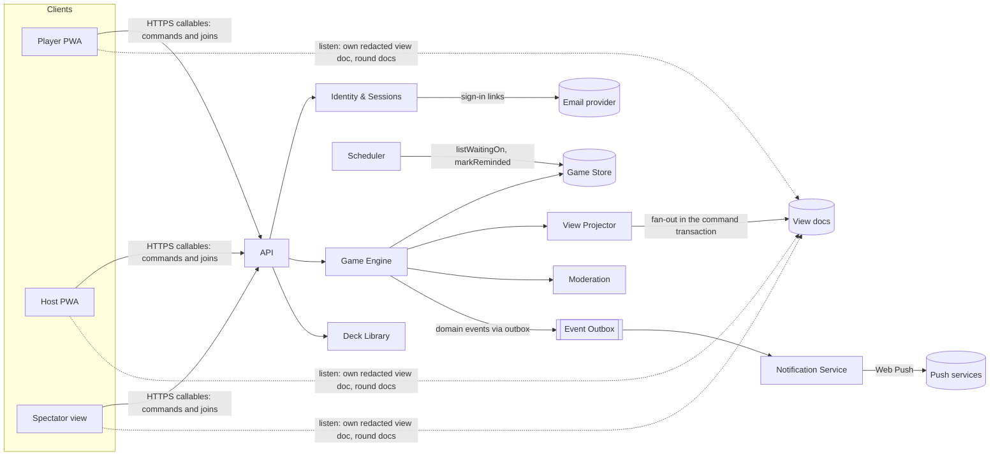
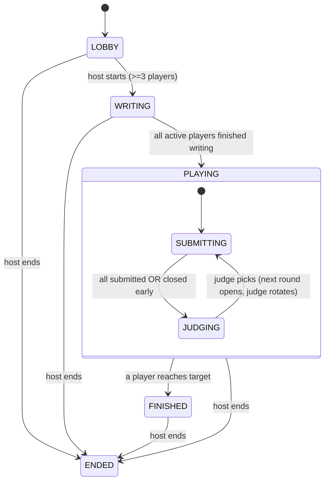

# Deep Cuts: High-Level Design

Status: draft v0.2 (amended after LLD review). Companion to [gameplay.md](./gameplay.md), which is the source of truth for rules. This document covers the major components, what each is responsible for, the invariants they uphold, and the contracts between them. The low-level designs below own schemas, wire formats and UI; where a section here carries a parenthetical pointer to an LLD, that LLD owns the detail and this text is a summary. Text superseded by the LLD review is marked "(superseded)" or replaced in place; see section 8 for the Firebase-specific deviations.

## Low-level designs

| LLD | Document | Scope |
|---|---|---|
| 0 | [00-platform-build-deploy.md](./lld/00-platform-build-deploy.md) | Repo, build, CI, Firebase projects, deploy order, TTL and index config, logging and metrics conventions |
| 1 | [01-game-engine.md](./lld/01-game-engine.md) | `packages/engine`: aggregate, `decide`, commands, events, playability, Moderation, test matrix |
| 2 | [02-view-projector.md](./lld/02-view-projector.md) | `project`, viewers, `ViewDoc`/`RoundDoc`, fan-out, redaction tests; replaces the Change Feed |
| 3 | [03-game-store.md](./lld/03-game-store.md) | Firestore data model, rules, indexes, `runCommand` transaction, outbox, event log, `deleteGame` cascade |
| 4 | [04-identity-sessions.md](./lld/04-identity-sessions.md) | Principals, host email-link flow, seat join/rejoin/reissue/revoke, room codes, threat model |
| 5 | [05-command-api-contracts.md](./lld/05-command-api-contracts.md) | `packages/contracts`, callables, `defineCallable`, error codes, rate limiter, versioning |
| 6 | [06-notifications-scheduler.md](./lld/06-notifications-scheduler.md) | FCM push, fan-out, dedupe, reminder sweep, notification fallback |
| 7 | [07-web-client.md](./lld/07-web-client.md) | PWA screens, session handling, drafts, service worker |

Milestones and steps for building all of this: [execution-plan.md](./execution-plan.md).

## 1. Design drivers

These properties of the game shape almost every decision below.

| Driver | Consequence |
|---|---|
| **Asynchronous, hours-to-days games, no timers** | No live connection is required for correctness. Realtime is a convenience layer. State must be durable and every request must be safe to retry. |
| **Anonymity until the judge picks** | The server holds secrets (who played what, who wrote what). Clients must never receive them early. Redaction is a first-class, centralized concern. |
| **No accounts for players; email sign-in for hosts** | Two identity classes with different strength. Player identity is a bearer token bound to one seat in one game. |
| **Notifications are the "turn" mechanism** | Notification delivery is core to playability, not a nice-to-have. A daily reminder needs a scheduler even though the game has no timers. |
| **3 to 10 players, small friend groups** | Scale is many small games, not one big one. Per-game serialization is cheap and removes whole classes of concurrency bugs. |
| **Phones first** | Installable PWA, flaky networks, backgrounded tabs. Commands must be idempotent. |

## 2. System context



Dashed = a direct client read of a document the Projector already redacted for exactly that viewer (or a resolved-round doc that is public by resolution). This replaces the original hint-only Change Feed (superseded, LLD 2 section 9). The Scheduler's reminders reach Notifications as `Reminder` outbox rows written by the `markReminded` command (section 3.9).

## 3. Components

Each component lists its **responsibility**, what it **owns**, its **invariants**, and its **interface**. "Must" statements are testable.

### 3.1 Web Client (PWA)

**Responsibility.** Render the game for one viewer and issue commands on their behalf. Holds no authority: everything it shows comes from a `GameView`, and every rule is enforced server-side.

**Owns.** Local UI state only: the unconfirmed red-card selection (the "change your pick until you confirm" step is purely client-side), draft text in the card-writing form (also persisted server-side, see Game Engine), notification permission state, the session credential.

**Invariants.**
- C1. The client never computes game outcomes; it renders `GameView` and sends commands.
- C2. Correct after being closed for days: on open it listens to its own view doc and the rounds collection (LLD 2 section 9). It never depends on having seen prior events. (Replaces "fetches the current view and, optionally, the feed".)
- C3. Every command carries a client-generated `idempotencyKey`; a retry after a network failure is always safe.
- C4. Degrades without push: if notifications are denied or unsupported, the UI still shows "your turn" state on open and via the page title/badge.

**Interface (consumes).** Callable API (section 5), view-doc and round-doc listeners (section 3.7).

### 3.2 API Layer

**Responsibility.** The only entry point for clients. Authenticates the caller to a `Principal`, validates and rate-limits requests, routes commands to the Game Engine. Contains no game rules. Game state is read by clients straight from the Projector's view documents (section 3.7), not through the API.

**Invariants.**
- A1. Every request resolves to exactly one `Principal` (section 4.1) or is rejected before reaching any other component.
- A2. Commands are authorized by *role in the game* (`host`, `player`, `judge`, `spectator`) via the Engine's `actorRole`, not by trusting client-supplied claims.
- A3. Responses never contain data that did not pass through the View Projector (for game state) or an explicit strict-schema DTO (for everything else).
- A4. Join-by-code endpoints are rate-limited per IP and per code; a 4-letter code is a short-lived convenience (72 h lookup window), not a secret (see section 7, R2). Host email sign-in rate limits rest on Firebase's own throttling plus an optional `beforeEmailSent` guard (LLD 5 section 8.1); the sign-in link is sent by the Auth SDK, not by our code.

**Interface (provides).** Callable API (section 5, LLD 5 section 3).

### 3.3 Identity & Sessions

**Responsibility.** Establish who is calling, in two tiers.

| Principal | How established | Strength | Authority |
|---|---|---|---|
| `Host` | Email + single-use sign-in link (SDK email-link flow); Auth session | Verified email | Create games; host controls for games they created; deck library |
| `Seat` (player) | Join with display name; server mints a one-time custom token bound to `(gameId, playerId)`; the personal rejoin link carries the long-lived secret | Bearer secret | Act as that player in that game only |
| `Spectator` | Opens the link; anonymous session (needed only to dedupe People's Choice votes) | Weak | Read-only view; vote if enabled |

**Owns.** Host profile, per-seat records (rejoin-secret hash, `epoch`, revocation markers; LLD 4). Sign-in links and sessions are Firebase Auth's.

**Invariants.**
- I1. A seat is valid for exactly one `(gameId, playerId)`; it can never act in another game or as another player.
- I2. Secrets are high-entropy, stored only as hashes, and revocable. Removing a player disables the Auth user and revokes its refresh tokens; deletion happens in the `deleteGame` cascade (a deleted user could be silently recreated by a still-valid custom token). Deleting a game purges every seat. The rejoin link is long-lived: it keeps working until the player is removed or the host reissues it (Q3).
- I3. Sign-in links are single-use and short-lived.
- I4. Display names are unique among seated players (case-insensitive) so "who hasn't played" is unambiguous; a departed player's name is freed.
- I5. The host principal is the only way to obtain host powers; there is no "promote seat to host" path (host transfer is explicitly deferred in gameplay.md).

**Interface (provides).** (Replaces the original `requestHostSignIn`/`redeemHostSignIn`/`resolveSession`/`revoke`; LLD 4 sections 2 to 6.)
```
// host sign-in: the Firebase SDK email-link flow (sendSignInLinkToEmail / signInWithEmailLink); no server function
principalOf(auth) -> Principal                           // pure; Host | Seat | Spectator | guest
assertSeatLive(principal, gameId) -> void | NOT_AUTHORIZED(seat_revoked)   // refuses removed or reissued seats
joinGame(roomCodeOrInvite, displayName, idempotencyKey) -> {gameId, playerId, customToken, rejoinUrl}   // checks Moderation for the name
rejoin(gameId, secret) -> {playerId, customToken}
reissueRejoinLink(gameId, playerId) -> Url               // host reissue rotates the secret; the old link stops working. Players can also copy their own current link.
handleIdentityRow(db, gameId, rowId) -> void             // outbox consumer: disable, tombstone and revoke a departed seat; idempotent; also called by the hourly redrive
```

### 3.4 Game Engine (domain core)

**Responsibility.** The single authority on game rules. Takes `(currentState, command)` and produces `(newState, events)` or a rejection. Implemented as a **pure, deterministic function with no I/O**, so every rule in gameplay.md can be unit- and property-tested without a database, clock, or network. Randomness for shuffles and the first judge is injected through a seedable `Rng` port; card ids come from a separate CSPRNG `mintId` port that is not replayable (E8).

**Owns.** The game aggregate, one per game (LLD 1 section 3.2):

```
Game
  id, roomCode, hostId, settings, phase, version, paused, totalJoins
  players[]      { id, name, joinOrder, status, hand[], scorePile[], writeProgress, powerUsage }
  pools          { redDeck[], redDiscard[], greenDeck[] }                   // anonymous (greenDiscard is unused and dropped)
  round?         { number, judgeId, greenCard, phase, submissions[], revealOrder[] }
  history[]      RoundSummary (ids only; full RoundRecords are written once to rounds/{n})   // immutable
  votes[]        (People's Choice, if enabled; capped)
  waitingOn, episode, waitingSince, reminderDueAt                             // scheduler denormalization
drafts           { playerId, red[], green[] }   // NOT on the aggregate: one private document per player; authorship exists ONLY here
```

**State machine.**



"Fewer than 3 active players" is a derived condition (`paused`), not a phase; while paused, `PLAYING` commands are rejected with `PAUSED`. Nobody is notified when a pause begins; when it ends, the players the game is waiting on are (section 3.8).

**Invariants.** (These are the heart of the design.)

*Structural*
- E1. Every command is validated against the current phase and the actor's role; invalid commands are rejected with a typed reason and change nothing.
- E2. Each command is atomic: state and its events commit together or not at all.
- E3. `version` increases by exactly 1 per accepted command that changes the aggregate; commands apply in a single total order per game. A text-only `saveDraft` changes no aggregate and does not bump `version`. Every version has exactly one event document (no gaps; LLD 1 section 7.1).
- E4. Idempotency: replaying a command with the same `(gameId, actor, idempotencyKey)` returns the original result and has no further effect.

*Cards and decks*
- E5. **Conservation.** Every card is in exactly one place: a pool, a hand, a discard, a score pile (green only), or the current round's submissions. No command creates or destroys a card except `writeIn` (creates) and `removeCard` (destroys, host/moderation; only a card that has been shown to the table, Q13).
- E6. Hands hold at most 7 cards; after a round resolves, every player who played is topped up to 7 (reshuffling the red discard into the deck if the deck is exhausted).
- E7. The green deck cannot run out before the game ends (`green count >= players × target`); late joiners add their green cards before they're active, preserving this. `WRITING -> PLAYING` is refused unless the pools meet the playability minimums below, which also determine how many cards each player must write (Q7, Q9).

*Anonymity*
- E8. **No authorship in the pool.** A card's author is known only while it is in a private draft. When a player marks writing "finished", their cards move into the anonymous pools and the author link is dropped. Nothing after that point, including host tools and logs, can say who wrote a card. No stored event or log can be used to reconstruct authorship: card ids are not derived from replayable seeds, and events for card-minting commands (`finishWriting`, `importDeck`, `writeIn`) carry neither seed nor actor. Write-in cards stay in the game and recirculate like any card, and nothing stored or shown to other players marks a card or submission as a write-in (no `variant` in events, outbox rows, round docs or history; `powerUsage` is server-only and projected only to its owner; LLD 1, LLD 2). Accepted residual: players may guess a write-in from unfamiliar text.
- E9. A submission's owner is recorded for the round but is not exposed to anyone (including the judge and host) until the round result is committed.
- E10. `revealOrder` is fixed once at reveal time and persisted, so a refresh never reshuffles the judge's view.
- E11. The judge can only pick a submission present in `revealOrder`, and only after the round is in `JUDGING`.

*Rounds and scoring*
- E12. Exactly one judge per round; the judge never submits and never scores in that round; judge rotation follows `joinOrder` over *active* players.
- E13. A player has at most one confirmed submission per round, and it must come from their own hand. Confirmed submissions are final.
- E14. A round resolves exactly once; it awards exactly one green card, to exactly one non-judge player.
- E15. The game finishes when a player's score pile reaches `target`; after `FINISHED` only read commands, `castVote`, `endGame` and `deleteGame` are accepted (`castVote` so the final round can be voted on).
- E16. Variants: Write-in and Redraw are each usable at most once per player per game; votes can't target one's own card; votes never affect scoring. A game holds at most `MAX_VOTES` (1500) votes (`VARIANT_UNAVAILABLE`, detail `vote_cap`). Declared weakness: with spectator voting on, a seated player can vote from an anonymous session for their own card or twice; People's Choice never affects scoring, so the impact is limited to the award (LLD 1 section 8.8).

*Membership*
- E17. Removing or losing a player returns their hand to the red pool, drops any unrevealed submission of theirs back into that hand-return, and recomputes "who the round is waiting on". A departing player's score pile returns to the green deck; their points leave with them (Q12). If the judge is removed, judging passes to the next active player.
- E18. Late joiners are `WRITING` until finished, enter play at the next round boundary with 7 cards and 0 points, and never receive cards mid-round; while the game is paused, ready players are activated immediately and sit out the in-flight round. A game seats at most 10 players and accepts at most `MAX_TOTAL_JOINS` (50) joins in total, counted by a monotonic `totalJoins` that includes players who left the lobby (`ROOM_FULL`, detail `join_cap`).

**Playability minimums.** For `N` active players and score target `T`, counting every card in the game's red or green pools, hands and (for red) the discard:

```
G_min = N × T                       // green
R_min = 7N + max(2N, 7)             // red: the initial deal plus a draw pile of at least 2N, and never fewer than 7
```

- *Green.* The most rounds a game can last before someone reaches `T` is `N(T-1) + 1`, so `N × T` is a safe, simple bound. It is also what a new deck supplies when every player writes `T` green cards.
- *Red.* Each round draws at most `N-1` cards, so a draw pile of `2N` gives about two rounds before the first reshuffle, and the floor of 7 guarantees a Redraw (7 cards) is always possible. `R_min` never exceeds the new-deck total of `10N` (`N = 3`: 28 vs 30; `N = 4`: 36 vs 40; `N = 10`: 90 vs 100), so a brand-new game with everyone writing the standard counts always qualifies.
- *Per-player write counts (Q7).* `existing_red` / `existing_green` are cards already supplied by a reused deck.
  - New deck: each player writes 10 red and `T` green.
  - Reused deck: each player writes `ceil(max(0, R_min - existing_red) / N)` red and `ceil(max(0, G_min - existing_green) / N)` green. Both are at most the new-deck counts.
  - If a reused deck already meets both minimums, the host may choose any red count from 0 to 10 and green count from 0 to `T`, as long as the totals still meet the minimums.
- *Late joiners.* `N` grows by one, so both minimums grow (the score target stays frozen at start). A late joiner writes the game's configured counts, or more if that is what it takes to restore `R_min` and `G_min` at the new `N`.
- *Removals.* A removed or departed player's hand returns to the red pool and their score pile to the green deck (E17), so card totals are unchanged while `N` shrinks, and the minimums can only get easier to meet.
- *Enforcement.* `finishWriting` and `join` recompute the minimums; the host cannot start play (and a late joiner cannot be activated) while they're unmet. A `removeCard` that would drop the totals below the minimums is refused (`NOT_PLAYABLE`, detail `below_minimum`); the host's way out is `endGame`. The UI shows each player how many cards they still need to write.

**Interface (provides).** Pure core plus a thin application service:

```
// pure
decide(state: Game, cmd: Command, ctx: {now, rng, mintId, actor, drafts}) -> Result<{state: Game, events: DomainEvent[], ...}, Rejection>

// application service (the only caller of the Store's write path)
execute(gameId, cmd, principal, idempotencyKey) -> CommandResult      // realized as Store.runCommand, section 3.5
```

**Commands** (actor in brackets; exact payloads in LLD 1 section 7, wire form in LLD 5 section 2.4):

| Command | Actor | Phase | Effect |
|---|---|---|---|
| `createGame(settings)` | Host (own callable) | - | New game in `LOBBY`; allocates room code |
| `updateSettings(...)` | Host | LOBBY (`profanity` also in WRITING, PLAYING) | Target, profanity filter, variants, spectators and (only when a reused deck already makes the game playable) cards each player writes, capped at the new-deck maximum. Nested `variants` and `spectators` objects are replaced, not merged |
| `join(name)` | Anyone (own callable) | any non-ended | Adds player (`LOBBY` or late-join into `WRITING` status); `ROOM_FULL` at 10 seated or at the total-join cap (`join_cap`) |
| `leave()` | Player | LOBBY, WRITING, PLAYING | See E17 |
| `removePlayer(id)` | Host | LOBBY, WRITING, PLAYING | See E17 |
| `removeCard(id)` | Host | LOBBY, WRITING, PLAYING | Only a card that has been shown to the table; any other id is `NOT_FOUND` (hidden cards are not probeable). Refused below the playability minimums. See E5 |
| `importDeck(...)` | Host (server-only; Deck Library phase) | LOBBY | Adds a saved deck's cards; never accepted by `command` |
| `startGame()` | Host | LOBBY | Requires >=3 players; to `WRITING` |
| `saveDraft(red[], green[])` | Player | WRITING | Replaces player's private drafts (validated by Moderation); text-only edits change no aggregate |
| `finishWriting()` | Player | WRITING (or late joiner in PLAYING) | Requires full counts; pools cards, drops authorship (E8) |
| `confirmSubmission(cardId)` | Player (non-judge) | SUBMITTING | E13 |
| `closeSubmissions()` | Judge or Host | SUBMITTING | To `JUDGING` with what's in (needs >=1 submission) |
| `pickWinner(submissionId)` | Judge | JUDGING | E11, E14; scores; deals; opens next round or finishes |
| `passJudging()` | Host | SUBMITTING, JUDGING | Judge becomes next active player; see gameplay.md "Stalled judge" |
| `writeIn(text)` / `redraw()` | Player | SUBMITTING | Variants, once each |
| `castVote(submissionId)` | Player/Spectator | PLAYING, FINISHED (resolved rounds) | People's Choice, if enabled; `vote_cap` at `MAX_VOTES` |
| `endGame()` | Host | LOBBY, WRITING, PLAYING, FINISHED | To `ENDED` |
| `deleteGame()` | Host (own callable) | any | Permanently deletes the game, its history and its seats; the only way a game is removed (S5) |
| `markReminded(episode)` | System (Scheduler) | WRITING, PLAYING | Advances the reminder clock and records the reminder intent (section 3.9); a no-op if the episode changed or is not yet due |

**Domain events** (consumed by the event log and Notifications; contain ids and kinds, never card text): `GameCreated`, `SettingsUpdated`, `PlayerJoined`, `PlayerLeft`, `PlayerRemoved`, `DeckImported`, `WritingStarted`, `PlayerFinishedWriting`, `PlayStarted`, `PlayerActivated`, `RoundOpened{judge}`, `SubmissionConfirmed{playerId}`, `HandRedrawn`, `SubmissionsClosed`, `JudgeChanged{reason: passed|left|removed|resumed}`, `RoundVoided`, `WinnerPicked`, `VoteCast`, `CardRemoved`, `GameFinished`, `GameEnded`, `GameDeleted`, `PausedChanged` (LLD 1 section 11). The notifying subset is in section 3.8.

### 3.5 Game Store

**Responsibility.** Durable persistence of the game aggregate with safe concurrent access.

**Owns.** Game aggregates (current state), private drafts, resolved-round docs, an append-only event log per game (one doc per version), the idempotency ledger, the outbox, per-seat identity records, and the deletion job.

**Invariants.**
- S1. **Single writer per game.** Writes take a lock on the aggregate plus a version assertion (the Admin SDK's pessimistic transactions; the explicit `next.version === prev.version + 1` check and `create()` on `events/{version}` make a lost update impossible). Two concurrent commands cannot both succeed against the same version; the loser waits or is retried by the transaction.
- S2. State, appended events, idempotency record, outbox rows and view documents commit in one transaction (the transactional outbox), so no event is lost or published without its state change.
- S3. Round history is append-only; `RoundRecord`s are never edited. The single exception is `redact`: a host's `removeCard` blanks that card's text in the resolved-round docs that contain it (LLD 3 section 6.3).
- S4. A game is always loadable from its stored state alone; no dependency on in-memory state.
- S5. **Games persist until the host explicitly deletes them**, regardless of phase; nothing that defines a game expires automatically (only operational scaffolding has a TTL, LLD 3 section 2.6). `deleteGame` is an atomic phase 0 (the game becomes un-commandable) followed by a resumable cascade that removes views, drafts, seat Auth users, push subscriptions, history and the aggregate.

**Interface.** (Replaces the original `load`/`commit`/`listWaitingOn(olderThan)`; a transaction cannot span a separate load and commit. LLD 3 section 5.1.)
```
runCommand(input) -> CommandOutcome                 // read, decide, fan-out and write in one transaction
createGame(...) / findByRoomCode(code) -> gameId?
listWaitingOn(page) -> [{gameId, episode, waitingOn, since, dueAt, version}]     // for Scheduler
listGamesByHost(hostId, page) -> GameSummary[]
rebuildViews(gameId)                                // repair after a projector change
```

### 3.6 View Projector (redaction)

**Responsibility.** The **only** path by which game state reaches a client. A pure function from `(Game, Viewer)` to a `GameView` containing exactly what that viewer may know right now.

**Invariants.**
- V1. `project` is total and side-effect free; `GameView` is a separate type from `Game`, so a raw aggregate cannot be serialized to a client by accident.
- V2. **Hands are private.** A view contains only the viewer's own hand.
- V3. **Submissions are anonymous until resolved.** During `SUBMITTING`: the viewer sees their own submission, plus which players have/haven't submitted (not what). During `JUDGING`: the judge sees the shuffled cards with opaque `submissionId`s and no owners; non-judges see the same list and no owners. After the result, the round's record includes owners. Declared limit: when a player is removed or leaves during `JUDGING`, or the host passes judging to a player who had submitted, that player's card vanishes from `reveal` and from `submittedBy`, so anyone who saw the earlier list can infer its owner; this affects only a withdrawn card, which cannot win (LLD 2 open question 8).
- V4. No view ever includes card authorship (it doesn't exist after E8) or other players' drafts.
- V5. Spectator views are a strict subset of player views.
- V6. Views carry the aggregate `version`, so clients can detect staleness and order responses.
- V7. History exposes only resolved rounds; the in-progress round is never in history.

**Verification.** V2 to V5 are covered by a property test suite: for random games and every viewer role, assert that no forbidden field or value appears anywhere in the serialized view.

**Interface.** (Replaces `projectFeed(game, viewer, sinceRound?)` and the two-kind `Viewer`; LLD 2 sections 2, 3 and 7.1. V1 to V7 are unchanged.)
```
project(game: Game, viewer: Viewer) -> GameView
makeProjector(game) / viewerFor(game, uid) / viewersOf(game) / fanOut(prev, next, opts) -> ViewWrite[]     // one view doc per viewer, written in the command transaction
toRoundDoc(record) -> RoundDoc;  projectFeed(records, sinceRound?) -> RoundDoc[]                          // viewer-independent; for tests and tools
```
`Viewer` is `{kind: 'player', uid, playerId, isHost} | {kind: 'spectator', uid|null, isHost} | {kind: 'departed', uid, playerId, reason}`.

### 3.7 Change Feed (realtime): realized as view-doc listeners

(Superseded. The original design was a hint-only feed (`{gameId, version}` over SSE, fed from the outbox). LLD 2 section 9 replaces it, because Firestore listeners on per-viewer, already-redacted documents are both the query and the realtime channel. The component dissolves into the Projector's write path; there is no SSE endpoint and no `projectFeed` serving path.)

**Responsibility.** Let connected clients see a change as soon as it commits.

**Invariants.** (LLD 2 section 9.1)
- F1 (revised). **The feed carries game data, but only data already redacted for exactly that audience**: the viewer's own `views/{uid}` doc (or `views/spectator`) and the immutable `rounds/{n}` docs that became public at resolution. There is no other channel that carries game data. Redaction is still never re-implemented on a push channel, because the Projector writes the documents.
- F2. Lossy by design: missing, duplicate, or reordered snapshots are harmless because each snapshot is a complete document and `version` orders them.
- F3. Not required for correctness; clients fall back to a one-shot read on open, on focus and at a low polling rate.
- F4 (revised). Who can read what: `views/{uid}` only by that uid; `views/spectator` by any signed-in user while spectators are enabled; `rounds/*` by any signed-in user. Spectator access is therefore capability-by-game-id, not membership of the game. The original "subscribing requires a valid principal for that game" is relaxed accordingly (LLD 2 open question 2, decided in LLD 3 section 3.2).
- F5 (new). Views and round docs change only inside the command transaction, so a listener never sees a view that its own state has not committed.
- F6 (new). Cross-document consistency is eventual: a client with a view that says round `n` is resolved but without `rounds/n` yet shows a loading state.

**Interface.** Firestore `onSnapshot`/`getDoc` on `views/{uid}` or `views/spectator`, and a `rounds` query ordered by `round`. (The `GET /games/{id}/events` SSE endpoint is dropped.)

### 3.8 Notification Service

**Responsibility.** Deliver "it's your turn" and daily reminders to the right people, at most one visible notification per trigger, without leaking game content. Principle: a player is pushed whenever they **become** newly waited-on, and reminded daily for as long as they remain waited-on, in every phase where the game waits on someone: WRITING (players who have not finished writing), SUBMITTING (non-judge players who have not submitted), JUDGING (the judge).

**Owns.** Push subscriptions (per seat, per game, up to 5 devices) and a per-(outbox row, recipient) delivery record.

**Trigger table** (LLD 6 section 9; one recipient receives at most one notification per command, so `WinnerPicked` merges into the next `RoundOpened` or `GameFinished`).

| Event | Notified | Title |
|---|---|---|
| `WritingStarted` | every player who has cards to write | Time to write |
| `RoundOpened` (the first, and each later round) | the non-judge players (a late joiner is activated into it) | Your turn |
| `SubmissionsClosed` (all submitted, or the judge closed it) | the judge | Time to judge |
| `JudgeChanged` | the new judge ("Time to judge" if all cards are in, else "You're judging"); the old judge only if they now owe a card ("Your turn") | |
| `PausedChanged{paused:false}` | the players the game is waiting on | Game resumed |
| `WinnerPicked` | all seated players, including late joiners still writing (merged into the next `RoundOpened` as "Your turn" for non-judges) | Round result |
| `GameFinished` | all seated players, including late joiners still writing | Game over |
| `GameEnded` (the host ended the game) | all seated players (writing, ready or active), also while paused | Game ended ("The host ended the game.") |
| Daily reminder (`Reminder`) | players the game is currently waiting on in WRITING, SUBMITTING or JUDGING, and late joiners still writing | Reminder |
| pause, `PlayerLeft`, `PlayerRemoved`, `PlayerJoined`, others | nobody | |

A player is notified whenever they become newly waited-on, and reminded daily for as long as they remain waited-on, in WRITING, SUBMITTING and JUDGING (a late joiner still writing is reminded in any phase). Nothing is sent while paused, except that ending the game notifies everyone seated; copy is generic (no card text, no names). A late joiner who becomes waited-on in WRITING is already in the app, so gets no push.

**Invariants.**
- N1. **At most one visible notification per `(outbox row, recipient)`** (a rare duplicate alert is possible), enforced by a delivery record created before sending, so redelivery of the trigger cannot double-notify. A crash between provider acceptance and the record update may resend once with the same collapse key and tag; the device shows one notification, which may alert twice.
- N2. A notification never contains card text or anything not already visible to that recipient (payloads are ids and generic copy; the client fetches content).
- N3. Reminders only to players the game is currently waiting on (WRITING: unfinished writers; SUBMITTING: non-judge players who have not submitted; JUDGING: the judge), **at most one per 24 h per `(player, game)`**, stopping on pause, finish or end.
- N4. Failure of a push provider never fails or delays a game command (fully asynchronous, retried with backoff; dead subscriptions are pruned when the push provider reports the token unregistered or invalid).
- N5. Email is used only for host sign-in links in v1 (gameplay.md: no email notifications to start).

**Interface.** (LLD 6 sections 2 and 9)
```
// consumes
onDomainEvent(row) -> void                                        // outbox trigger
registerSubscription(uid, gameId, fcmToken, deviceId?) -> void
unregisterSubscription(uid, gameId, fcmToken) -> void
```

### 3.9 Scheduler

**Responsibility.** Provide the only time-based behavior in the system: the daily reminder sweep. The game has no timers, so the Scheduler decides nothing about the game itself.

**Invariants.**
- T1. The Scheduler holds no game logic and never edits game fields itself. Its only write to game state is the Engine's `markReminded` system command, issued through the Store's `runCommand`; it advances the reminder clock and records the reminder intent in the outbox in one transaction. (Replaces "read-only with respect to game state".)
- T2. Idempotent: running a sweep twice produces the same notifications once (N1/N3); a replayed `markReminded` idempotency key writes nothing.
- T3. Time enters the Engine only via the `ctx.now` parameter, never from ambient clocks inside `decide`; the Scheduler and Notifications read time only through an injected clock.

**Interface.** Periodic job (hourly) calling `Store.listWaitingOn`, then `Store.runCommand(markReminded)` per due game; the resulting `Reminder` outbox row is delivered by Notifications.

### 3.10 Moderation

**Responsibility.** Apply the host's profanity setting to user-supplied text (display names, card text, pitch-it text).

**Invariants.**
- M1. Applied server-side at write time (`join`, `saveDraft`, `writeIn`, pitch), never only in the client.
- M2. The filter mode is a game setting; changing it affects future writes and does not rewrite existing cards (the host can still `removeCard`).
- M3. Returns a verdict plus a user-facing reason, so rejections explain themselves ("this word isn't allowed in this game").
- M4. Deterministic and local (a wordlist), with no third-party call on the hot path, so it can't leak card text to an outside service.

**Interface.**
```
check(text, kind: 'name'|'card'|'pitch', mode: 'on'|'off') -> {ok} | {ok:false, reason}
```

### 3.11 Deck Library (later phase)

**Responsibility.** Let a host save a finished game's cards and seed future games.

**Invariants.**
- D1. Library entries are owned by a `Host` and are not visible to others.
- D2. Saved cards retain no authorship (consistent with E8) and no game or player ids.
- D3. Importing never violates E5-E7: imported cards enter the pools like written ones, and count rules (per-player write counts, green deck sufficiency) still hold. The host decides how an imported deck combines with newly written cards; players only write enough to make the game playable, or a host-chosen number up to the new-deck maximum if the deck already suffices (Q5, Q7).

**Interface.**
```
saveDeck(hostId, gameId) -> DeckId
listDecks(hostId) -> DeckSummary[]
importDeck(hostId, deckId, gameId) -> void   // LOBBY only
```

## 4. Cross-cutting contracts

### 4.1 Principals and roles

```
Principal = Host{hostId} | Seat{gameId, playerId} | Spectator{uid} | Guest
Role (per game, derived by Engine) = host | player | judge | spectator
```
The host also plays: they are both `host` and a `player` in the same game, with a seat and a hand like anyone else (Q1).

### 4.2 Command envelope

```
{
  v,                     // wire contract major (LLD 5 section 2.6)
  gameId,
  idempotencyKey,        // client-generated UUID
  expectedVersion?,      // guard for commands that depend on what the user saw (required for the five round commands)
  type, payload
}
-> { ok: true,  version, view, draftSeq?, replay, sv }        // view is the caller's fresh GameView; replay marks an idempotent replay; sv is the server's contract version
 | { ok: false, reason: <typed enum>, version, detail?, retryAfterMs?, sv }
```
`expectedVersion` matters for `pickWinner`, `confirmSubmission`, `writeIn`, `closeSubmissions` and `passJudging`: if the round changed under the user (e.g., the host passed judging), the command is rejected with `STALE` instead of being applied to a different situation than the one the user saw. A rejection is an HTTP-success body; only gates (no auth, bad shape, `CLIENT_OUTDATED`) and infrastructure failures are transport errors (LLD 5 section 1).

### 4.3 Error taxonomy

Typed, stable reason codes the client can render (LLD 5 section 2.3): `NOT_AUTHORIZED`, `WRONG_PHASE`, `STALE`, `NOT_IN_HAND`, `ALREADY_SUBMITTED`, `ROOM_FULL`, `NAME_TAKEN`, `CONTENT_REJECTED`, `PAUSED`, `RATE_LIMITED`, `NOT_FOUND`, plus the Engine's `NOT_PLAYABLE`, `INVALID_ARGUMENT` and `VARIANT_UNAVAILABLE`. An optional `detail` from a closed per-code set refines a reason without leaking state, including `join_cap` (`ROOM_FULL`), `vote_cap` (`VARIANT_UNAVAILABLE`) and `seat_revoked` (`NOT_AUTHORIZED`, a removed or reissued seat). `CLIENT_OUTDATED` is a gate answer (an `HttpsError` detail), not a body reason. Rejections never reveal hidden state (a failed `pickWinner` must not distinguish "no such card" from "card not in this round" in a way that leaks anything; likewise `removeCard` answers `NOT_FOUND` for an unknown card and for one never shown).

### 4.4 Time

Only the Scheduler and Notifications read wall-clock time. The Engine receives `now` as input (for timestamps in history), and no rule depends on it.

### 4.5 Observability

Structured logs keyed by `gameId` and `version`; logs must never contain card text, display names beyond a hash, or tokens. Metrics: command latency and rejection rates by reason, version-conflict retry rate, push delivery success, reminder volume.

## 5. External interfaces (sketch)

Illustrative; exact shapes are in LLD 5 (superseding the REST sketch of v0.1). Every client call is a Firebase callable; there is no custom REST API.

**Callables** (LLD 5 section 3)
```
command          { v, gameId, idempotencyKey, expectedVersion?, type, payload }     // every in-game command (section 4.2)
createGame       { v, idempotencyKey, hostName, settings? }  -> { gameId, roomCode, inviteUrl }
deleteGame       { v, gameId, idempotencyKey }               -> { deleting: true }          // a replay answers NOT_FOUND, which the client treats as success
joinGame         { v, target: {code} | {gameId}, displayName, idempotencyKey } -> { gameId, playerId, customToken, rejoinUrl }
lobbyInfo        { v, target }                               -> { joinable, playerCount? }  // pre-join, minimal; never returns the gameId
rejoin           { v, gameId, secret }                       -> { playerId, customToken }
spectate         { v, gameId }                               -> { available, vote }
registerPush / unregisterPush { v, gameId, fcmToken, deviceId? }
reissueRejoinLink { v, gameId, playerId } -> { rejoinUrl };  signOutEverywhere;  listGamesByHost;  hostProfile
// host email sign-in is the Firebase SDK flow, not a callable
```
**Reads** (Firestore listeners, section 3.7)
```
views/{uid}  or  views/spectator      -> ViewDoc { schema, viewsRev, enabled, version, view: GameView | null, draftSeq?, draft? }
rounds  (ordered by `round`)          -> resolved RoundDocs  (the catch-up feed)
```
**Representative `GameView`** (superseded sketch, now per LLD 2 section 4.2 and LLD 5 section 2.5; what a player may see):
```
{ audience: 'player', gameId, version, phase, paused, settings, target, targetFrozen, writeCounts,
  you: { playerId, status, isHost, isJudge, turn, score, hand[], writeTarget, cardsLeft, powerUsage, yourSubmission?, myVotes },
  players: [{id, name, score, status, isHost, cardsLeft}],
  waitingOn: [playerId],                                   // a top-level list, not a per-player flag
  round?: { number, judgeId, green, phase, expected[], submittedBy: [playerId],     // who, not what
            reveal?: [{submissionId, text, pitch}] },                               // no owners
  resolved,                                                 // highest resolved round: fetch rounds/{n}
  winnerId?, awards?, host?: {...} }                        // no `result` object: history is in the round docs
```

## 6. Key flows

**Submit and reveal (the anonymity path).**
1. Player selects a card locally (no server state), then confirms: `confirmSubmission(cardId)`.
2. Engine checks E13, appends the submission with the owner recorded, emits `SubmissionConfirmed{playerId}`, increments version.
3. In the same transaction the Projector rewrites every affected view doc; each client's listener fires and the Projector's output shows them "N of M played" and *who*, not *what*.
4. When the last submission lands (or the judge/host closes early), Engine emits `SubmissionsClosed`, fixes `revealOrder` (E10); Notifications pings the judge.
5. Judge's view now includes `reveal[]` with opaque ids. `pickWinner` resolves the round (E14), emits `WinnerPicked`, and writes `rounds/{n}`; the next views carry `resolved = n` and the round doc has owners.

**Returning after two days.** Open link, seat session in storage, the listener on the viewer's own view doc returns current state and a `rounds` query returns resolved rounds. No event replay needed (C2).

**Retry on flaky network.** Client resends the same envelope; the Store finds the idempotency record and returns the original result (E4).

## 7. Risks and mitigations

| # | Risk | Mitigation |
|---|---|---|
| R1 | **Anonymity leak** via an overlooked field, log line, event log or notification | Single Projector path (V1), property tests (V2 to V5), no authorship stored after pooling and none recoverable from events or ids (E8), no card text in push/logs (N2, section 4.5) |
| R2 | **4-letter codes are guessable**, and late joins are always allowed, so a guessed code lets a stranger into a game | Long unguessable invite token in the shareable link; code window 72 h, lookups rate-limited (A4); no room-lock control for now (Q2), so the invite token, the window and rate limiting are the only gates |
| R3 | **Push is unreliable**, especially iOS where web push needs the PWA installed | Client works without push (C4); onboarding prompts install; daily reminder; accepted for v1; revisit email notifications if it proves insufficient (Q4) |
| R4 | **Lost seat token** (cleared storage, new phone) loses the player's hand | Persistent personal rejoin link per player, reissuable by the host (Q3, I2) |
| R5 | **Host absence stalls the game**, as accepted in gameplay.md | Accepted for v1; Engine already has `hostId` indirection so transfer is a small later change |
| R6 | Lost updates under concurrent commands | S1/S2 single writer (lock plus version assertion), plus idempotency |
| R7 | Games persist until deleted, so abandoned games accumulate | Accepted (S5, Q6); host-initiated delete; revisit if storage cost matters |

## 8. Technology

Decided: Firebase backend (Firestore, Cloud Functions, Auth, FCM, Hosting) with a TypeScript React PWA. See [tech-stack.md](./tech-stack.md) for the component mapping. Deliberate deviations from this document on Firestore, all driven by the fact that Firestore rules cannot hide fields in the aggregate:
- The Change Feed component (3.7) is replaced by listeners on per-viewer, already-redacted view documents: F1 and F4 are revised, C2 is reworded, and the 3.6 interface, the section 5 query endpoints, the section 6 flow steps and the section 9 build-order step change accordingly (LLD 2 section 9.2 lists every superseded passage).
- The Store interface is `runCommand` rather than `load`/`commit` (3.5), and S1 is realized as lock plus version assertion.
- Identity uses the Firebase SDK email-link flow and Auth custom tokens (3.3).

## 9. Suggested build order

0. **Platform** (LLD 0): Bun workspace, CI, emulator harness, Firebase projects, rules/indexes/TTL deploy path. Everything below lands on it.
1. **Engine + Projector + property tests** (no I/O): the whole ruleset, anonymity included, runnable in tests.
2. **Store + API + Identity** with view-doc listeners: a playable game end to end. (The original "Change Feed (SSE hints)" step is not built; listeners arrive here, LLD 2 section 9.)
3. **Notifications + Scheduler**: makes async play practical.
4. **Moderation**, then **variants**, then **spectators / People's Choice**, then **Deck Library**. (The Moderation module ships with the Engine, LLD 1 section 12; the step is wiring and wordlist content.)

## 10. Decisions and open questions

Resolved in PR review (these are now requirements; gameplay.md is updated to match):

| # | Question | Decision |
|---|---|---|
| Q1 | Does the host also play? | Yes. The host holds a seat and the host role. |
| Q2 | Room lock | Not for now. Late joins stay open to anyone with the invite. |
| Q3 | Seat recovery | A player's personal rejoin link keeps working until they're removed, and the host can reissue it (rotating the old one out). |
| Q4 | Players who deny push | Acceptable for v1; revisit email notifications if it isn't good enough. |
| Q5 | Saved-deck import vs. writing phase | The host decides how a reused deck is combined with newly written cards (see Q7). |
| Q6 | Retention | Games persist until the host explicitly deletes them. |
| Q7 | Cards written per player | Derived from what the game needs for its player count. For a new deck, players write the standard counts (up to 10 red, target-many green). With a reused deck, players write only enough to make the game playable; if the deck already suffices, the host may choose how many each player writes, up to the new-deck maximum. A late joiner may be asked to write more than the standard counts. |
| Q8 | Profanity filter changes mid-game | Fine: applies to future writes only (M2). |
| Q9 | Playability minimum | `G_min = N × T`, `R_min = 7N + max(2N, 7)`; see "Playability minimums" in section 3.4. |
| Q10 | Finished-game access | Finished games stay readable, with history and awards, through the same links until the host deletes them. Spectators keep access too. |
| Q11 | Notifications on every turn | A player is pushed whenever they become newly waited-on, in every phase including WRITING ("write your cards"), and on a new judge or an unpause; a daily reminder follows while they stay waited-on (section 3.8; LLD 6). |
| Q12 | Leaver's score pile | A departing or removed player's score pile returns to the green deck; their points leave with them (E17). |
| Q13 | `removeCard` reach | The host may remove only a card that has been shown to the table (played into a reveal, or in a resolved round), refused when it would drop totals below the playability minimums; `endGame` is the escape hatch (E5, LLD 1 section 8.6). |
| Q14 | Write-in cards after use | Write-ins stay in the deck and are indistinguishable from other cards (E8). |
