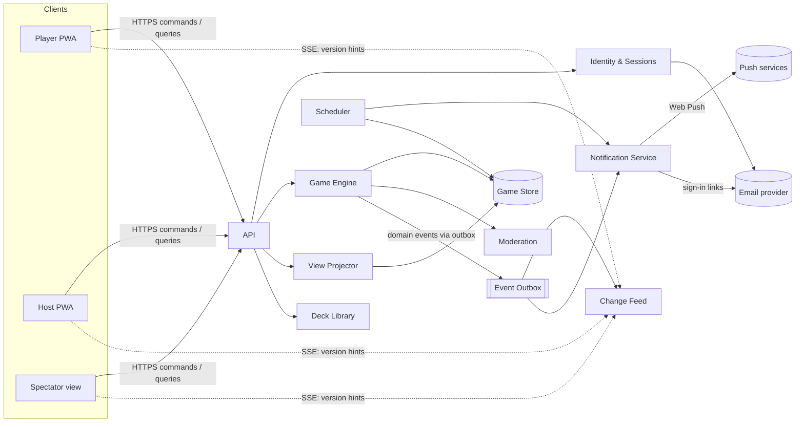
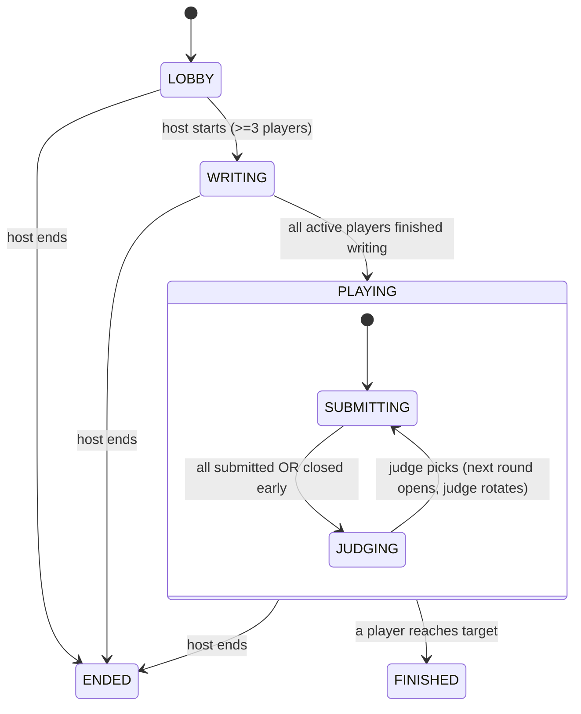

# Deep Cuts: High-Level Design

Status: draft v0.1. Companion to [gameplay.md](./gameplay.md), which is the source of truth for rules. This document covers the major components, what each is responsible for, the invariants they uphold, and the contracts between them. Low-level designs (schemas, wire formats, UI) come later, one per component.

## 1. Design drivers

These properties of the game shape almost every decision below.

| Driver | Consequence |
|---|---|
| **Asynchronous, hours-to-days games, no timers** | No live connection is required for correctness. Realtime is a convenience layer. State must be durable and every request must be safe to retry. |
| **Anonymity until the judge picks** | The server holds secrets (who played what, who wrote what). Clients must never receive them early. Redaction is a first-class, centralized concern. |
| **No accounts for players; email sign-in for hosts** | Two identity classes with different strength. Player identity is a bearer token bound to one seat in one game. |
| **Notifications are the "turn" mechanism** | Notification delivery is core to playability, not a nice-to-have. A daily reminder needs a scheduler even though the game has no timers. |
| **3 to 10 players, small friend groups** | Scale is many small games, not one big one. Per-game serialization is cheap and removes whole classes of concurrency bugs. |
| **Phones first** | Installable PWA, flaky networks, backgrounded tabs. Commands must be idempotent. |

## 2. System context



Dashed = hint-only channel carrying no game data.

## 3. Components

Each component lists its **responsibility**, what it **owns**, its **invariants**, and its **interface**. "Must" statements are testable.

### 3.1 Web Client (PWA)

**Responsibility.** Render the game for one viewer and issue commands on their behalf. Holds no authority: everything it shows comes from a `GameView`, and every rule is enforced server-side.

**Owns.** Local UI state only: the unconfirmed red-card selection (the "change your pick until you confirm" step is purely client-side), draft text in the card-writing form (also persisted server-side, see Game Engine), notification permission state, the session credential.

**Invariants.**
- C1. The client never computes game outcomes; it renders `GameView` and sends commands.
- C2. Correct after being closed for days: on open it fetches the current view and, optionally, the feed. It never depends on having seen prior events.
- C3. Every command carries a client-generated idempotency key; a retry after a network failure is always safe.
- C4. Degrades without push: if notifications are denied or unsupported, the UI still shows "your turn" state on open and via the page title/badge.

**Interface (consumes).** Command API, Query API, Change Feed (section 5).

### 3.2 API Layer

**Responsibility.** The only entry point for clients. Authenticates the caller to a `Principal`, validates and rate-limits requests, routes commands to the Game Engine and queries to the View Projector. Contains no game rules.

**Invariants.**
- A1. Every request resolves to exactly one `Principal` (section 4.1) or is rejected before reaching any other component.
- A2. Commands are authorized by *role in the game* (`host`, `player`, `judge`, `spectator`) via the Engine's `actorRole`, not by trusting client-supplied claims.
- A3. Responses never contain data that did not pass through the View Projector (for game state) or an explicit DTO (for everything else).
- A4. Join-by-code and sign-in endpoints are rate-limited per IP and per code; a 4-letter code is a short-lived convenience, not a secret (see section 7, R2).

**Interface (provides).** Command API and Query API (section 5).

### 3.3 Identity & Sessions

**Responsibility.** Establish who is calling, in two tiers.

| Principal | How established | Strength | Authority |
|---|---|---|---|
| `Host` | Email + single-use sign-in link; session cookie | Verified email | Create games; host controls for games they created; deck library |
| `Seat` (player) | Join with display name; server mints an opaque bearer token bound to `(gameId, playerId)` | Bearer secret | Act as that player in that game only |
| `Spectator` | Opens the link; optional anonymous token (needed only to dedupe People's Choice votes) | Weak | Read-only view; vote if enabled |

**Owns.** Host records (email, id), sign-in link tokens, seat tokens (stored hashed), spectator tokens.

**Invariants.**
- I1. A seat token is valid for exactly one `(gameId, playerId)`; it can never act in another game or as another player.
- I2. Tokens are high-entropy, stored only as hashes, and revocable. Removing a player or deleting a game revokes the seat token. A seat token is long-lived: it is what the player's rejoin link carries, so the link keeps working until the player is removed or the host reissues it (Q3).
- I3. Sign-in links are single-use and short-lived.
- I4. Display names are unique within a game (case-insensitive) so "who hasn't played" is unambiguous.
- I5. The host principal is the only way to obtain host powers; there is no "promote seat to host" path (host transfer is explicitly deferred in gameplay.md).

**Interface (provides).**
```
requestHostSignIn(email) -> void                       // emails a link
redeemHostSignIn(token) -> HostSession
joinGame(roomCodeOrInvite, displayName) -> SeatSession // checks Moderation for name
resolveSession(credential) -> Principal | null
issueRejoinLink(gameId, playerId) -> Url               // host reissue rotates the seat token; the old link stops working. Players can also copy their own current link.
revoke(principalRef) -> void
```

### 3.4 Game Engine (domain core)

**Responsibility.** The single authority on game rules. Takes `(currentState, command)` and produces `(newState, events)` or a rejection. Implemented as a **pure, deterministic function with no I/O**, so every rule in gameplay.md can be unit- and property-tested without a database, clock, or network. Randomness (shuffles, first judge) is injected through a seedable `Rng` port.

**Owns.** The game aggregate, one per game:

```
Game
  id, roomCode, hostId, settings, phase, version
  players[]      { id, name, joinOrder, status, hand[], scorePile[], writeProgress, powerUsage }
  pools          { redDeck[], redDiscard[], greenDeck[], greenDiscard[] }   // anonymous
  drafts[]       { playerId, red[], green[] }                               // private, authorship exists ONLY here
  round?         { number, judgeId, greenCard, phase, submissions[], revealOrder[] }
  history[]      RoundRecord                                                // immutable
  votes[]        (People's Choice, if enabled)
```

**State machine.**



"Fewer than 3 active players" is a derived condition (`paused = activePlayers < 3`), not a phase; while paused, `PLAYING` commands are rejected and nobody is notified.

**Invariants.** (These are the heart of the design.)

*Structural*
- E1. Every command is validated against the current phase and the actor's role; invalid commands are rejected with a typed reason and change nothing.
- E2. Each command is atomic: state and its events commit together or not at all.
- E3. `version` increases by exactly 1 per accepted command; commands apply in a single total order per game.
- E4. Idempotency: replaying a command with the same `(gameId, actor, idempotencyKey)` returns the original result and has no further effect.

*Cards and decks*
- E5. **Conservation.** Every card is in exactly one place: a pool, a hand, a discard, a score pile (green only), or the current round's submissions. No command creates or destroys a card except `writeIn` (creates) and `removeCard` (destroys, host/moderation).
- E6. Hands hold at most 7 cards; after a round resolves, every player who played is topped up to 7 (reshuffling the red discard into the deck if the deck is exhausted).
- E7. The green deck cannot run out before the game ends (`green count >= players × target`); late joiners add their green cards before they're active, preserving this. `WRITING -> PLAYING` is refused unless the pools meet the playability minimums below, which also determine how many cards each player must write (Q7, Q9).

*Anonymity*
- E8. **No authorship in the pool.** A card's author is known only while it is in a private draft. When a player marks writing "finished", their cards move into the anonymous pools and the author link is dropped. Nothing after that point, including host tools and logs, can say who wrote a card.
- E9. A submission's owner is recorded for the round but is not exposed to anyone (including the judge and host) until the round result is committed.
- E10. `revealOrder` is fixed once at reveal time and persisted, so a refresh never reshuffles the judge's view.
- E11. The judge can only pick a submission present in `revealOrder`, and only after the round is in `JUDGING`.

*Rounds and scoring*
- E12. Exactly one judge per round; the judge never submits and never scores in that round; judge rotation follows `joinOrder` over *active* players.
- E13. A player has at most one confirmed submission per round, and it must come from their own hand. Confirmed submissions are final.
- E14. A round resolves exactly once; it awards exactly one green card, to exactly one non-judge player.
- E15. The game finishes when a player's score pile reaches `target`; after `FINISHED` only read commands and `endGame` are accepted.
- E16. Variants: Write-in and Redraw are each usable at most once per player per game; votes can't target one's own card; votes never affect scoring.

*Membership*
- E17. Removing or losing a player returns their hand to the red pool, drops any unrevealed submission of theirs back into that hand-return, and recomputes "who the round is waiting on". If the judge is removed, judging passes to the next active player.
- E18. Late joiners are `WRITING` until finished, enter play at the next round boundary with 7 cards and 0 points, and never receive cards mid-round.

**Playability minimums.** For `N` active players and score target `T`, counting every card in the game's red or green pools, hands and (for red) the discard:

```
G_min = N × T                       // green
R_min = 7N + max(2N, 7)             // red: the initial deal plus a draw pile of at least 2N, and never fewer than 7
```

- *Green.* The most rounds a game can last before someone reaches `T` is `N(T-1) + 1`, so `N × T` is a safe, simple bound. It is also what a new deck supplies when every player writes `T` green cards.
- *Red.* Each round draws at most `N-1` cards, so a draw pile of `2N` gives about two rounds before the first reshuffle, and the floor of 7 guarantees a Redraw (7 cards) is always possible. `R_min` never exceeds the new-deck total of `10N` (`N = 3`: 28 vs 30; `N = 4`: 36 vs 40; `N = 10`: 90 vs 100), so a brand-new game with everyone writing the standard counts always qualifies.
- *Per-player write counts (Q7).* `existing_red` / `existing_green` are cards already supplied by a reused deck.
  - New deck: each player writes 10 red and `T` green.
  - Reused deck: each player writes `ceil(max(0, R_min - existing_red) / N)` red and `ceil(max(0, G_min - existing_green) / N)` green. Both are at most the new-deck counts.
  - If a reused deck already meets both minimums, the host may choose any red count from 0 to 10 and green count from 0 to `T`, as long as the totals still meet the minimums.
- *Late joiners.* `N` grows by one, so both minimums grow. A late joiner writes the game's configured counts, or more if that is what it takes to restore `R_min` and `G_min` at the new `N`.
- *Removals.* A removed or departed player's hand returns to the red pool (E17), so red totals are unchanged while `N` shrinks, and the minimums can only get easier to meet.
- *Enforcement.* `finishWriting` and `join` recompute the minimums; the host cannot start play (and a late joiner cannot be activated) while they're unmet. The UI shows each player how many cards they still need to write.

**Interface (provides).** Pure core plus a thin application service:

```
// pure
decide(state: Game, cmd: Command, ctx: {now, rng}) -> Result<{state: Game, events: DomainEvent[]}, Rejection>

// application service (the only caller of the Store's write path)
execute(gameId, cmd, principal, idempotencyKey) -> CommandResult
```

**Commands** (actor in brackets):

| Command | Actor | Phase | Effect |
|---|---|---|---|
| `createGame(settings)` | Host | - | New game in `LOBBY`; allocates room code |
| `updateSettings(...)` | Host | LOBBY | Target, profanity filter, variants, and (only when a reused deck already makes the game playable) cards each player writes, capped at the new-deck maximum |
| `join(name)` | Anyone | any non-ended | Adds player (`LOBBY` or late-join into `WRITING` status) |
| `leave()` | Player | any | See E17 |
| `removePlayer(id)` / `removeCard(id)` | Host | any | See E17, E5 |
| `startGame()` | Host | LOBBY | Requires >=3 players; to `WRITING` |
| `saveDraft(red[], green[])` | Player | WRITING | Replaces player's private drafts (validated by Moderation) |
| `finishWriting()` | Player | WRITING | Requires full counts; pools cards, drops authorship (E8) |
| `confirmSubmission(cardId)` | Player (non-judge) | SUBMITTING | E13 |
| `closeSubmissions()` | Judge or Host | SUBMITTING | To `JUDGING` with what's in (needs >=1 submission) |
| `pickWinner(submissionId)` | Judge | JUDGING | E11, E14; scores; deals; opens next round or finishes |
| `passJudging()` | Host | SUBMITTING, JUDGING | Judge becomes next active player; see gameplay.md "Stalled judge" |
| `writeIn(text)` / `redraw()` | Player | SUBMITTING | Variants, once each |
| `castVote(submissionId)` | Player/Spectator | after result | People's Choice, if enabled |
| `endGame()` | Host | any | To `ENDED` |
| `deleteGame()` | Host | any | Permanently deletes the game, its history and its tokens; the only way a game is removed (S5) |

**Domain events** (consumed by Change Feed and Notifications; contain ids and kinds, never card text): `PlayerJoined`, `PlayerRemoved`, `WritingStarted`, `PlayerFinishedWriting`, `RoundOpened{judge}`, `SubmissionConfirmed{playerId}`, `SubmissionsClosed`, `WinnerPicked`, `JudgeChanged`, `GameFinished`, `GameEnded`, `PausedChanged`.

### 3.5 Game Store

**Responsibility.** Durable persistence of the game aggregate with safe concurrent access.

**Owns.** Game aggregates (current state), an append-only event log per game, the idempotency ledger, and the outbox.

**Invariants.**
- S1. **Single writer per game.** Writes use compare-and-set on `version` (or an equivalent per-game lock). Two concurrent commands cannot both succeed against the same version; the loser is retried by `execute` against fresh state.
- S2. State, appended events, idempotency record, and outbox rows commit in one transaction (the transactional outbox), so no event is lost or published without its state change.
- S3. Round history is append-only; `RoundRecord`s are never edited.
- S4. A game is always loadable from its stored state alone; no dependency on in-memory state.
- S5. **Games persist until the host explicitly deletes them**, regardless of phase; nothing expires automatically. `deleteGame` removes the aggregate, event log, outbox rows, idempotency records, push subscriptions and tokens together.

**Interface.**
```
load(gameId) -> {state: Game, version}
commit(gameId, expectedVersion, newState, events[], idempotencyRecord) -> ok | VersionConflict
findByRoomCode(code) -> gameId?
listWaitingOn(olderThan) -> [{gameId, playerIds, since}]     // for Scheduler
```

### 3.6 View Projector (redaction)

**Responsibility.** The **only** path by which game state reaches a client. A pure function from `(Game, Viewer)` to a `GameView` containing exactly what that viewer may know right now.

**Invariants.**
- V1. `project` is total and side-effect free; `GameView` is a separate type from `Game`, so a raw aggregate cannot be serialized to a client by accident.
- V2. **Hands are private.** A view contains only the viewer's own hand.
- V3. **Submissions are anonymous until resolved.** During `SUBMITTING`: the viewer sees their own submission, plus which players have/haven't submitted (not what). During `JUDGING`: the judge sees the shuffled cards with opaque `submissionId`s and no owners; non-judges see the same list and no owners. After the result, the round's record includes owners.
- V4. No view ever includes card authorship (it doesn't exist after E8) or other players' drafts.
- V5. Spectator views are a strict subset of player views.
- V6. Views carry the aggregate `version`, so clients can detect staleness and order responses.
- V7. History exposes only resolved rounds; the in-progress round is never in history.

**Verification.** V2 to V5 are covered by a property test suite: for random games and every viewer role, assert that no forbidden field or value appears anywhere in the serialized view.

**Interface.**
```
project(game: Game, viewer: Viewer) -> GameView
projectFeed(game: Game, viewer: Viewer, sinceRound?) -> RoundRecord[]
```
`Viewer` is `{kind: 'player'|'spectator', playerId?, isHost}`.

### 3.7 Change Feed (realtime hints)

**Responsibility.** Tell connected clients "this game changed, fetch again." That is all.

**Invariants.**
- F1. **Carries no game data**, only `{gameId, version}`. Redaction therefore never has to be re-implemented on a push channel.
- F2. Lossy by design: missing, duplicate, or reordered hints are harmless because clients refetch the full view and compare `version`.
- F3. Not required for correctness; clients fall back to polling at a low rate and on tab focus.
- F4. Subscribing requires a valid principal for that game (spectators included).

**Interface.** `GET /games/{id}/events` (SSE) streaming `{version}`; fed from the Event Outbox.

### 3.8 Notification Service

**Responsibility.** Deliver "it's your turn" and daily reminders to the right people, at most once per trigger, without leaking game content.

**Owns.** Push subscriptions (per seat, per device), per-player notification state (`lastNotifiedFor`), delivery log.

**Trigger table.**

| Event | Recipients | Message |
|---|---|---|
| `RoundOpened` | All active non-judge players | New green card, your turn |
| `SubmissionsClosed` / all submitted | The judge | All cards in |
| `WinnerPicked` | All players | Result is in |
| `GameFinished` | All players | Game over |
| Scheduler tick | Players the round is waiting on, once per 24 h | Reminder |

**Invariants.**
- N1. **At-most-once per `(event, recipient)`**, enforced by a dedupe key, so outbox redelivery cannot double-notify.
- N2. A notification never contains card text or anything not already visible to that recipient (payloads are ids and generic copy; the client fetches content).
- N3. Reminders are sent only to players the round is *currently* waiting on, never more than one per 24 h per player, and stop when the game is paused, finished, or ended.
- N4. Failure of a push provider never fails or delays a game command (fully asynchronous, retried with backoff; dead subscriptions are pruned on 404/410).
- N5. Email is used only for host sign-in links in v1 (gameplay.md: no email notifications to start).

**Interface.**
```
// consumes
onDomainEvent(event) -> void
registerSubscription(seatRef, pushSubscription) -> void
unregisterSubscription(seatRef, endpoint) -> void
```

### 3.9 Scheduler

**Responsibility.** Provide the only time-based behavior in the system: the daily reminder sweep. The game has no timers, so the Scheduler never changes game state.

**Invariants.**
- T1. **Read-only with respect to game state**; it only asks the Store "who is each game waiting on, since when?" and hands the answer to Notifications.
- T2. Idempotent: running a sweep twice produces the same notifications once (N1/N3).
- T3. Time enters the Engine only via the `ctx.now` parameter, never from ambient clocks inside `decide`.

**Interface.** Periodic job (e.g., hourly) calling `Store.listWaitingOn` then `Notifications.sendReminders`.

### 3.10 Moderation

**Responsibility.** Apply the host's profanity setting to user-supplied text (display names, card text, pitch-it text).

**Invariants.**
- M1. Applied server-side at write time (`join`, `saveDraft`, `writeIn`, pitch), never only in the client.
- M2. The filter mode is a game setting; changing it affects future writes and does not rewrite existing cards (the host can still `removeCard`).
- M3. Returns a verdict plus a user-facing reason, so rejections explain themselves ("this word isn't allowed in this game").
- M4. Deterministic and local (a wordlist), with no third-party call on the hot path, so it can't leak card text to an outside service.

**Interface.**
```
check(text, kind: 'name'|'card'|'pitch', mode: 'on'|'off') -> {ok} | {ok:false, reason}
```

### 3.11 Deck Library (later phase)

**Responsibility.** Let a host save a finished game's cards and seed future games.

**Invariants.**
- D1. Library entries are owned by a `Host` and are not visible to others.
- D2. Saved cards retain no authorship (consistent with E8) and no game or player ids.
- D3. Importing never violates E5-E7: imported cards enter the pools like written ones, and count rules (per-player write counts, green deck sufficiency) still hold. The host decides how an imported deck combines with newly written cards; players only write enough to make the game playable, or a host-chosen number up to the new-deck maximum if the deck already suffices (Q5, Q7).

**Interface.**
```
saveDeck(hostId, gameId) -> DeckId
listDecks(hostId) -> DeckSummary[]
importDeck(hostId, deckId, gameId) -> void   // LOBBY only
```

## 4. Cross-cutting contracts

### 4.1 Principals and roles

```
Principal = Host{hostId} | Seat{gameId, playerId} | Spectator{gameId, token?}
Role (per game, derived by Engine) = host | player | judge | spectator
```
The host also plays: they are both `host` and a `player` in the same game, with a seat and a hand like anyone else (Q1).

### 4.2 Command envelope

```
{
  gameId,
  idempotencyKey,        // client-generated UUID
  expectedVersion?,      // optional optimistic guard for commands that depend on what the user saw
  type, payload
}
-> { ok: true,  version, view }              // view is the caller's fresh GameView
 | { ok: false, reason: <typed enum>, version }
```
`expectedVersion` matters for `pickWinner` and `confirmSubmission`: if the round changed under the user (e.g., the host passed judging), the command is rejected with `STALE` instead of being applied to a different situation than the one the user saw.

### 4.3 Error taxonomy

Typed, stable reason codes the client can render: `NOT_AUTHORIZED`, `WRONG_PHASE`, `STALE`, `NOT_IN_HAND`, `ALREADY_SUBMITTED`, `ROOM_FULL`, `NAME_TAKEN`, `CONTENT_REJECTED`, `PAUSED`, `RATE_LIMITED`, `NOT_FOUND`. Rejections never reveal hidden state (a failed `pickWinner` must not distinguish "no such card" from "card not in this round" in a way that leaks anything).

### 4.4 Time

Only the Scheduler and Notifications read wall-clock time. The Engine receives `now` as input (for timestamps in history), and no rule depends on it.

### 4.5 Observability

Structured logs keyed by `gameId` and `version`; logs must never contain card text, display names beyond a hash, or tokens. Metrics: command latency and rejection rates by reason, version-conflict retry rate, push delivery success, reminder volume.

## 5. External interfaces (sketch)

Illustrative; exact shapes belong in the API low-level design.

**Commands**
```
POST /hosts/sign-in            { email }
POST /hosts/sign-in/redeem     { token }
POST /games                    { settings }                   -> { gameId, roomCode, inviteUrl }
POST /games/join               { roomCode | inviteToken, displayName } -> { gameId, seatToken }
POST /games/{id}/commands      <command envelope>
POST /games/{id}/push          { subscription }
```
**Queries**
```
GET /games/{id}/view           -> GameView        (viewer from credential)
GET /games/{id}/feed?since=N   -> RoundRecord[]
GET /games/{id}/events         -> SSE of { version }
GET /lobby/{roomCode}          -> { gameId?, joinable, playerCount }   // pre-join, minimal
```
**Representative `GameView`** (what a player may see):
```
{ version, phase, paused, settings, you: {playerId, role, hand[], score},
  players: [{id, name, score, status, waitingOn: bool}],
  round?: { number, judgeId, green, phase,
            yourSubmission?, submittedBy: [playerId],     // who, not what
            reveal?: [{submissionId, text}] },             // no owners
  result?: {...}, awards?: {...} }
```

## 6. Key flows

**Submit and reveal (the anonymity path).**
1. Player selects a card locally (no server state), then confirms: `confirmSubmission(cardId)`.
2. Engine checks E13, appends the submission with the owner recorded, emits `SubmissionConfirmed{playerId}`, increments version.
3. Change Feed pushes `{version}`; other clients refetch; the Projector shows them "N of M played" and *who*, not *what*.
4. When the last submission lands (or the judge/host closes early), Engine emits `SubmissionsClosed`, fixes `revealOrder` (E10); Notifications pings the judge.
5. Judge's view now includes `reveal[]` with opaque ids. `pickWinner` resolves the round (E14), emits `WinnerPicked`; the next view includes the round in history with owners.

**Returning after two days.** Open link, seat token in storage, `GET /view` returns current state and `GET /feed` returns resolved rounds. No event replay needed (C2).

**Retry on flaky network.** Client resends the same envelope; Engine finds the idempotency record and returns the original result (E4).

## 7. Risks and mitigations

| # | Risk | Mitigation |
|---|---|---|
| R1 | **Anonymity leak** via an overlooked field, log line, or notification | Single Projector path (V1), property tests (V2 to V5), no authorship stored after pooling (E8), no card text in push/logs (N2, section 4.5) |
| R2 | **4-letter codes are guessable**, and late joins are always allowed, so a guessed code lets a stranger into a game | Long unguessable invite token in the shareable link; code lookup is rate-limited (A4); no room-lock control for now (Q2), so the invite token and rate limiting are the only gates |
| R3 | **Push is unreliable**, especially iOS where web push needs the PWA installed | Client works without push (C4); onboarding prompts install; daily reminder; accepted for v1; revisit email notifications if it proves insufficient (Q4) |
| R4 | **Lost seat token** (cleared storage, new phone) loses the player's hand | Persistent personal rejoin link per player, reissuable by the host (Q3, I2) |
| R5 | **Host absence stalls the game**, as accepted in gameplay.md | Accepted for v1; Engine already has `hostId` indirection so transfer is a small later change |
| R6 | Lost updates under concurrent commands | S1/S2 single writer with CAS, plus idempotency |
| R7 | Games persist until deleted, so abandoned games accumulate | Accepted (S5, Q6); host-initiated delete; revisit if storage cost matters |

## 8. Technology

Decided: Firebase backend (Firestore, Cloud Functions, Auth, FCM, Hosting) with a TypeScript React PWA. See [tech-stack.md](./tech-stack.md) for the component mapping. One deliberate deviation from this document: on Firestore the Change Feed (F1) is replaced by listeners on per-viewer, already-redacted view documents, since Firestore rules cannot hide fields in the aggregate.

## 9. Suggested build order

1. **Engine + Projector + property tests** (no I/O): the whole ruleset, anonymity included, runnable in tests.
2. **Store + API + Identity** with polling-only client: a playable game end to end.
3. **Change Feed** (SSE hints): removes polling.
4. **Notifications + Scheduler**: makes async play practical.
5. **Moderation**, then **variants**, then **spectators / People's Choice**, then **Deck Library**.

## 10. Decisions and open questions

Resolved in PR review (these are now requirements; gameplay.md is updated to match):

| # | Question | Decision |
|---|---|---|
| Q1 | Does the host also play? | Yes. The host holds a seat and the host role. |
| Q2 | Room lock | Not for now. Late joins stay open to anyone with the invite. |
| Q3 | Seat recovery | A player's personal rejoin link keeps working until they're removed, and the host can reissue it (rotating the old one out). |
| Q4 | Players who deny push | Acceptable for v1; revisit email notifications if it isn't good enough. |
| Q5 | Saved-deck import vs. writing phase | The host decides how a reused deck is combined with newly written cards (see Q7). |
| Q6 | Retention | Games persist until the host explicitly deletes them. |
| Q7 | Cards written per player | Derived from what the game needs for its player count. For a new deck, players write the standard counts (up to 10 red, target-many green). With a reused deck, players write only enough to make the game playable; if the deck already suffices, the host may choose how many each player writes, up to the new-deck maximum. |
| Q8 | Profanity filter changes mid-game | Fine: applies to future writes only (M2). |
| Q9 | Playability minimum | `G_min = N × T`, `R_min = 7N + max(2N, 7)`; see "Playability minimums" in section 3.4. |
| Q10 | Finished-game access | Finished games stay readable, with history and awards, through the same links until the host deletes them. Spectators keep access too. |
