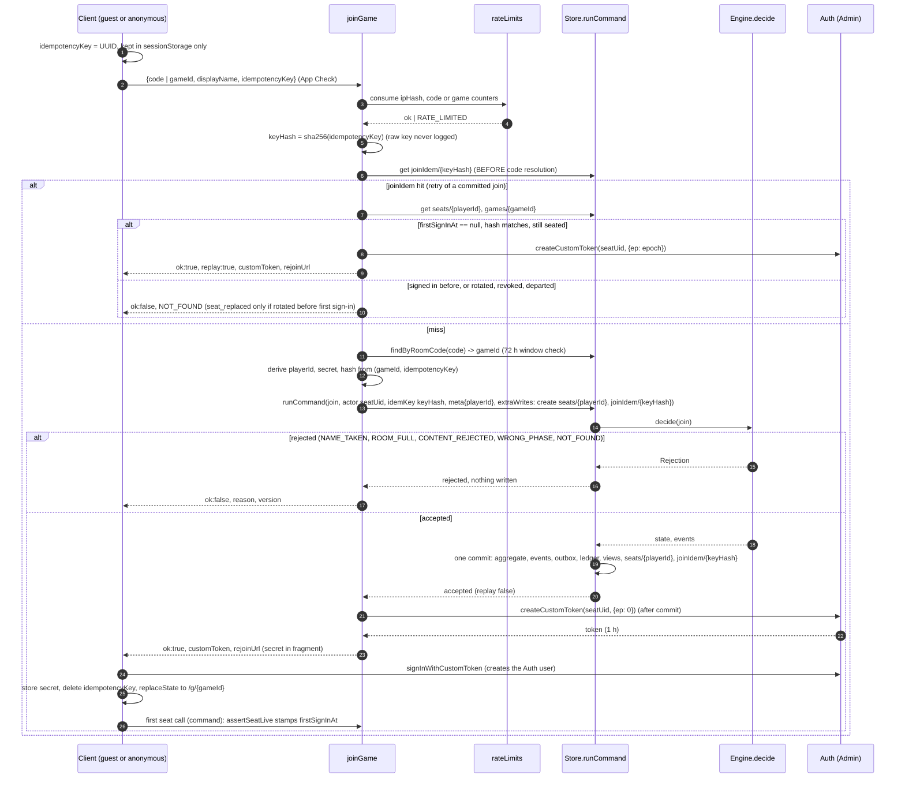

# Deep Cuts: LLD 4, Identity & Sessions (Firebase Auth)

Status: draft v0.1. Companion to [gameplay.md](../gameplay.md), [high-level-design.md](../high-level-design.md) (HLD), [tech-stack.md](../tech-stack.md), [00-platform-build-deploy.md](./00-platform-build-deploy.md) (LLD 0), [01-game-engine.md](./01-game-engine.md) (LLD 1), [02-view-projector.md](./02-view-projector.md) (LLD 2) and [03-game-store.md](./03-game-store.md) (LLD 3). This LLD specifies how every caller becomes a `Principal`, the host email-link flow, the seat join, rejoin, reissue and revocation flows, spectators, room codes and invites, identity rate limits, the threat model, and the tests. It builds on `seatUid`, `actorRole`, `runCommand`'s `meta`/`extraWrites`, the `seats` document, the `identity` outbox topic and `deletions` job unchanged; conflicts are recorded at the end rather than silently fixed. HLD invariants I1 to I5 and A1, A4 are kept; new invariants are labeled **ID1 onward**. "Must" statements are testable. Code lives in `functions/src/identity/` (Admin SDK, Node 22). It imports `@dc/engine` (`seatUid`) and `@dc/contracts` and calls the Store only through `runCommand`, `findByRoomCode` and its own `seats` documents.

## 1. Decisions at a glance

| Topic | Decision | Rationale |
|---|---|---|
| Custom claims | **One developer claim, `ep` (seat epoch), on seat custom tokens; no other custom claims.** A seat is recognized by its uid (`seat:{gameId}:{playerId}`) plus a `seats` document check that compares `ep` with `seats/{playerId}.epoch` | The uid already binds `(gameId, playerId)` and the game's player list is the authority (I1); `ep` is the one fact the uid cannot carry: which rotation of the seat a session was minted for, so a rotation kills every older token, redeemed or not (ID16) |
| Seat session length | Until removal, reissue, or the client clears storage. The custom token lives 1 h and is only a one-time redemption ticket; the session after that is the Firebase refresh token | Q3 and I2: the link, not the session, is the durable credential |
| Seat revocation | Disable the Auth user (creating a disabled tombstone user if it never signed in), revoke refresh tokens, null the secret hash. Auth users are deleted by the `deleteGame` cascade | A deleted user can be silently recreated by a still-valid custom token (up to 1 h); a disabled one cannot sign in |
| Immediate cutoff | `command` checks the player list (free, via the Engine) **and** one `seats/{playerId}` read (`revokedAt`, token `ep` against `epoch`, token `auth_time` strictly after `notBefore`) per seat call | Closes the 1 h ID-token window for commands; the `checkRevoked` Auth call per command would add latency and quota |
| Rejoin secret | 128 random bits, base64url (22 chars), derived by HMAC at join (so retries are repeatable), random at reissue | LLD 3 requires `join` writes to be reproducible across transaction reruns |
| Secret storage | `SHA-256` with domain separation, no salt, no pepper, no slow hash | 128-bit uniform secret: offline guessing is infeasible, so work factors and peppers buy nothing |
| Host sign-in | Client SDK `sendSignInLinkToEmail` / `signInWithEmailLink`, no email provider, no Dynamic Links | tech-stack decision; Dynamic Links is shut down and is only needed for mobile apps |
| Same-device vs cross-device completion | Email kept in `localStorage` for same device; otherwise the page asks for the email again | Firebase's required pattern; never put the email in the continue URL |
| Multi-game devices | Each game uses its own named Firebase app instance (`game-{gameId}`) for seat or anonymous sessions; the default instance holds only the host session | One Auth instance has one current user; joining a second game must not sign out the first game or the host |
| Room code | 4 consonants (LLD 3), valid at lookup for **72 h** after creation and only while the game holds it (LOBBY, WRITING, PLAYING); never reveals `gameId` to `lobbyInfo` callers | "Short-lived convenience" (R2) made concrete; section 8 has the numbers |
| Invite | `{origin}/g/{gameId}`; the same route with `#k={secret}` is a rejoin link | tech-stack: game id is the unguessable invite |

## 2. Principal model

### 2.1 Auth users and uids

| Principal | Firebase mechanism | uid | `firebase.sign_in_provider` | Created |
|---|---|---|---|---|
| Host | Email link | Firebase-generated, 28 chars (`hostId`) | non-`anonymous`, non-`custom` (email-link; the only enabled provider) | first email-link sign-in |
| Seat | Custom token | `seat:{gameId}:{playerId}`, 5 + 20 + 1 + 10 = 36 chars (limit 128) | `custom` | lazily, at the client's first `signInWithCustomToken` (LLD 3 6.2) |
| Host's own seat | The host's email-link user | `hostId`; `players[].uid = hostId` | as host | with the host |
| Spectator | Anonymous Auth | Firebase-generated, 28 chars | `anonymous` | client `signInAnonymously` |
| Guest | none | none | none | n/a |

- **uid ratification (resolves LLD 1 open question 15).** `seatUid(gameId, playerId) = "seat:" + gameId + ":" + playerId` is confirmed. `gameId` is the 20-char Firestore auto-id; `playerId` is `p_` plus 8 chars of lowercase RFC 4648 base32 (`a-z2-7`), the alphabet LLD 1 left open. Strict parse regex: `^seat:([A-Za-z0-9]{20}):(p_[a-z2-7]{8})$`.
- Only the Functions runtime ever produces uids with the `seat:` prefix (custom tokens and the tombstones of section 6.2). Client-reachable providers generate 28-char uids, so a host or spectator can never collide with a seat uid or with the literal `spectator` doc id (LLD 2 3.4).
- **Host's seat has no `seats` document, no secret, no rejoin link and no custom token.** The host returns by email link (I5). `PlayerLeft{hostPlayerId}` therefore has no identity work (6.2).

### 2.2 Principal resolution (A1)

```ts
// functions/src/identity/principal.ts
export type Principal =
  | { kind: "host"; uid: Uid }
  | { kind: "seat"; uid: Uid; gameId: GameId; playerId: PlayerId; authTime: number /* seconds */; ep: number /* seat epoch claim (K-B) */ }
  | { kind: "spectator"; uid: Uid }                 // anonymous Auth
  | { kind: "guest" };                              // no auth; allowed only on callables whose `allow` contains `"guest"`

const SEAT_UID = /^seat:([A-Za-z0-9]{20}):(p_[a-z2-7]{8})$/;

export function principalOf(auth: CallableRequest["auth"]): Principal {   // pure, no I/O
  if (!auth) return { kind: "guest" };
  const provider = auth.token.firebase?.sign_in_provider;
  if (provider === "custom") {
    const m = SEAT_UID.exec(auth.uid);
    const ep = auth.token.ep;
    if (!m || !Number.isSafeInteger(ep) || ep < 0) throw reject("NOT_AUTHORIZED");   // a custom token we never minted (no or bad `ep`)
    return { kind: "seat", uid: auth.uid, gameId: m[1]!, playerId: m[2]!, authTime: auth.token.auth_time, ep };
  }
  if (provider === "anonymous") return { kind: "spectator", uid: auth.uid };
  if (auth.token.email && auth.token.email_verified === true) return { kind: "host", uid: auth.uid };
  throw reject("NOT_AUTHORIZED");
}

export const toActor = (p: Principal): Actor => {
  if (p.kind === "guest") throw reject("NOT_AUTHORIZED");
  return { kind: "user", uid: p.uid };
};

// The only custom-token mint in the codebase (ID12): exactly one developer claim, `ep`.
export const mintSeatToken = (uid: Uid, epoch: number): Promise<string> => getAuth().createCustomToken(uid, { ep: epoch });

// Seat freshness (ID3): one point read, outside the command transaction.
export async function assertSeatLive(db: Firestore, p: Extract<Principal, { kind: "seat" }>, gameId: GameId, now: number): Promise<void> {
  if (p.gameId !== gameId) throw reject("NOT_AUTHORIZED");                       // cross-game uid reuse (ID2)
  const ref = db.doc(`games/${gameId}/seats/${p.playerId}`);
  const d = (await ref.get()).data() as SeatDoc | undefined;
  if (!d || d.revokedAt !== null || d.uid !== p.uid
      || p.ep !== d.epoch                                                        // minted before a rotation (K-B)
      || !(p.authTime > d.notBefore))                                            // strict: auth_time has 1 s resolution
    throw reject("NOT_AUTHORIZED", "seat_revoked");                              // detail per LLD 5 DETAIL_BY_CODE
  if (d.firstSignInAt === null)                                                  // first resolution of this seat: ends join replay (K-C, ID19)
    await ref.update({ firstSignInAt: now }).catch(() => {});                    // idempotent; a lost write is retried by the next call
}
```

- **Where `firstSignInAt` is set.** `principalOf` is pure, so the write sits in `assertSeatLive`, the I/O half of seat resolution: the first seat call that resolves the seat stamps `firstSignInAt`. `rejoin` stamps it too (section 5). A seat session that only listens and never calls `command` leaves `firstSignInAt` null, so a same-key join replay can still return a token until the first seat call; the key lives only in the joining tab's `sessionStorage` until the response is persisted (section 4.1), which bounds that residual (threat table, open question 19).
- **`notBefore` is strict and second-granular.** Firebase `auth_time` is whole seconds, so reissue and revocation set `notBefore = ceilToSecond(now)` (`Math.ceil(now / 1000)`) and sessions need `auth_time > notBefore`. A legitimate client whose fresh sign-in lands in the same second as a reissue is rejected once with `seat_revoked`; if that rejection arrives within 3 s of its own `signInWithCustomToken`, the client waits 1 s, signs in again with the same (still valid, correct-`ep`) custom token and retries once before showing the Gone screen (LLD 7).

- **Role resolution stays in the Engine.** `command` passes `toActor(principal)` to `runCommand`; the Engine's `actorRole` maps the uid to `playerId` through `game.players[].uid`, so the host's powers and the host's seat share one identity (tech-stack 4). `Principal` carries no roles, so a client cannot assert one (A2).
- **Which callables allow which principals** (`callable()` from LLD 0 P12 gets an `allow` option; default is "signed in"):

| Callable | guest | spectator | host | seat | Notes |
|---|---|---|---|---|---|
| `lobbyInfo`, `joinGame`, `rejoin` | yes | yes | yes | yes | pre-membership endpoints (`allow` contains `"guest"`); callers are not yet a seat |
| `spectate` | no | yes | yes | yes | needs a signed-in user for the follow-up document read |
| `command` | no | yes (`castVote`, reads) | yes | yes (after `assertSeatLive`) | Engine authorizes the command |
| `reissueRejoinLink`, `signOutEverywhere`, `createGame`, `listGamesByHost` | no | no | yes | no | host only |

- **One developer claim, `ep` (seat epoch), on seat custom tokens; no other custom claims.** Seat custom tokens are minted as `createCustomToken(uid, { ep: epoch })` (only through `mintSeatToken`), and Firebase copies `ep` into every ID token of that session. Developer claims cannot be revoked short of expiry, so nothing that grants power goes in one: game, player and host-ness stay derivable from the uid and the aggregate. `ep` grants nothing; it only lets `assertSeatLive` reject a session minted for an earlier rotation of the seat (`ep !== seats/{playerId}.epoch`), which closes the reissue race of section 5. Reissue increments `epoch`, so any custom token minted before it, redeemed or not, is dead for commands. No `setCustomUserClaims` call exists in the codebase and `createCustomToken` is called only inside `mintSeatToken` (lint-checked, ID12).
- **App Check.** `request.app` is verified by `enforceAppCheck: true` in `callable()` for every function here. Tokens are not replay-protected (`consumeAppCheckToken` needs the client to fetch a limited-use token per call and each costs a reCAPTCHA assessment); the counters in section 9 are the control. Firebase Auth's own endpoints (`signInAnonymously`, `sendSignInLinkToEmail`, `signInWithCustomToken`) are covered by App Check only after the Identity Platform upgrade of section 13.

## 3. Host flow

### 3.1 Sign-in

```ts
// apps/web (LLD 7 owns the screens; this is the contract)
const settings: ActionCodeSettings = {
  url: `${location.origin}/host/finish?next=${encodeURIComponent("/host")}`,   // authorized domain, no email, no secrets
  handleCodeInApp: true,
};                                                                              // no dynamicLinkDomain, no linkDomain, no iOS/Android blocks
await sendSignInLinkToEmail(getAuth(), email, settings);
localStorage.setItem("dc.hostEmail", email);                                    // same-device completion

// on /host/finish
if (isSignInWithEmailLink(auth, location.href)) {
  const email = localStorage.getItem("dc.hostEmail") ?? await promptEmail();    // cross-device: ask again
  await signInWithEmailLink(auth, email, location.href);
  localStorage.removeItem("dc.hostEmail");
  history.replaceState(null, "", next);                                         // strips oobCode and apiKey from the URL
}
```

- **No `requestHostSignIn` / `redeemHostSignIn` callables.** The Client SDK sends and redeems the link; the Auth backend generates and consumes the code. HLD 3.3's `requestHostSignIn(email)` and `redeemHostSignIn(token)` are therefore realized by the SDK calls above (open question 1).
- **Dynamic Links (resolves LLD 0 open question 9).** Not used. The web email-link flow needs only a `url` on an authorized domain and `handleCodeInApp: true`. The link points at the Auth action handler (`https://{authDomain}/__/auth/action`), which redirects to `url` with `oobCode`; the code is consumed only when `signInWithEmailLink` runs, so mail scanners that fetch the link do not burn it. Set `authDomain` to the custom domain once it exists so the email shows our domain (section 13).
- **Same versus cross-device.** Same device finds the email in `localStorage`. Different browser (or an installed iOS PWA versus Safari, which do not share storage) prompts for the email; a wrong email fails with `auth/invalid-email`. The email is never placed in the continue URL (session-fixation guidance).
- **I3.** Single-use and short expiry are Firebase's. We do not depend on the exact expiry; the UI says "the link expires soon" and offers resend.
- **Host principal.** A host call is accepted when the ID token has a verified email and is neither anonymous nor custom (`principalOf`). Only email link is enabled at the project (LLD 0 section 2), so this is exactly an email-link user.

### 3.2 Host profile, session, sign-out

- `hosts/{hostUid}` is created lazily and idempotently by `ensureHostProfile(uid)`, called by the `createGame` and `listGamesByHost` handlers before their work (`create()` ignoring `ALREADY_EXISTS`). Fields: `{ schema: 1, createdAt: number }`. The email is **not** copied (Auth owns it; fewer places to leak, HLD 4.5).
- **Session persistence.** Firebase default (IndexedDB) on the default app instance; the refresh token does not expire. A host stays signed in until `signOut`, revocation, or cleared storage.
- **Sign-out.** `signOut(auth)` on this device. `signOutEverywhere` (host callable) calls `revokeRefreshTokens(hostUid)`: refresh stops at once, issued ID tokens live up to 1 h. `deleteGame` additionally compares `auth_time` with `getUser(uid).tokensValidAfterTime` so a revoked session cannot run the one irreversible command (ID12).
- **Account lifecycle.** The cascade never deletes the host's Auth user (LLD 3 6.4). There is no self-service account deletion in v1. The same email always maps to the same uid (one account per email is the Auth default); if the Auth user were deleted by an admin, a new sign-in yields a new uid and the old games become unmanageable (`hostId` mismatch). Admin procedure: do not delete host users with live games (open question 9).

### 3.3 Email-link throttling and abuse (A4)

Per-email and per-IP caps on `sendSignInLinkToEmail` cannot be enforced by our code, because the client calls Firebase directly. Controls, in order:
1. Firebase's own per-project email quota and per-IP throttles on the Auth endpoints (infrastructure level, tech-stack 7).
2. After the Identity Platform upgrade: App Check enforcement on Auth, which blocks scripted callers that are not our app.
3. Client cooldown of 60 s per send and 5 sends per hour per browser (UX only, not a control).
4. Alerting on the Auth sign-in-email volume metric (LLD 0 `ops/`), and the option of a `beforeEmailSent` blocking function if it is available for email-link emails on the pinned SDK (to be verified; it would let us apply the per-email counter of section 9).

The abuse that remains is spamming a third party's inbox with a Firebase-branded sign-in email. Accepted for v1 (open question 1).

## 4. Player join

### 4.1 Contract

```ts
// functions/src/identity/join.ts   (types exported from @dc/contracts by LLD 5)
interface JoinInput  { target: { code: string } | { gameId: GameId }; displayName: string; idempotencyKey: string /* client UUID; a credential (K-C) */ }
type JoinResult =
  | { ok: true;  gameId: GameId; playerId: PlayerId; customToken: string; rejoinUrl: string; version: number; replay: boolean }
  | { ok: false; reason: ErrorCode; version: number; detail?: string };   // NOT_FOUND, NAME_TAKEN, ROOM_FULL, CONTENT_REJECTED, WRONG_PHASE, RATE_LIMITED
```

`rejoinUrl` is `{APP_ORIGIN}/g/{gameId}#k={secret}`. It appears only in this response body; the callable wrapper never logs results (P19). Rejection bodies follow LLD 5 `RejectionSchema`: `version` is the aggregate version the rejection was decided against where a game was read (the Engine's rejection, `out.version`), else `0` (rate limit, unknown or expired code, key-lookup miss); the wrapper adds `sv`.

- **The join `idempotencyKey` is a credential (K-C).** Until the seat's first sign-in, anyone holding it can replay the join and receive the seat's custom token and rejoin secret. So: the client generates it, keeps it only in `sessionStorage` until the join response is persisted (secret stored, LLD 7), then deletes it; it is never logged by the client or the server (the logger redacts the field, LLD 5). The server keeps only `keyHash = sha256(idempotencyKey)` (base64url): the join ledger doc id is derived from `keyHash` (passed as the Store's `idemKey`), and the recovery index is `joinIdem/{keyHash}`. The raw key is used in memory only, as the HMAC input of 4.2, so a database read plus a leaked derivation key still cannot compute a secret.
- **`joinIdem/{keyHash}`** (top-level, server-only, rules deny all; LLD 3 owns the data-model row): `{ gameId, playerId, uid, createdAt, expiresAt }`, created in the join transaction (as an `extraWrites` entry next to the seat doc), with a Firestore TTL on `expiresAt = createdAt + 7 days` (the sixth TTL group). `joinGame` reads it **before** resolving the room code, so a same-key retry recovers the committed seat even after the code expired or was released.
- **Replay only before first sign-in.** A replay (from `joinIdem` or from a Store ledger replay) returns the custom token and the rejoin secret only while `seats/{playerId}.firstSignInAt == null`. After the seat has been signed in once (stamped by `assertSeatLive` or `rejoin`, section 2.2), a replay returns `NOT_FOUND` with no detail, and the player must use their rejoin link.

### 4.2 Deterministic minting (LLD 3 5.5 and 6.2)

`runCommand`'s callback may rerun; `extraWrites` must be pure. So every random-looking value is derived from a server key and the client's `(gameId, idempotencyKey)`, never drawn inside the call:

```ts
const K = defineSecret("SEAT_DERIVATION_KEY");          // 32 random bytes, Secret Manager (section 13)
const mac = (label: string, gameId: GameId, idempotencyKey: string) =>
  createHmac("sha256", K.value()).update(`${label}\0${gameId}\0${idempotencyKey}`).digest();

export const derivePlayerId = (g: GameId, k: string): PlayerId => "p_" + base32lower(mac("pid", g, k).subarray(0, 5));   // 40 bits -> 8 chars
export const deriveSecret   = (g: GameId, k: string): string   => mac("secret", g, k).subarray(0, 16).toString("base64url"); // 128 bits -> 22 chars
export const hashSecret = (g: GameId, secret: string): string =>      // no playerId: rejoin looks the seat up by hash (section 5)
  createHash("sha256").update(`dc-seat-v1\0${g}\0${secret}`).digest("base64url");
```

- The HMAC key is what makes the secret unpredictable: knowing an `idempotencyKey` does not let anyone compute the secret offline. It is still a credential, because the server hands the secret to anyone who replays the key before the seat's first sign-in (4.1, ID19); hence hash-only storage, `sessionStorage`-only on the client, and no logging. The HMAC key lives in Secret Manager, readable by `fn-runtime` only, bound only to `joinGame`.
- **Hash choice.** The secret is 128 uniformly random bits. At 10^12 guesses per second an exhaustive search of 2^128 takes about 10^19 years, so a salt (no two secrets share a value), a pepper, or a slow KDF (bcrypt, argon2: tens of ms per rejoin for no security) add nothing. SHA-256 is used because the lookup is by hash (section 5), which a salted or slow scheme would break. The domain-separation prefix and the `gameId` binding stop a hash copied between games from validating; the seat binding comes from the document's location and `uid`.
- Two joins with the same `idempotencyKey` are the same join (`joinIdem` hit, or ledger replay ST3 when two same-key calls race past the `joinIdem` read); two honest clients draw UUIDs, so collisions are negligible. `playerId` collisions inside a game (40 bits, at most 50 joins) are about 10^-9; the `create()` of the `seats` doc fails, the Store maps it to `INVARIANT`, and the client retries with a new key.

### 4.3 Sequence



### 4.4 Ownership, failure and retry

| Step | Owner | Failure | Result and recovery |
|---|---|---|---|
| Rate limit, `joinIdem` read, code lookup | Identity | counter exceeded; unknown, expired or released code (checked only on a `joinIdem` miss) | `RATE_LIMITED` or `NOT_FOUND` (uniform, 8.3, `version: 0`); nothing written |
| Validate, name, room, moderation, add player | Engine in the transaction | any rejection | Typed rejection; **no ledger row, no seat doc, no Auth user** |
| Seat doc `seats/{playerId}` | Identity's pure `extraWrites`, committed by the Store | transaction aborts | Player and seat both absent; retry is safe (ID5) |
| Commit | Store | `UNAVAILABLE` after send | Same-key retry replays or applies once (ST3) |
| `createCustomToken` | Identity, after commit | IAM or network error | `unavailable`; the player exists with a seat and an unknown secret until the client retries the **same** `idempotencyKey` (still in `sessionStorage`), which hits `joinIdem/{keyHash}` (even if the code has since expired or been released), re-derives the same secret and mints a fresh token, as long as the seat has never been signed in |
| Client `signInWithCustomToken` | Client | token older than 1 h | Client calls `rejoin` with the stored secret instead (section 5) |

- **Orphaned Auth users.** Auth users exist only after a successful client sign-in, which can only follow a committed join. A user can lack a live seat in three cases: (a) the player was removed and then redeemed a token minted before removal (prevented by the disabled tombstone, 6.2); (b) the game was deleted (purged by the cascade, which covers LOBBY leavers too, 6.3); (c) **late redeem**: a custom token minted at join (valid 1 h) is redeemed after `purgeSeats` ran (the player left or the game was deleted within that hour), which recreates an enabled Auth user nobody purges. Mitigation chosen: `assertSeatLive` refuses any seat whose `seats/{playerId}` doc is gone or revoked (it already does: `!d` rejects), the game's `views` and `seats` are deleted by then so rules and commands give such a user no capability, and the user is inert. The residual is one dormant enabled Auth user per late redeem (at most one per join in the last hour before a purge). No sweep is built (open question 16).
- **No orphaned seats.** A seat whose client never received the response (page closed after commit) is a lobby entry nobody controls. The player's retry from the same tab fixes it for 7 days (`joinIdem` and ledger TTL), even after the room code expired; closing the tab drops the `sessionStorage` key, so the retry must come from that tab session. The host can remove the ghost at any time. A replay older than the TTL is not repairable by key; the player joins again under a new name or the host removes the ghost. Accepted (open question 6).
- **Replay after rotation or first sign-in.** On any replay (`joinIdem` hit or ledger `replay: true`) Identity reads `seats/{playerId}`. If `firstSignInAt !== null` it returns `NOT_FOUND` with no detail (K-C: the key no longer yields credentials; use the rejoin link). Otherwise it re-derives the hash and compares it with `secretHash`; if the seat was reissued or revoked in between, it returns `NOT_FOUND` (detail `seat_replaced`) instead of a secret that no longer works (ID6).
- **Same-uid caveat.** Because `actor.uid` is derived server-side, the unauthenticated caller of `joinGame` never asserts a uid; the Engine's check `actor.uid === seatUid(game.id, playerId)` (LLD 1 section 6) is then true by construction and guards against a bug, not an attacker.

```ts
export async function joinGame(db: Firestore, req: CallableRequest<JoinInput>, deps: Deps): Promise<JoinResult> {
  const p = principalOf(req.auth);                                         // any kind; guest is normal here
  const i = JoinInputSchema.parse(req.data);                               // the wrapper and this handler never log `idempotencyKey`
  await limits.consume(db, joinLimits(req, i));                            // section 9; throws RATE_LIMITED (version 0)
  const keyHash = sha256b64url(i.idempotencyKey);                          // the only form of the key that is stored (K-C)
  const prior = (await db.doc(`joinIdem/${keyHash}`).get()).data() as JoinIdemDoc | undefined;   // BEFORE code resolution
  if (prior) {                                                             // retry of a committed join; code may have expired or been released
    if ("gameId" in i.target && i.target.gameId !== prior.gameId) return { ok: false, reason: "NOT_FOUND", version: 0 };
    return replayJoin(db, prior.gameId, prior.playerId, i.idempotencyKey);
  }
  const gameId = "gameId" in i.target ? i.target.gameId : await resolveCode(db, i.target.code);   // NOT_FOUND if null or past 72 h
  if (!gameId) return { ok: false, reason: "NOT_FOUND", version: 0 };
  const playerId = derivePlayerId(gameId, i.idempotencyKey);
  const uid = seatUid(gameId, playerId);
  const secret = deriveSecret(gameId, i.idempotencyKey), secretHash = hashSecret(gameId, secret);
  const now = deps.clock();
  const out = await runCommand(db, deps, {
    gameId, cmd: { type: "join", playerId, name: i.displayName }, actor: { kind: "user", uid }, idemKey: keyHash,   // ledger id derives from the hash (C-IDEM, K-C)
    meta: { playerId },
    extraWrites: () => [
      { op: "create", path: `games/${gameId}/seats/${playerId}`,
        data: { uid, secretHash, createdAt: now, epoch: 0, notBefore: 0, revokedAt: null, firstSignInAt: null } satisfies SeatDoc },
      { op: "create", path: `joinIdem/${keyHash}`,
        data: { gameId, playerId, uid, createdAt: now, expiresAt: now + 7 * DAY_MS } satisfies JoinIdemDoc },
    ],
  });
  if (out.kind === "rejected") return { ok: false, reason: out.rejection.code, version: out.version, detail: out.rejection.detail };
  if (out.kind === "deleting") return { ok: false, reason: "NOT_FOUND", version: 0 };
  if (out.replay) return replayJoin(db, gameId, playerId, i.idempotencyKey);   // two same-key calls raced past the joinIdem read
  const customToken = await mintSeatToken(uid, 0);                         // fresh seat: epoch 0
  log.info({ event: "auth.join", gameId, playerId, version: out.version });   // no name, no secret, no key
  return { ok: true, gameId, playerId, customToken, rejoinUrl: `${APP_ORIGIN.value()}/g/${gameId}#k=${secret}`, version: out.version, replay: false };
}

// Replay: credentials only while the seat has never been signed in (K-C, ID19).
async function replayJoin(db: Firestore, gameId: GameId, playerId: PlayerId, key: string): Promise<JoinResult> {
  const [s, g] = await db.getAll(db.doc(`games/${gameId}/seats/${playerId}`), db.doc(`games/${gameId}`));
  const seat = s.data() as SeatDoc | undefined, game = g.data() as GameDoc | undefined;
  const me = game?.players.find(x => x.id === playerId);
  if (!seat || !game || game.store.deleting || !me || !SEATED.has(me.status) || seat.firstSignInAt !== null)
    return { ok: false, reason: "NOT_FOUND", version: 0 };                 // no detail: use the rejoin link
  const secret = deriveSecret(gameId, key);
  if (seat.revokedAt !== null || seat.secretHash === null || !safeEqual(seat.secretHash, hashSecret(gameId, secret)))
    return { ok: false, reason: "NOT_FOUND", version: 0, detail: "seat_replaced" };   // reissued before first sign-in (ID6)
  const customToken = await mintSeatToken(seat.uid, seat.epoch);
  log.info({ event: "auth.join", gameId, playerId, version: game.version, replay: true });
  return { ok: true, gameId, playerId, customToken, rejoinUrl: `${APP_ORIGIN.value()}/g/${gameId}#k=${secret}`, version: game.version, replay: true };
}
```

`SeatDoc = { uid: Uid; secretHash: string | null; createdAt: number; epoch: number /* = the token claim ep */; notBefore: number /* seconds; sessions need auth_time > notBefore */; revokedAt: number | null; firstSignInAt: number | null }`. `notBefore` and `firstSignInAt` are this LLD's additions to LLD 3's required fields. `JoinIdemDoc = { gameId: GameId; playerId: PlayerId; uid: Uid; createdAt: number; expiresAt: number }`.

- **Why the replay reads the seat doc, not the ledger.** A `joinIdem` hit skips `runCommand`, so it needs no room code and no ledger; the seat doc and aggregate are the authority for "still seated, not rotated, never signed in". `version` is the aggregate's current version (the decision was read against it); `replay: true` tells the client it is a recovery. The `seat_replaced` detail is kept only for a rotation before first sign-in, so it reveals nothing to a key holder that the seat's owner had not already lost.

### 4.5 Client session behavior

- After `signInWithCustomToken` the SDK holds a refresh token; ID tokens refresh hourly without our involvement. The custom token's 1 h expiry is irrelevant afterwards.
- The client stores `{gameId: secret}` locally (IndexedDB, per game) so it can (a) show "copy my link" and (b) recover with `rejoin` if the Auth user is gone (anonymous cleanup does not touch seat users, but Safari's 7-day storage cap on non-installed sites can clear both; the link then restores the seat). LLD 7 must tell players to save their link (R4).
- On redeem or join the client calls `history.replaceState(null, "", "/g/{gameId}")` to drop the fragment (section 10).
- The join `idempotencyKey` lives only in `sessionStorage` from the first send until the join response is persisted (secret stored), then the client deletes it; it is never written to IndexedDB or `localStorage`, never put in a URL and never logged (K-C, LLD 7).

## 5. `rejoin(secret)`

```ts
interface RejoinInput  { gameId: GameId; secret: string }
type RejoinResult = { ok: true; playerId: PlayerId; customToken: string } | { ok: false; reason: "NOT_FOUND" | "RATE_LIMITED"; version: 0 };

// Wire schema is deliberately permissive (any JSON value), so the callable wrapper's input parse never surfaces a
// validation error for rejoin; the shape is checked here and every malformed input gets the uniform NOT_FOUND (ID10).
export const RejoinInputSchema = z.unknown();

export async function rejoin(db: Firestore, req: CallableRequest<unknown>, deps: Deps): Promise<RejoinResult> {
  const raw = RejoinInputSchema.parse(req.data) as Partial<Record<"gameId" | "secret", unknown>> | null;
  const gameId = typeof raw?.gameId === "string" ? raw.gameId.slice(0, 64) : "";   // claimed gameId keys the counter even if malformed
  const secret = typeof raw?.secret === "string" ? raw.secret.slice(0, 64) : "";
  await limits.consume(db, rejoinLimits(req, gameId));                      // checked BEFORE any lookup (ID11)
  const notFound = async (): Promise<RejoinResult> => {                     // one answer for every failure; the counter write is awaited
    await limits.fail(db, req, gameId);
    return { ok: false, reason: "NOT_FOUND", version: 0 };                  // always 0, even when a game was read: keeps bodies identical (ID10)
  };
  if (!shapeOk(gameId, secret)) return notFound();                          // 20-char id, 22 base64url chars
  const hash = hashSecret(gameId, secret);
  const q = await db.collection(`games/${gameId}/seats`).where("secretHash", "==", hash).limit(1).get();
  const seat = q.docs[0]?.data() as SeatDoc | undefined;
  const playerId = q.docs[0]?.id;
  if (!seat || !playerId || seat.revokedAt !== null || !safeEqual(seat.secretHash!, hash)) return notFound();
  const g = await db.doc(`games/${gameId}`).get();                           // defense in depth: still seated, not deleting
  const me = g.exists ? (g.data() as GameDoc).players.find(x => x.id === playerId) : undefined;
  if (!me || me.uid !== seat.uid || !SEATED.has(me.status) || (g.data() as GameDoc).store.deleting) return notFound();
  const customToken = await mintSeatToken(seat.uid, seat.epoch);             // ep = the epoch the hash was matched under
  // Reissue race (ID16): a reissue/revoke can commit between the lookup above and the mint. Re-read the seat after minting;
  // if the hash or epoch changed or the seat was revoked, discard the token and answer NOT_FOUND. A rotation that commits
  // after this re-read is covered by K-B: the token carries the old `ep`, so assertSeatLive rejects every session from it.
  const ref = db.doc(`games/${gameId}/seats/${playerId}`);
  const again = (await ref.get()).data() as SeatDoc | undefined;
  if (!again || again.revokedAt !== null || again.secretHash === null || !safeEqual(again.secretHash, hash) || again.epoch !== seat.epoch)
    return notFound();
  if (again.firstSignInAt === null) await ref.update({ firstSignInAt: deps.clock() });   // ends join-key replay (K-C)
  log.info({ event: "auth.rejoin", gameId, playerId });
  return { ok: true, playerId, customToken };
}
```

- **Lookup without a name.** The link carries only `gameId` and the secret. The seat is found with a single-field equality query on `secretHash` inside that game's `seats` subcollection (automatic index; LLD 3 does not exempt it). A query on a hash of a high-entropy value leaks nothing through timing; the follow-up `timingSafeEqual` is defense in depth, not the protection.
- **No existence leak (ID10).** Unknown game, wrong secret, revoked seat, rotated-out secret, departed player, malformed input and deleting game all return the identical `NOT_FOUND` body (`version: 0` in every case, a deliberate exception to "the version where a game was read") and HTTP status. Malformed input includes a wrong type or a missing field: the `rejoin` wire schema is `z.unknown()` (LLD 5), so the wrapper's parse cannot produce `invalid-argument`, and the handler maps every shape failure to the same `NOT_FOUND`. Every failure path awaits the failure-counter write before returning, so a burst cannot outrun the counter. Rate-limit rejections are also uniform for existing and non-existing games because counters key on the claimed `gameId` string, not on whether it exists.
- **What rejoin changes.** A token mint, plus at most one seat write ever (`firstSignInAt`, if still null): no version bump, no view write (PJ10). It does not touch `notBefore`, so **other devices stay signed in** (multi-device is a feature: one uid, one view doc, several listeners). Only reissue (6.1) and removal (6.2) end existing sessions.
- **Finished and ended games.** Rejoin works in FINISHED and ENDED (Q10) as long as the seat is not revoked.
- **Reissue race (ID16, closed by K-B).** A rejoin that matched the old hash just before a reissue mints a token with the old `ep`. The post-mint re-read (hash and epoch unchanged, not revoked) discards it in most cases; a reissue that commits after the re-read still leaves the token redeemable, but every session from it carries the old `ep` and `assertSeatLive` rejects it with `seat_revoked`, as it does any pre-rotation custom token (redeemed or not, and even though its `auth_time` passes `notBefore`). The earlier accepted residual is therefore gone for commands. Listener reads of `views/{uid}` by such a session are denied too: the LLD 3 view rule compares `request.auth.token.ep` with `seats/{playerId}.epoch` for seat uids (open question 20, resolved).
- **Brute force.** 2^128 secrets, so guessing is hopeless; the limits (section 9) exist to cap cost and noise, not to protect the secret.
- **`rejoin_fail_game` DoS (item 25, accepted).** The per-game failure counter (30 failures per hour, 15 min lock) is keyed on the claimed `gameId`, so anyone holding the invite (which is the `gameId`) can lock `rejoin` for that game for 15 minutes by sending 30 bad secrets. Legitimate rejoins of that game then get `RATE_LIMITED` until the lock lapses; joins, commands and existing sessions are unaffected. Accepted for v1: the invite is already the entry credential, the effect is short and cosmetic, and keying on the secret's hash instead would let a flood probe validity. The client shows "try again in a few minutes" on `RATE_LIMITED` (LLD 5 owns the retry-after copy).

```mermaid
sequenceDiagram
    autonumber
    participant C as New device
    participant R as rejoin
    participant RL as rateLimits
    participant F as Firestore
    participant A as Auth
    C->>C: open /g/{gameId}#k=secret
    C->>R: {gameId, secret}  (App Check)
    R->>RL: consume ipHash, game counters
    R->>F: seats where secretHash == H(gameId, secret)
    alt malformed, no match, revoked, not seated, deleting, or rotated during mint
        R->>RL: record failure (awaited)
        R-->>C: NOT_FOUND, version 0 (identical for every cause)
    else match
        R->>F: get games/{gameId} (still seated?)
        R->>A: createCustomToken(seat uid, {ep: epoch})
        R->>F: re-read seats/{playerId} (hash, epoch, revokedAt unchanged); stamp firstSignInAt if null
        R-->>C: customToken
        C->>A: signInWithCustomToken (same uid as other devices)
        C->>C: store secret, replaceState to /g/{gameId}
        C->>F: onSnapshot views/{uid} (unchanged path)
    end
```

## 6. Lifecycle: reissue, leave and remove, delete

### 6.1 Host reissue

```ts
// host callable: reissueRejoinLink({ gameId, playerId }) -> { rejoinUrl }
await db.runTransaction(async tx => {
  const [g, s] = await tx.getAll(gameRef, seatRef);
  const game = g.data() as GameDoc | undefined;
  if (!game || game.store.deleting || game.hostId !== principal.uid) throw reject("NOT_AUTHORIZED");
  const pl = game.players.find(x => x.id === playerId);
  if (!pl || !SEATED.has(pl.status) || !s.exists || (s.data() as SeatDoc).revokedAt !== null) throw reject("NOT_FOUND");
  const secret = randomBytes(16).toString("base64url");                    // fresh CSPRNG, NOT derived
  tx.update(seatRef, { secretHash: hashSecret(gameId, secret), epoch: FieldValue.increment(1),   // kills every token with the old `ep` (K-B)
                       notBefore: Math.ceil(now / 1000) });                 // ceilToSecond: sessions need auth_time > notBefore
  result = secret;
});
try { await getAuth().revokeRefreshTokens(uid); }                           // after the transaction; idempotent, rerun on retry
catch (e) { if (code(e) !== "auth/user-not-found") throw e; }               // never signed in: no Auth user, nothing to revoke; still return the link
await clearSeatPush(db, gameId, uid);                                       // L6 push module: drop the old sessions' devices for this seat; after commit, idempotent
```

- **Reissue before the first sign-in.** The seat's Auth user is created lazily by the client (2.1), so it may not exist yet. `revokeRefreshTokens` then fails with `auth/user-not-found`, which is treated as success: there are no sessions to end, and the epoch increment already kills any unredeemed custom token minted for the old epoch. The callable still returns the new link. Existing users are revoked as before; any other Auth error fails the callable (the host retries, which rotates again).

- `clearSeatPush(db, gameId, uid)` is exported by LLD 6's push module and runs after the transaction commits (not inside it: ST2); it deletes the seat's registered devices so the reissued-out sessions stop receiving pushes. The new sessions re-register.
- Not an Engine command (LLD 1): no version bump, no events, no view write (PJ10). It reads the aggregate for authorization (a short lock; commands queue behind it for tens of milliseconds).
- **Effects.** The old link stops working at once (hash replaced). Existing sessions die: `revokeRefreshTokens` stops token refresh, and `assertSeatLive` rejects, on the very next command, any token whose `ep` is not the new epoch or whose `auth_time` is not after `notBefore`. Custom tokens minted before the reissue (by join, a join replay or a racing `rejoin`) carry the old `ep`, so sessions redeemed from them later are rejected too. A listener opened with a still-valid ID token can keep reading `views/{uid}` for up to 1 h (rules cannot check revocation), That residual is accepted for v1. A session redeemed after the reissue from a pre-reissue custom token cannot read at all: the LLD 3 view rule checks `ep` against the seat's `epoch` (open question 20, resolved).
- The legitimate player signs in again with the new link on every device; the host has to deliver the link out of band. **The host learns the new secret and can therefore act as that player** (see their hand, play for them). The host is trusted with `removePlayer`, `passJudging` and `closeSubmissions`; this is a wider power than gameplay.md states (open question 4).
- A retry of the callable rotates again (not idempotent by design: each call is a fresh link; the last one wins).
- **Players copying their own link.** Client-side only: it shows `{origin}/g/{gameId}#k={stored secret}`. The server cannot reproduce a secret from its hash.

### 6.2 Leave and remove (revocation)

Triggered by `topic: "identity"` outbox rows for `PlayerLeft` and `PlayerRemoved` (LLD 3 section 8). The consumer derives the uid from the event, so it needs no roster.

```ts
export const identityOutbox = onDocumentCreated({ document: "games/{gameId}/outbox/{rowId}", retry: true, serviceAccount: FN_RUNTIME },
  (ev) => handleIdentityRow(db, ev.params.gameId, ev.params.rowId));

/** Exported hand-off (C-IDHANDOFF). Work for ONE `identity` outbox row; idempotent. Called by the trigger above and by L6's hourly redrive. */
export async function handleIdentityRow(db: Firestore, gameId: GameId, rowId: string): Promise<void> {
  const ref = db.doc(`games/${gameId}/outbox/${rowId}`);
  const row = (await ref.get()).data() as OutboxRow | undefined;
  if (!row || row.topic !== "identity" || row.processedAt !== null) return;
  if (row.event.t === "PlayerLeft" || row.event.t === "PlayerRemoved") await revokeSeat(db, gameId, row.event.playerId, deps.clock());
  await ref.update({ processedAt: deps.clock() });                           // only L4 writes processedAt on identity rows
}

export async function revokeSeat(db: Firestore, gameId: GameId, playerId: PlayerId, now: number): Promise<void> {
  const seatRef = db.doc(`games/${gameId}/seats/${playerId}`);
  const seat = (await seatRef.get()).data() as SeatDoc | undefined;
  if (!seat) return;                                                         // the host's seat has no seats doc: nothing to revoke
  const uid = seat.uid;                                                      // always seat:{gameId}:{playerId}; asserted below
  assert(uid === seatUid(gameId, playerId));
  await seatRef.update({ revokedAt: seat.revokedAt ?? now, secretHash: null, notBefore: Math.ceil(now / 1000) });    // 1. blocks rejoin and commands
  try { await getAuth().updateUser(uid, { disabled: true }); }               // 2. blocks sign-in and refresh, even with a live custom token
  catch (e) { if (code(e) !== "auth/user-not-found") throw e; await getAuth().createUser({ uid, disabled: true }); }   // never signed in: leave a disabled tombstone
  await getAuth().revokeRefreshTokens(uid);                                  // 3. kills refresh tokens
  log.info({ event: "auth.revoke", gameId, playerId });
}
```

- Steps are in an order where each is individually safe and the whole is idempotent; a crash re-delivers the trigger (at-least-once) or the hourly redrive (LLD 3 section 8, LLD 6), which calls `handleIdentityRow(db, gameId, rowId)` for each unprocessed `identity` row older than its threshold. Redrive hook: L6's `redriveOutbox` (hourly) imports `handleIdentityRow` from `functions/src/identity`; it never calls `revokeSeat` directly.
- **Two consumers, one writer of `processedAt`.** `identity` rows are read by two consumers: L4 (revocation, above) and L6 (push cleanup for the departed seat's devices). Only L4 writes `processedAt` on them; L6 records its own progress in its own fields (`notifDoneAt`, `notifAttempts`, `poisonedAt`; LLD 3 `OutboxRow`). Neither consumer's state gates the other.
- **Revoked-seat errors.** A command or read refused because the seat is revoked carries `NOT_AUTHORIZED` with detail `seat_revoked` (added to `DETAIL_BY_CODE` by LLD 5), so the client can show the Gone screen instead of a generic denial. `assertSeatLive` uses that detail for `revokedAt !== null`, a missing seat doc, an `ep` that is not the seat's `epoch`, and `auth_time <= notBefore`.
- **Deletion versus disabling.** The task text (HLD, tech-stack 4) says "delete the Auth user". A deleted user would be silently recreated by `signInWithCustomToken` with a token minted shortly before removal (valid up to 1 h), re-opening access to the tombstone and to `rounds`. Disabled users cannot sign in. The disabled users are deleted by the cascade (6.3). The one cost is up to 50 dormant Auth users per game until it is deleted, which is what tech-stack section 10 already budgets (open question 3).
- **Departing player's own client.** It receives the tombstone view (LLD 2 4.3), must `signOut` its `game-{gameId}` app and may `signInAnonymously` to follow the spectator doc.
- A removed player who wants back joins fresh: new `playerId`, new uid, new secret.

### 6.3 `deleteGame` hand-off (LLD 3 6.4 stage `identity`)

```ts
export interface IdentityPort {
  /** Idempotent. Deletes exactly the given seat uids of one game. Unknown uids are success. Throws IdentityPurgeError if any deletion failed, so the stage retries.
   *  The caller (LLD 3 identity stage) passes the union of job.seatUids and every uid in games/{g}/seats/* (C-SEATS), so LOBBY leavers are covered. */
  purgeSeats(i: { gameId: GameId; uids: Uid[] }): Promise<{ requested: number; deleted: number }>;
}

export const purgeSeats: IdentityPort["purgeSeats"] = async ({ gameId, uids }) => {   // uids already a union, see above; purgeSeats only filters and deletes
  const prefix = `seat:${gameId}:`;
  const targets = [...new Set(uids)].filter(u => u.startsWith(prefix) && SEAT_UID.test(u));   // never the host, never another game (ID9)
  let failed = 0;
  for (let i = 0; i < targets.length; i += 1000) {                                          // deleteUsers accepts at most 1000 uids per call
    const r = await getAuth().deleteUsers(targets.slice(i, i + 1000));                      // missing users count as success
    failed += r.failureCount;
    if (r.failureCount) log.warn({ event: "auth.purge.partial", gameId, failed: r.failureCount });
  }
  if (failed) throw new IdentityPurgeError(gameId, failed);
  return { requested: uids.length, deleted: targets.length };
};
```

- **Which uids (C-SEATS).** The `identity` stage passes the UNION of `job.seatUids` (`players[].uid` minus `hostId`, so removed or departed non-LOBBY players, whose records stay, are included) and every uid read from `games/{g}/seats/*`. LOBBY leavers' player records are deleted (LLD 1), so only their `seats/*` docs (revoked, with a disabled tombstone Auth user) identify them; the `seats` collection survives until the `history` stage, so the union catches them and their disabled users are purged too. Deleting a user also invalidates its refresh tokens, so no separate revoke is needed. The seat docs themselves go with the `history` stage, after this one.
- At the 50-join cap (LLD 3 open question 8) one call suffices; the loop makes the 1000 limit irrelevant. Resumable: a failed stage reruns the whole call, and a second run deletes nothing.

### 6.4 Seat and host summary

| Event | Seat doc | Auth user | Sessions |
|---|---|---|---|
| `join` | created with the hash, `epoch: 0`, `firstSignInAt: null`; `joinIdem/{keyHash}` created | created lazily by the client | tokens carry `ep: 0` |
| first seat call or rejoin | `firstSignInAt` stamped once | untouched | join-key replay ends |
| rejoin | untouched apart from the stamp above | untouched | others stay valid |
| reissue | new hash, `epoch+1`, `notBefore=ceilToSecond(now)` | refresh tokens revoked (skipped if the user does not exist yet) | old sessions and every pre-reissue custom token rejected on next command (`ep` mismatch) |
| leave, remove | `revokedAt`, `secretHash=null` | disabled (tombstone if absent), tokens revoked | commands rejected at once, listener reads end at tombstone or 1 h |
| `deleteGame` | deleted by cascade | deleted by `purgeSeats` | gone |
| host sign-out everywhere | n/a | host tokens revoked | `deleteGame` rechecks |

## 7. Spectators

- **Flow.** The client opens `/g/{gameId}`, has no seat session, calls `signInAnonymously` on its `game-{gameId}` app, then `spectate({ gameId })`, then `onSnapshot(views/spectator)`.
- **`spectate` callable** (`{ gameId } -> { available: boolean; vote: boolean }`): requires a signed-in non-guest, rate limited per IP. It reads `games/{gameId}` once and returns `available = !deleting && settings.spectators.enabled` and `vote = available && variants.peoplesChoice && spectators.vote`. It grants **nothing**: access is the rule `signedIn() && resource.data.enabled == true` on `views/spectator` (LLD 3 3.1). Its job is the rate limit, a clean answer without a `permission-denied` round trip, and the post-removal fallback LLD 2 4.3 expects. For an unknown game it returns `{ available: false, vote: false }`, identical to a game with spectators off (ID10).
- **The `enabled` flag** is owned by the Store: the next command after the host toggles it rewrites the doc (LLD 3 3.2). Finished games keep `enabled` as set, so spectators can read history and awards (Q10) until `deleteGame`.
- **Vote dedupe.** The Engine keys spectator votes `s:{uid}` (LLD 1 8.8), so one anonymous uid is one vote per round; clearing storage mints a new uid and a new vote. This is the HLD's "weak" spectator tier by design. `castVote` for the spectator principal is limited to 60 per hour per uid (section 9), and the vote-count cap is the Engine's `MAX_VOTES` (`vote_cap`, resolved: LLD 1 open question 9). With `spectators.vote` on, a seated player can vote through an anonymous session for their own card or twice; E16 is weak against this by design (threat table, item 3).
- **Garbage.** Spectators are anonymous Auth users, one per browser profile. Upgrade the project to Identity Platform and enable **automatic cleanup of anonymous accounts** (30 days of inactivity). A cleaned-up user whose client returns just signs in anonymously again; its earlier votes stay in `votes[]` and simply cannot be changed. Seat users are not anonymous, so cleanup never touches them (ID13).
- **Spectators in finished games.** Allowed and unlimited; no Auth-side state depends on the game phase. After `deleteGame` the views are deleted first (LLD 3 6.4), so `get` returns "missing" and the rule denies.

## 8. Room codes and invites

### 8.1 Format and allocation (coordination with LLD 3 6.1)

- Alphabet `BCDFGHJKLMNPQRSTVWXZ`, length 4, 160,000 codes, normalized to upper case, whitespace stripped. Allocation, collision retry and one-live-game-per-code are LLD 3's (ST8). Identity adds only validation and lookup.
- **Lookup (`resolveCode`).** One `get` of `roomCodes/{code}` through `findByRoomCode`. It returns `gameId` only when the doc exists **and** `now - createdAt <= CODE_WINDOW_MS` (72 h, a function param). As built (#34): the Store's `findByRoomCode(db, code)` normalizes and validates the code with `RoomCodeSchema` and returns `{gameId, createdAt}` (or null) for a code that exists, applying no window; `resolveCode` compares `createdAt` with `CODE_WINDOW_MS` itself, so no Store change was needed. Past the window the doc stays until release (LLD 3 does not TTL it) but lookups ignore it; the host shares the link instead (the UI should say so). Late joiners days later use the invite link, which has no expiry. A host-triggered code refresh would need a Store change (open question 5).
- **Invite.** `inviteUrl = {APP_ORIGIN}/g/{gameId}`. The same path with `#k=` is a rejoin link. The client dispatches on the fragment: `k` present means `rejoin`, a stored session means open the game, neither means show the join form for this `gameId`.

### 8.2 `lobbyInfo`

```ts
interface LobbyInput  { code: string } | { gameId: GameId }
type LobbyResult = { joinable: false } | { joinable: true; playerCount: number };
```

- Returns `{ joinable: false }` for an unknown, malformed, expired, released, full (10 seated), finished, ended or deleting game. The wrong-code and full-room cases are deliberately indistinguishable (UI copy: "Check the code. The game may also be full."). The actual join still yields `ROOM_FULL` once a code hit is proven by a lookup the attacker already made.
- It never returns `gameId`, host name, phase or any player name. A code is thus never a path to the game id except through `joinGame`, which hands out a seat (and therefore the id) only after the Engine accepts the join.
- Cost: one `roomCodes` get, plus one aggregate get only on a hit.

### 8.3 R2 guessing analysis

Assume `L` live codes (games created in the last 72 h that are not finished), `p = L / 160,000` per uniformly random guess, and expected guesses to the first hit `1 / p = 160,000 / L`. Per-IP limit: **30 `lobbyInfo` or code-`joinGame` lookups per hour, 1 h lockout when exceeded** (section 9). Per LLD 5, the `code_ip` counter **counts misses and refunds hits**: a lookup that resolves a live code is refunded, so the 30/h bounds guessing (misses), not legitimate use; a household of ten joining one game does not exhaust it. The table below is therefore a bound on misses per IP.

| Scenario | Expected guesses to any live game | Time at 30/h, one IP | With 100 IPs |
|---|---|---|---|
| `L = 50` | 3,200 | 107 h | 1.1 h |
| `L = 200` | 800 | 26.7 h | 16 min |
| `L = 1000` | 160 | 5.3 h | 3.2 min |
| One specific game (`L` irrelevant, 1 of 160,000) | median 110,900 | 3,700 h (154 days) | 37 h |

- A 4-letter code is therefore **not a secret** against a determined attacker with many IPs, exactly as HLD R2 says. It stops casual and single-IP guessing and makes targeting a *specific* game impractical; it does not make "some random game" safe. Q2 (no room lock) leaves the invite and rate limits as the only gates, so the layered mitigations are:
  1. 72 h code window, which bounds `L` to recent games and ends the exposure of old games without host action.
  2. Per-IP, per-code and per-game counters (section 9); per-game code joins capped at 15 per hour so a flood cannot fill the 10 seats and the next hour's window reopens.
  3. A **global miss alert** (`rate.limited` events plus lookup-miss rate over 300/min) and a kill switch param `CODE_LOOKUP_ENABLED=false` that makes `lobbyInfo` and code joins return `NOT_FOUND` while invite links keep working.
  4. A stranger who joins can be removed by the host (E17), and cannot see hands, drafts or submission owners (V2 to V5).
- Invite links (`gameId`, 62^20 or about 2^119 possibilities) are not enumerable. Their per-IP limit (60 per hour) exists only to bound cost.

## 9. Rate limits and App Check per callable

The counter mechanism (`rateLimits/{kind}_{key}`, fixed window, lockout, `expiresAt` TTL) is LLD 5's. The limits Identity needs:

| Callable | Counter key | Limit | On exceed | App Check |
|---|---|---|---|---|
| `lobbyInfo` (by code) | `ipHash` (`code_ip`) | 30 misses/h (hits refunded, LLD 5) | `RATE_LIMITED`, locked 1 h | required |
| `lobbyInfo` (by code) | code | 120/h | `RATE_LIMITED`, 15 min | required |
| `lobbyInfo` (by `gameId`) | `ipHash` | 60/h | `RATE_LIMITED`, 1 h | required |
| `joinGame` (by code) | `ipHash` (`code_ip`) | 30 misses/h, shared with `lobbyInfo` (hits refunded) | `RATE_LIMITED`, 1 h | required |
| `joinGame` | `ipHash` | 20 joins/h | `RATE_LIMITED` | required |
| `joinGame` | `gameId` | 15/h by code, 40/h by invite | `RATE_LIMITED` | required |
| `joinGame` | `keyHash` | none (`joinIdem/{keyHash}` and the ledger are the dedupe; the raw key keys nothing) | n/a | n/a |
| `rejoin` | `ipHash` | 10 **failures**/h | locked 1 h | required |
| `rejoin` | `gameId` (as claimed) | 30 failures/h | locked 15 min (only an attacker who knows a valid `gameId` can trigger it) | required |
| `spectate` | `ipHash` | 60/h | `RATE_LIMITED` | required |
| `reissueRejoinLink` | `hostUid` | 30/h | `RATE_LIMITED` | required |
| `signOutEverywhere` | `hostUid` | 5/h | `RATE_LIMITED` | required |
| host sign-in email | per email, per IP | Firebase-managed (3.3) | Auth error | after Identity Platform |
| anonymous sign-in | per IP | Firebase-managed | Auth error | after Identity Platform |
| `command` (`castVote`, spectator) | `uid` | 60/h | `RATE_LIMITED` | required |

- `ipHash = HMAC(RATE_LIMIT_HASH_SALT, ip)` truncated, with IPv6 reduced to its `/64` first. `ip` is `request.rawRequest.ip` (first hop behind Google's front end; to be verified at the first deploy). Households and phone carriers share IPs, so limits are sized for ten people joining from one Wi-Fi within an hour.
- Counters never store the code, game id or IP in clear text (LLD 0 P19 and `rateLimits` docs are keyed by hash).
- Failures count after the work (`rejoin`; the `limits.fail` write is awaited on every rejection path before the response), successes and failures both count before it (`lobbyInfo`, `joinGame`).

## 10. Threat model

| Threat | Impact | Mitigation | Residual |
|---|---|---|---|
| **Stolen rejoin link** (chat forwarded, screenshot) | Full control of one seat (hand, submissions, votes), not host powers | Host reissue rotates the secret, increments `epoch`, kills refresh tokens and rejects old sessions and every pre-reissue custom token on the next command (`ep` mismatch, ID7, ID16); removal revokes | Up to 1 h of listener reads on an already-open ID token (sessions redeemed later from a pre-reissue custom token are denied by the view rule's `ep` check, open question 20); the thief could act before the host noticed |
| **Reissue/rejoin race** | A rejoin racing a reissue returns a token for the old secret | Post-mint re-read; the token carries the old `ep`, so `assertSeatLive` rejects all its sessions (K-B) | Commands: none (formerly accepted residual, now closed). Listener reads as in the row above |
| **Leaked join `idempotencyKey`** (log, extension, shared device before the response was stored) | Replaying the join returns the seat's custom token and rejoin secret | Key kept only in `sessionStorage` until the response is persisted, then deleted; never logged (client, server, logger redaction); stored only as `keyHash`; replay returns credentials only while `firstSignInAt == null`, after which it is `NOT_FOUND` (ID19) | A key holder who replays between commit and the seat's first seat call gets the seat; requires access to the joining tab's storage |
| **Shoulder-surfed or leaked room code** | A stranger can join as a new player | 72 h window, rate limits, host removal, no hand or author exposure (section 8.3) | Accepted by Q2 |
| **Link in browser history, referrer, logs** | Secret disclosure | Secret is in the fragment (never sent to servers, not in `Referer`, not in server logs). Client `replaceState` strips it after redeem. Hosting sends `Referrer-Policy: no-referrer`. `callable()` never logs request or response bodies. Service worker never caches or logs the fragment. | The visited-URL list of the browser may hold the full link before scripts run; equal to the link sitting in the group chat |
| **Link preview bots** in chat apps | Could fetch the link | Fragment is not sent in HTTP requests; the page does nothing on GET without JS | None |
| **Shared device** | Next user sees the seat | Session lives in per-game app storage; "Leave this device" calls `signOut` and deletes the stored secret; the seat itself stays | Player's responsibility; host can reissue |
| **Host email compromise** | Attacker is the host (deletes games, sees reissued secrets) | Email-link only (no password to phish), Firebase single-use links, `signOutEverywhere`, `deleteGame` rechecks `tokensValidAfterTime` | Mailbox owner is the host; no recovery channel beyond the mailbox (R5 accepted) |
| **Spectator-identity voting** (item 3) | With `spectators.vote` on, a seated player (or anyone) can open an anonymous session and vote for their own card, or vote again as a second identity | `castVote` per-uid limit and `MAX_VOTES` cap bound the volume; People's Choice never affects scoring | **E16 is weak against this by design.** Own-card exclusion keys on `p:` voters only, and anonymous uids are free. Accepted: the award is cosmetic. The host can turn off `spectators.vote` |
| **Rejoin lockout by invite holder** (item 25) | Anyone with the `gameId` can lock `rejoin` for that game for 15 min via `rejoin_fail_game` | Counters keyed on the claimed `gameId`; joins, commands and live sessions are unaffected | Accepted (section 5) |
| **Malicious spectator** | Spam votes; read public data | Rules expose only the projected spectator doc and `rounds`; votes limited per uid; Engine vote cap | New anonymous uid = new vote (weak tier by design). A removed player can come back as a spectator and vote for their own card (LLD 1's own-card rule keys on `p:` voters only) |
| **Removed player replays an old token** | Continued commands or reads | `command` resolves uid through the player list (immediate), `assertSeatLive` checks `revokedAt` (immediate); user disabled so no new tokens, and a still-valid custom token cannot sign in; tombstone view for open listeners | Listener reads end at the tombstone or at ID-token expiry (1 h) |
| **Cross-game uid reuse** | Use game A's seat in game B | uid embeds `gameId`; `assertSeatLive` and the Engine reject any other game (ID2); rules compare the exact uid per view doc | None |
| **Brute-force rejoin or enumeration** | Seat takeover; learn which games exist | 128-bit secret; uniform failures; counters per IP and game (ID10, ID11) | None material |
| **Anonymous or custom-token account farming** | Auth user growth, cost | Firebase per-IP throttles; Identity Platform cleanup; per-game join and 10-seat caps; purge on delete | Up to 50 dormant users per game |
| **Host impersonating a player after reissue** | Host sees that player's hand | Host is trusted; documented | Open question 4 |
| **Derivation key leak** | Secrets for known `(gameId, idempotencyKey)` pairs become computable | Key in Secret Manager, bound to `joinGame` only; raw idempotencyKeys are never stored (`joinIdem` and the ledger hold only `keyHash`-derived ids, and the HMAC takes the raw key, so a database dump plus the derivation key still yields no secret) | Rotating the key invalidates replay of in-flight joins only; stored hashes still verify |
| **Database read of `joinIdem`** | Learn which `(gameId, playerId)` a key hash joined | Server-only collection, rules deny all (ID-R4); hash of a 122-bit UUID is not reversible; 7-day TTL | None material |

## 11. Invariants

HLD I1 to I5 and A1, A4 map as follows; new invariants are ID1 onward.

| # | Invariant | Mechanism | Tests |
|---|---|---|---|
| **I1** | A seat credential is valid for exactly one `(gameId, playerId)` | Strict uid parse (2.2); `assertSeatLive` compares envelope `gameId`; Engine resolves by uid | ID2 tests, cross-game replay |
| **I2** | Tokens high-entropy, stored only as hashes, revocable; removal revokes | 128-bit secret, SHA-256 hash only (4.2), `revokeSeat` (6.2), cascade (6.3) | ID4, ID8 |
| **I3** | Host sign-in links single-use and short-lived | Firebase email-link (3.1) | Emulator email-link test: second redeem fails |
| **I4** | Display names unique per game | Engine `join` (`NAME_TAKEN`) | Join rejection test: no seat doc |
| **I5** | No path from seat to host power | No code creates a `host` principal except verified-email non-custom users; no claim setter, and the only claim (`ep`) grants nothing; host seat has no secret | ID12 |
| **A1** | Every request resolves to one principal or is rejected | `principalOf` is total; unknown provider throws; each callable's `allow` list is explicit | ID1 |
| **A4** | Join and sign-in endpoints rate-limited per IP and per code | Section 9 | ID11 |

| # | New invariant | Mechanism | Tests |
|---|---|---|---|
| **ID1** | `principalOf` maps every possible token to exactly one kind or rejects; `guest` is accepted only on callables whose `allow` contains `"guest"` | Pure function plus per-callable `allow` list | Table-driven unit test over providers, uid shapes, email-verified flags; a lint test that every `callable()` declares `allow` |
| **ID2** | A seat principal can act only in the game embedded in its uid | `assertSeatLive` gameId check; strict regex | Integration: seat of g1 sending `command` for g2 gets `NOT_AUTHORIZED`; uid of other shapes rejected |
| **ID3** | A seat call is accepted only if the seat exists, `revokedAt === null`, the token's `ep === epoch`, and the token's `auth_time > notBefore` (strict; `notBefore = ceilToSecond(now)` at reissue and revocation), in addition to the Engine's player-list check | `assertSeatLive` | Reissue and remove then immediate command with the old token: rejected without waiting for expiry; token with `auth_time == notBefore` rejected; token with `ep` one below the epoch rejected; custom token without `ep` rejected by `principalOf` |
| **ID4** | The rejoin secret is never persisted or logged in clear text; it appears only in `joinGame` and `reissueRejoinLink` responses and in the URL fragment | Hash-only storage; log field allowlist; callable wrapper skips bodies | P19 sentinel scan includes secret and custom-token values; a unit test that `SeatDoc` has no secret field |
| **ID5** | A seat document exists iff its player record exists (until revocation or deletion); no Auth write happens before the join commits | `extraWrites` in the join transaction; `createCustomToken` after commit; Auth user created by the client | Fault injection: reject join, abort transaction, throw before token mint; assert seats and Auth users |
| **ID6** | Join is idempotent: same `idempotencyKey` yields the same `playerId`, secret and hash, one player, one seat, also after the room code expired or was released; a replay after rotation or revocation never returns a stale secret | HMAC derivation (4.2); `joinIdem` read before code resolution; `replayJoin` hash check | Join twice; join, let the code expire, join again by code: same seat; join, reissue, join again returns `NOT_FOUND seat_replaced` |
| **ID7** | After reissue the old secret fails `rejoin`, old sessions fail commands, the new secret works, and no Engine state or view changes | Rotation transaction (6.1) | Version and view `updateTime` unchanged; old link, old ID token, new link behaviors |
| **ID8** | After a `PlayerLeft` or `PlayerRemoved` row is processed, the seat is revoked, the Auth user is disabled (or a disabled tombstone exists), refresh tokens are revoked, rejoin fails; processing is idempotent and the host's account is never touched | `revokeSeat`; missing seat doc means no-op | Run twice; custom token minted before removal then `signInWithCustomToken` fails; host seat leave touches no Auth user |
| **ID9** | `purgeSeats` deletes only uids of the form `seat:{gameId}:*` for that game, never a host or other game, is idempotent, chunks at 1000, and throws on any failure | Prefix and regex filter; failure count check | Mixed list with host uid and foreign uid: only matching deleted; 2,500 uids chunked; forced failure retried |
| **ID10** | Failures are indistinguishable: `rejoin` for unknown, wrong, revoked, rotated, departed, deleting and malformed input; `lobbyInfo` for unknown, expired, released, full, finished; `spectate` for unknown and disabled | One result shape per endpoint; no early differentiated returns | Table test comparing full response bodies and status codes byte for byte |
| **ID11** | Rate limits of section 9 are consumed before any lookup or Auth call, and lockouts return `RATE_LIMITED` | `limits.consume` first in each handler | Integration: N+1th request is limited; counter keys contain no raw IP, code or game id |
| **ID12** | The only developer claim ever set is `ep` (seat epoch) on seat custom tokens; host-only callables require the host principal; `deleteGame` rejects a host session older than `tokensValidAfterTime` | Lint rule banning `setCustomUserClaims` and any `createCustomToken` call outside `mintSeatToken`, which passes exactly `{ ep }`; `allow` list | Lint test; decoded minted token has exactly one developer claim, `ep`; revoke host then `deleteGame` |
| **ID13** | Anonymous spectators never obtain more than read access to `views/spectator` and `rounds`; spectator votes dedupe by uid | Rules (LLD 3 3.3 rows 3, 8 to 11); Engine voter key `s:{uid}` | Rules matrix plus Engine tests |
| **ID14** | Room codes resolve only within 72 h and only to games still holding them; `lobbyInfo` never returns `gameId` | `resolveCode` window check; response type | Clock test at 71 h and 73 h; type test on `LobbyResult` |
| **ID15** | Identity logs contain only `gameId`, `playerId`, hashed IP and counts: no secrets, tokens, join idempotency keys, emails, names or fragments | `log.ts` allowlist (LLD 0 section 9) | P19 sentinel scan |
| **ID16** | No custom token minted before a reissue yields a session that `command` accepts or that can read `views/{uid}`: every seat token carries `ep`, reissue increments `epoch`, `assertSeatLive` rejects `ep !== epoch`, and the LLD 3 view rule denies a seat read whose `ep` differs from `seats/{playerId}.epoch`; additionally `rejoin` re-reads the seat after minting and returns `NOT_FOUND` if hash, `epoch` or `revokedAt` changed | `mintSeatToken`, epoch check (2.2), post-mint re-read (section 5) | Fault-injection hook between mint and re-read: reissue there, assert `NOT_FOUND` and no token; hook after the re-read: reissue there, the returned token signs in but its first `command` is `NOT_AUTHORIZED seat_revoked` and its `views/{uid}` listener gets `permission-denied`; unredeemed join token redeemed after reissue: same rejections; rules row ID-R6 |
| **ID17** | The `identity` cascade stage purges the union of `job.seatUids` and every uid in `seats/*`, so LOBBY leavers' disabled Auth users are deleted; no Auth user for a seat of a deleted game survives except late-redeem orphans, which are inert | C-SEATS union (6.3); `assertSeatLive` refuses missing seat docs | Game with a LOBBY leaver (player record deleted, tombstone user present): `deleteGame`, then assert the tombstone is gone; late-redeem test: redeem after purge, assert the user has no capability (`command` rejected with `seat_revoked`) |
| **ID18** | `handleIdentityRow(db, gameId, rowId)` is idempotent, writes `processedAt` only for `identity` rows, and is the only entry point to `revokeSeat` for both the trigger and the redrive; `reissueRejoinLink` calls `clearSeatPush` only after its transaction commits | Exported function (6.2); L6 redrive imports it | Call twice and via the redrive: one revocation effect; fault between `revokeSeat` and the `processedAt` write, redrive completes; L6 `notifDoneAt` written without touching `processedAt` |
| **ID19** | The join `idempotencyKey` is a credential: it is never stored (only `keyHash`, in `joinIdem/{keyHash}` and the ledger id) or logged; a replay returns a custom token and secret only while `seats/{playerId}.firstSignInAt == null`, and `NOT_FOUND` (no detail) afterwards; `firstSignInAt` is stamped by `assertSeatLive` or `rejoin` | `replayJoin`, `joinIdem` written in the join transaction, stamp in 2.2 and section 5 | Join, sign in, one `command`, replay: `NOT_FOUND` without detail; join, rejoin on a second device, replay: `NOT_FOUND`; no document field or log line equals the raw key (sentinel) |
| **ID20** | Every identity rejection body satisfies LLD 5 `RejectionSchema` (`version` present: the Engine's decision version for join rejections, otherwise `0`; always `0` for `rejoin`), and every `rejoin` rejection path awaits its failure-counter write | Handler code (4.4, 5) | Schema test over every rejection fixture; counter incremented before the response resolves (fake limiter with a delayed write) |

## 12. Tests

### 12.1 Unit (`bun test functions/src/identity`)

`principalOf` table (custom tokens with and without `ep`, non-integer `ep`); `assertSeatLive` table (`ep` equal, one below; `auth_time` equal to, one above `notBefore`); `mintSeatToken` passes exactly `{ ep }`; uid regexes; derivation determinism and distinctness across labels; `hashSecret` vectors; `safeEqual`; code normalization; `joinLimits`/`rejoinLimits` key builders contain no raw IP.

### 12.2 Integration (Auth + Firestore + Functions emulators, Node bundle, LLD 0 P9)

| Test | Assertion |
|---|---|
| Join happy path | `join` accepted; `seats/{pid}` exists; response token signs in and the Auth user has uid `seat:{g}:{pid}`; listener on `views/{uid}` works |
| Join rejected (`NAME_TAKEN`, `ROOM_FULL`, `CONTENT_REJECTED`, `WRONG_PHASE`) | No seat doc, no ledger row, no Auth user |
| Join retry | Fault before `createCustomToken`: same-key retry returns `replay: true`, same `playerId` and secret; seat count one; `joinIdem/{keyHash}` exists with the right `gameId`, `playerId`, `uid` and `expiresAt = createdAt + 7 d` |
| Join retry after code expiry | Commit, fault before mint, advance the clock past 72 h (and, separately, release the code): same-key retry by code still recovers the seat via `joinIdem` |
| Join replay after first sign-in | Join, sign in, one `command` (stamps `firstSignInAt`), same-key retry: `NOT_FOUND`, no detail, no token; same after a `rejoin` instead of a `command` |
| Join, reissue, retry | Before first sign-in: returns `NOT_FOUND seat_replaced` |
| Same-key race | Two concurrent same-key joins: one seat, one `joinIdem` doc; the loser gets the ledger replay and the same credentials |
| Join key never stored | Raw key absent from every document (ledger, `joinIdem`, seats, outbox) and every log line (sentinel); ledger and `joinIdem` ids derive from `keyHash` |
| Join rejection bodies | Engine rejections carry the decision `version`; unknown code and rate limit carry `version: 0`; all pass `RejectionSchema` (ID20) |
| Rejoin | New device signs in with same uid; first device remains valid; no `views` or aggregate write (`updateTime` unchanged); `firstSignInAt` stamped if it was null |
| Rejoin failures | Wrong secret, other game's secret, revoked, rotated, deleting, malformed (wrong types, missing fields, non-object `data`): identical `NOT_FOUND` bodies with `version: 0`, never `invalid-argument` (ID10); the failure counter is incremented before each response resolves (ID20) |
| Reissue | Old secret fails; old ID token fails `command`; an unredeemed custom token minted before the reissue signs in but its first `command` gets `seat_revoked` (`ep`); new secret works; `version` unchanged |
| Reissue before first sign-in | No Auth user exists: `revokeRefreshTokens` `auth/user-not-found` is swallowed, the new link is returned and works; with an existing user, refresh tokens are revoked |
| Same-second sign-in | Reissue at `t = s + 0.3`, sign in with the new token in second `s`: first `command` is `seat_revoked`; client retry after 1 s succeeds (with LLD 7) |
| Remove and leave | Outbox `identity` row processed; seat revoked; user disabled; `signInWithCustomToken` with a pre-removal token fails; commands rejected; tombstone readable by that uid only (rules) |
| Never-signed-in removal | Disabled tombstone created; later custom-token sign-in fails |
| Host seat leave | No Auth side effects |
| `purgeSeats` | Exclusion of host and foreign uids; chunking; idempotent; stage re-run after fault (with LLD 3's deletion test); LOBBY leaver tombstone purged via the `seats/*` union (ID17) |
| Late redeem | Custom token minted at join, player leaves and `purgeSeats` runs, then token redeemed: user exists but `command` and view reads are denied (ID17) |
| Rejoin vs reissue race | Reissue injected between mint and re-read: `NOT_FOUND`, no token; injected after the re-read: token returned, its session's `command` rejected `seat_revoked` and its `views/{uid}` read denied (ID16) |
| `handleIdentityRow` | Trigger and redrive both call it; replay is a no-op; `processedAt` set only by L4 (ID18); `reissueRejoinLink` calls `clearSeatPush` after commit |
| Rejoin game lock | 30 bad secrets lock `rejoin` for that game 15 min; joins and commands for the game unaffected |
| Spectator | Anonymous sign-in; `spectate` says `available`; read `views/spectator` when enabled; denied when disabled; `castVote` with `s:{uid}` replace semantics |
| Cross-game | Seat token for g1 on `command` for g2 rejected |
| Rate limits | Each row of section 9 trips at N+1; keys hashed |
| Code window | 71 h resolves, 73 h does not; `lobbyInfo` bodies identical for unknown, expired, full |
| Host email link | Using the Auth emulator's `GET /emulator/v1/projects/{p}/oobCodes`: send, redeem on the same page, second redeem fails (I3), cross-device with email prompt, wrong email fails; `ensureHostProfile` idempotent |
| Disabled-user enforcement | If the emulator does not reject disabled users on custom-token sign-in, mark the test as staging-smoke only: this step's own `scripts/smoke.ts` case (LLD 0 `scripts/smoke.ts`). #15 proved the surrounding seam there — a real custom token signs in on staging and the user is deleted again |
| Sentinel scan | Secrets, tokens, emails, names never appear in emulator logs (ID4, ID15) |

### 12.3 Security rules (extends LLD 3 section 3.3, same `rules-test/` harness)

Add principals `seatOther` (`seat:g2:pA`, provider `custom`) and `anonB` (anonymous). Rows:

| # | Resource | Allowed |
|---|---|---|
| ID-R1 | `games/g1/views/seat:g1:pA` | `get` by `seatA` only; `seatOther` (same player id, other game) denied |
| ID-R6 | `games/g1/views/seat:g1:pA` after a reissue (`seats/pA.epoch` 1) | `get` by a `seat:g1:pA` session with `ep: 1` only; a session redeemed from a pre-reissue custom token (`ep: 0`) or with no `ep` is denied (LLD 3 rows 4 and 21; open question 20) |
| ID-R2 | `games/g1/views/spectator` (enabled) | `get` by `anonB`, `spec`, any signed-in; not by `anon0` |
| ID-R3 | `games/g1/seats/pA` | none, including `seatA` and `host` |
| ID-R4 | `roomCodes/ABCD`, `rateLimits/*`, `deletions/*`, `joinIdem/*` | none |
| ID-R5 | A principal whose token has uid `spectator` | denied on `views/spectator` when `enabled: false` (LLD 3 row 20) |

### 12.4 End to end (Playwright)

Join by code, close the tab, reopen (session persists), open the rejoin link in a second context (both live), host reissues (first context is signed out on its next command and shows the "ask the host" screen), host removes (tombstone, then spectator fallback), second game on the same browser does not sign out the first (named apps).

## 13. Required setup and items for LLD 0

| Item | What | Where in LLD 0 |
|---|---|---|
| Auth providers | Email link and Anonymous only; authorized domains include `web.app`, `firebaseapp.com`, preview channel hosts, and the custom domain | section 2 (already listed) |
| Identity Platform upgrade | Upgrade each project (Blaze; free tier covers this scale, to confirm) to get **automatic anonymous-account cleanup** and **App Check enforcement for Auth endpoints**; enable both | add to section 2 and the walkthrough |
| Auth email sender and action URL | Custom sender domain and `authDomain` on the custom domain before launch (tech-stack section 10); SPF and DKIM records | walkthrough step 4, plus a launch checklist |
| `fn-runtime` roles | `roles/firebaseauth.admin` covers `createUser`, `updateUser`, `revokeRefreshTokens`, `deleteUsers`, `getUser`; `serviceAccountTokenCreator` self-grant and `iamcredentials.googleapis.com` already present | section 2 (confirms open question 6 there) |
| Secret `SEAT_DERIVATION_KEY` | 32 random bytes; created out of band like the other secrets; bound only to `joinGame` | section 7 secrets table |
| Existing secrets used | `RATE_LIMIT_HASH_SALT`, `LOG_HASH_SALT` | section 7 |
| Function params | `APP_ORIGIN` (per env), `CODE_WINDOW_MS` (default 72 h), `CODE_LOOKUP_ENABLED` | section 7 params |
| `callable()` options | `allow: Principal["kind"][]` (default signed-in; contains `"guest"` for the three pre-membership callables), no body logging | P12 |
| Hosting headers | Add `Referrer-Policy: no-referrer` for all paths in `firebase.json` | section 4 |
| `functions/exports.json` | `lobbyInfo`, `joinGame`, `rejoin`, `spectate`, `reissueRejoinLink`, `signOutEverywhere`, `identityOutbox` | section 4 check-bundle |
| Firestore TTL | `joinIdem` on `expiresAt` (the sixth TTL group, LLD 3) | TTL group list |
| Probe for the identity step | The plain `diag` probe (mint, sign in, delete the user) ran in #15 and was then removed. This step owns the extended probe: mint a token with `{ ep: 0 }`, sign in, confirm the ID token carries `ep`, `updateUser` disabled, a second custom-token sign-in fails, `deleteUsers`. Extend the staging smoke (`scripts/smoke.ts`) rather than resurrecting `diag` | section 11, `scripts/README.md` |
| Metrics | `auth.join`, `auth.rejoin`, `auth.reissue`, `auth.revoke`, `auth.purge.partial`, `rate.limited` counters; alert on revoke retries over 5 and on global lookup-miss rate | section 9 |

## Open questions / conflicts

1. **HLD 3.3 interface versus the Client SDK.** `requestHostSignIn(email)` and `redeemHostSignIn(token)` do not exist as server functions: the SDK sends and redeems the link (tech-stack 4). Consequently tech-stack section 7's "host sign-in requests per email" counter in a callable cannot exist, and A4 for sign-in rests on Firebase's own throttling, App Check on Auth (needs the Identity Platform upgrade), and possibly a `beforeEmailSent` blocking function (availability for email-link emails to verify). Needs sign-off that this weaker per-email control is acceptable.
2. **`resolveSession`, `issueRejoinLink`, `revoke` renamed.** HLD names map to `principalOf`/`assertSeatLive`, `reissueRejoinLink` (host callable, no Engine command) and internal `revokeSeat`/`purgeSeats`. The HLD's "spectator token" and "seat token" are Firebase custom/anonymous sessions, not opaque bearer tokens.
3. **"Delete the Auth user" on removal (HLD I2, tech-stack 4, LLD 1 interface table).** This LLD disables (or creates a disabled tombstone) and revokes tokens at removal, and deletes users only in the `deleteGame` cascade, because a deleted user can be recreated by a still-valid custom token for up to 1 h. Costs up to 50 dormant users per game until deletion. If a delayed hard delete is preferred, LLD 6's sweep could delete tombstones older than 2 h.
4. **Host can read a reissued secret.** The host's browser receives the new link and could use it to see the player's hand and act as them, which exceeds gameplay.md's host powers and strains E9's intent. A claim-once link (rotating on first redemption) was rejected because retry-safety conflicts with the host being unable to reuse it. Needs a product decision; the cheap alternative is to tell players that the host can do this.
5. **Room code expiry and refresh.** HLD calls the code a "short-lived convenience" but LLD 3 releases it only at FINISHED/ENDED/delete. This LLD enforces a 72 h window at lookup (no Store change). A host "new code" action (re-allocation, new `roomCodes` doc, `Game.roomCode` change) would need an Engine command and a Store change; not proposed for v1. Also `lobbyInfo`'s HLD shape `{gameId?, joinable, playerCount}` is narrowed to remove `gameId`.
6. **Lost join response past the TTL.** A player who committed a join but lost the response and never retried within 7 days (`joinIdem` and ledger TTL), or closed the tab and so lost the `sessionStorage` key, leaves a seat whose secret nobody knows; the host must remove it. Retries within 7 days now succeed even after the room code expired (K-C). Acceptable for friend groups; `firstSignInAt == null` could back a host-visible "never signed in" marker (not built).
7. **LLD 1: host cannot re-take a seat.** `join` requires `actor.uid === seatUid(...)`, and the host's uid is `hostId`, so a host who `leave`s cannot sit again with their own uid. The workaround is a normal `joinGame` as a second identity (a `seat:` uid in a `game-{gameId}` app) while keeping host powers in the default app. A cleaner fix is an Engine `takeSeat` command for the host; not requested yet.
8. **LLD 3 `seats` fields.** This LLD adds `notBefore` (seconds) and `firstSignInAt` (K-C) to the required `{uid, secretHash, createdAt, epoch, revokedAt}`; `secretHash` becomes nullable on revocation; `epoch` is now load-bearing as the token claim `ep` (K-B). LLD 3 also owns the new server-only `joinIdem/{keyHash}` collection (sixth TTL group). The LLD 3 rules matrix needs only the `joinIdem` deny row (seats stay server-only); `command` now performs one extra `seats` document read per seat call, outside the transaction (LLD 5 owns the call order).
9. **Host account lifecycle.** No self-service account deletion; an admin-deleted host user orphans their games. Needs an admin runbook, or a later "export and delete my account" flow.
10. **iOS PWA and email links.** An email link opens in Safari, not the installed PWA, so a host who requested the link inside the PWA signs in inside Safari (separate storage). The host UI is usable in Safari; the host's seat push subscriptions live per browser context. If this matters, add a host "sign in to the app" code flow that mints a custom token for `hostUid` (not designed here).
11. **`rawRequest.ip` and shared IPs.** Per-IP limits assume a correct client IP behind Google's front end and tolerate a household sharing one address. Both need confirmation at the first staging deploy; limits are function params.
12. **Identity Platform dependency and cost.** Anonymous-account auto-cleanup and App Check on Auth require the upgrade (tech-stack lists neither). **Resolved (issue #9):** pricing confirmed ([Identity Platform pricing](https://cloud.google.com/identity-platform/pricing)): the first 50,000 MAU are free for Email and Anonymous, and anonymous users are not counted with auto-cleanup on. The upgrade and the cleanup setting are applied on staging (check V6). The `listUsers` sweep fallback is not needed.
13. **App Check replay protection** (`consumeAppCheckToken`) is not adopted: per-call limited-use tokens add latency and reCAPTCHA assessment quota that an attacker could exhaust. Revisit if scripted traffic appears.
14. **Event payloads.** The identity consumer relies on `PlayerLeft{playerId}` and `PlayerRemoved{playerId}` (LLD 1 section 11) and on `seats/{playerId}` existing for every non-host player.
15. **Fan-out of Hosting headers.** `Referrer-Policy: no-referrer` and the `game-{gameId}` named-app rule are cross-cutting asks of LLD 0 and LLD 7; they do not break any prior decision.
16. **Late-redeem orphan users (B3).** A custom token minted at join and redeemed after `purgeSeats` ran creates an enabled, inert Auth user. Resolved by `assertSeatLive` refusing missing seat docs (decision here); a scheduled orphan sweep is not built. Reopen if Auth user counts show drift.
17. **Identity hand-off (C-IDHANDOFF).** Resolved by this edit: `handleIdentityRow` is exported and called by the trigger and by L6's redrive; `reissueRejoinLink` calls L6's `clearSeatPush`; `processedAt` on `identity` rows has a single writer (L4). L6 2.4 and LLD 3 section 8 must reference these names.
18. **`rejoin_fail_game` lock by invite holders and spectator-identity voting.** Both accepted as documented (section 5, threat table).
19. **Join key replay window (K-C).** Resolved by K-C: the key is a credential, stored only as `keyHash`, and replay yields credentials only until `firstSignInAt` is stamped. Residual: a seat session that signs in but never makes a seat call leaves the window open. After the Identity Platform upgrade a `beforeSignIn` blocking function could stamp `firstSignInAt` at the actual first sign-in; not built.
20. **Reissue/rejoin race residual (formerly accepted under ID16). RESOLVED (K-B plus the LLD 3 view rule).** Closed for commands by K-B (`ep` claim, strict `auth_time > notBefore`, epoch increment on reissue), and for reads by LLD 3 section 3.1: for seat uids the `views/{uid}` rule requires `request.auth.token.ep == get(seats/{playerId}).data.epoch` (one extra billed read per seat `get` or listener attach). Host and spectator reads are unaffected. Only the 1 h residual for a listener already open on a valid ID token remains (6.1).

## Interfaces to other LLDs

| LLD | This LLD provides | This LLD expects |
|---|---|---|
| 0 Platform | Setup and IAM list (section 13), the identity log events and counters, secret and param names, the `diag` probe extension, exports list, Hosting `Referrer-Policy` request | `callable()` with `allow` and `guestOk` options and no body logging; `fn-runtime` with `firebaseauth.admin`; Identity Platform upgrade; Secret Manager `SEAT_DERIVATION_KEY`; emulator harness for Auth email-link and custom-token tests (P9) |
| 1 Engine | Ratified `seatUid` (`seat:{gameId}:{playerId}`, alphabet `a-z2-7`); minting of `playerId`, `hostPlayerId`, `hostId`; the uid-to-player resolution rule kept as is; revocation driven by `PlayerLeft`/`PlayerRemoved` | `join` requiring `actor.uid === seatUid(...)`; events carrying `playerId`; `castVote` voter key `s:{uid}`; request for vote cap (LLD 1 open question 9); conflict 7 (host seat) for a future `takeSeat` |
| 2 Projector | Stable uid per seat across rejoin and reissue; `spectate` callable pointing at `views/spectator`; tombstone-compatible revocation; host seat doc keyed by `hostId` | Views contain no uids or secrets (PJ7); tombstones for removed players; `enabled` flag on `views/spectator` |
| 3 Store | `findByRoomCode` consumer with 72 h window; pure `extraWrites` creating `seats/{pid}`; `meta.playerId`; `IdentityPort.purgeSeats`; the `identity` outbox consumer and `revokeSeat`; `seats` field additions (`notBefore`, `firstSignInAt`, nullable `secretHash`, `epoch` as the `ep` claim); `joinIdem/{keyHash}` written via `extraWrites`; `idemKey = keyHash` for joins | `runCommand` with `meta`/`extraWrites`/replay semantics; deterministic-rerun guarantee (ST2); the `deletions` `identity` stage calling `purgeSeats` with the union of non-host `seatUids` and all `seats/*` uids (C-SEATS); `identity` outbox rows with `playerId`; seats rules (server-only); `roomCodes.createdAt`; `joinIdem` data-model row, rules deny-all, TTL on `expiresAt` (sixth group) |
| 5 Command API & contracts | `Principal`, `principalOf`, `toActor`, `assertSeatLive`; zod shapes for `JoinInput/Result`, `RejoinInput/Result`, `LobbyInput/Result`, `reissueRejoinLink`, `spectate`; error mapping (`NOT_FOUND` uniform; `NOT_AUTHORIZED` detail `seat_revoked` for revoked or missing seats); section 9 limits | Rate limiter implementation keyed as in section 9; `command` calls `principalOf` then `assertSeatLive` before `runCommand`; per-uid `castVote` limit; `GUEST_OK` allow-lists; `code_ip` counter that counts misses and refunds hits; `idempotencyKey` as the wire name in `JoinInput`, hashed at the boundary and redacted by the logger; `rejoin` wire schema `z.unknown()` so malformed input yields `NOT_FOUND`; `RejectionSchema.version` (`0` when no game state was read); `command` passes `now` to `assertSeatLive`; `createGame` and `listGamesByHost` call `ensureHostProfile`; never log bodies of identity callables |
| 6 Notifications & Scheduler | `identity` outbox topic ownership (ignore `notify`), exported `handleIdentityRow(db, gameId, rowId)` as the redrive hook, optional tombstone sweep (conflict 3), `pushSubs` keyed by seat uid unchanged | Do not write `processedAt` on `identity` rows (own progress in `notifDoneAt`); hosts the hourly redrive calling `handleIdentityRow`; exports `clearSeatPush(db, gameId, uid)`; alert wiring for `auth.revoke` retries |
| 7 Web Client | Session rules: named app `game-{gameId}` for seats and anonymous sessions, default app for the host; join, rejoin and email-link flows (sections 3 to 5); fragment stripping; stored per-game secret and "copy my link"; recover with `rejoin`; sign-out clears storage; tombstone then spectator fallback | Initialize App Check on every named app before callables or listeners; never put the secret in a path or query, never log it; handle `RATE_LIMITED` and the uniform `NOT_FOUND`; keep the join `idempotencyKey` only in `sessionStorage` until the response is persisted, then delete it, never log it; on `seat_revoked` within 3 s of a fresh sign-in, wait 1 s, sign in again and retry once; explain that 4-letter codes expire and links do not |
