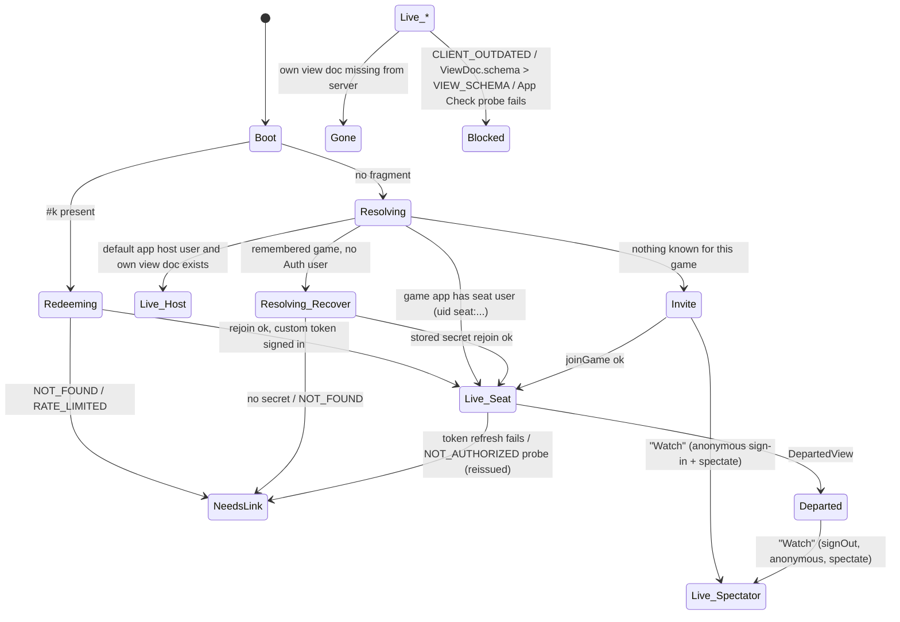
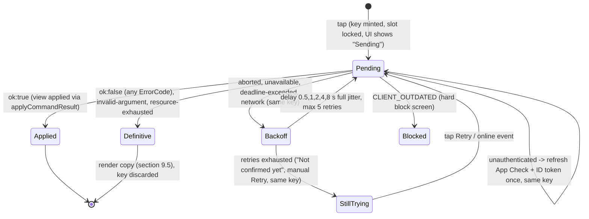

# Deep Cuts: LLD 7, Web Client (PWA)

Status: draft v0.1. Companion to [gameplay.md](../gameplay.md), [high-level-design.md](../high-level-design.md) (HLD), [tech-stack.md](../tech-stack.md), [00-platform-build-deploy.md](./00-platform-build-deploy.md) (LLD 0), [01-game-engine.md](./01-game-engine.md) (LLD 1), [02-view-projector.md](./02-view-projector.md) (LLD 2), [03-game-store.md](./03-game-store.md) (LLD 3), [04-identity-sessions.md](./04-identity-sessions.md) (LLD 4), [05-command-api-contracts.md](./05-command-api-contracts.md) (LLD 5) and [06-notifications-scheduler.md](./06-notifications-scheduler.md) (LLD 6). This LLD specifies `apps/web`: architecture and routing, session and listener data flow, the command layer, local-only state and draft sync, the screen inventory, notification and install onboarding, the service worker, the design system basics, performance and resilience, and the test plan. It builds on the names of LLDs 0 to 6 unchanged (`GameView`, `ViewDoc`, `RoundDoc`, `YouTurn`, `ErrorCode`, `DETAIL_BY_CODE`, `CONTRACT_V`, `VIEW_SCHEMA`, `defineCallable` bodies, `registerPush`); where they look wrong or underspecified the issue is recorded in "Open questions / conflicts", not silently changed. HLD invariants C1 to C4 are kept and mapped to mechanisms (section 12); new invariants are labeled **WC1 onward**. "Must" statements are testable. The client holds no authority: it renders what the Projector produced and sends commands, so most of this document is about faithful rendering, safe retrying and graceful degradation.

## 1. Decisions at a glance

| Topic | Decision | Rationale |
|---|---|---|
| Framework and build | React 19, Vite, TypeScript strict, Tailwind CSS 4 (`@tailwindcss/vite`), `vite-plugin-pwa` | tech-stack section 1; exact versions pinned in `apps/web/package.json` (LLD 0 section 3) |
| Router | `wouter` (about 2 KB) | Six routes, no loaders; a data router would duplicate the listener layer |
| State management | **No state library.** Three small stores on `useSyncExternalStore` (`session`, `game`, `ui`) plus component state | Server state is one document per viewer; derived values come from the Projector (`you.turn`), so there is nothing to normalize or memoize across screens. Saves dependency weight and keeps the C1 boundary visible |
| Firebase SDK | Modular imports only: `app`, `auth`, `firestore`, `functions`, `app-check`, `messaging` (messaging lazy) | Bundle budget, section 10 |
| Firebase app layout | Default app holds the host session; one named app `game-{gameId}` per game for seat or anonymous sessions (LLD 4 section 1) | Joining game B must not sign out game A or the host |
| Optimistic UI | **None for game state.** Only local-only state (selection, draft text) and in-flight indicators | C1: the client never computes outcomes; the command response already carries the fresh view, so the cost is one round trip |
| Firestore persistence | **Enabled**, multi-tab, on every Firebase app; cleared on sign-out, leave and removal; cached snapshots are marked stale and commands wait for a server-confirmed snapshot | LLD 2 asks for a persistent cache for round docs; instant paint and an offline read-only view; the cache holds only what that viewer may already see (section 10.2) |
| Service worker | `vite-plugin-pwa` `injectManifest`, **one** worker at `/sw.js` handling precache, raw `push`, `notificationclick`, receipts; no Firebase SDK inside it | A custom push handler cannot be expressed in `generateSW`; one worker avoids two competing registrations at scope `/` (conflict 1) |
| Update flow | `registerType: "prompt"`; "Update available" banner; hard block on `CLIENT_OUTDATED` | LLD 5 section 2.6; never reload under a typing user without consent |
| i18n | English only; no library; typed message catalog `src/i18n/en.ts` and `t()`; lint bans literal UI strings | Keeps a locale switch cheap without paying for ICU runtime |
| Analytics | None. No Firebase Analytics, no third-party scripts besides reCAPTCHA Enterprise (App Check) | Privacy and R1; server metrics (LLD 0, 5) already show the client health that matters |
| Component tests | `bun test` + happy-dom + Testing Library (not Vitest) | LLD 0 section 6 runs `bun test apps/web/src`; one runner for the repo |
| Fixtures | Golden `ViewDoc` JSON exported from the Projector tests into `packages/contracts/fixtures/` | The web imports only `@dc/contracts` (LLD 0 P5); no engine import for tests either |
| Theme | System by default; manual light/dark override stored locally | Section 9.1 |

## 2. Architecture

### 2.1 Folder structure (`apps/web`)

```
apps/web/
  index.html  vite.config.ts  tsconfig.json  .env.staging  .env.production  .env.emulator   # Vite .env.<mode> names, LLD 0
  public/icons/  (192, 512, maskable, badge-72, apple-touch-icon)
  src/
    main.tsx                 # boot: capture #k, init App Check, render (section 2.4)
    app/                     # App.tsx, routes.tsx, ErrorBoundary.tsx, UpdateBanner.tsx, BlockedScreen.tsx
    firebase/                # config.ts (reads env), apps.ts (default + game apps), appcheck.ts, persistence.ts
    session/                 # resolve.ts, redeem.ts, registry.ts (remembered games), sessionStore.ts
    game/                    # GameSession.ts (listeners, poll), viewReducer.ts, rounds.ts, screenFor.ts, derived.ts
    commands/                # client.ts (typed call()), intent.ts, retry.ts, errorCopy.ts
    drafts/                  # draftStore.ts, merge.ts
    notify/                  # status.ts, register.ts, install.ts, badge.ts
    sw/                      # sw.ts (injectManifest source), receipts.ts
    screens/                 # Home, HostHome, HostFinish, Join, Game/*, History, HostConsole, Me
    ui/                      # Card, Button, Sheet, Toast, LiveRegion, Skeleton, ConnectionChip
    i18n/                    # en.ts, t.ts, prompts.ts (writing examples)
    lib/                     # idb.ts, storage.ts (try/catch wrappers), uuid.ts, platform.ts
    styles/index.css         # Tailwind @theme tokens (section 9.1)
    test/                    # setup.ts (happy-dom), fixtures.ts, fakes
```

Imports: `@dc/contracts` only among workspace packages (LLD 0 P5 lint). `console.*` is banned in `src` by lint so view content cannot reach a console (WC5).

### 2.2 Routes and deep links

| Route | Screen | Notes |
|---|---|---|
| `/` | Home | Join form (code + name), "Your games" (host list and remembered seats), "Host a game", "Paste a link" |
| `/host` | Host home | Sign-in (email link) or signed-in list from `listGamesByHost`, "Create game" |
| `/host/finish` | Email-link completion | `isSignInWithEmailLink`, then `replaceState` to `next` (LLD 4 section 3.1); `next` accepted only if it starts with `/` and not `//` |
| `/g/:gameId` | Game (everything phase-dependent) | Invite link, push deep link and rejoin link (`#k=`) all land here |
| `/g/:gameId/history` | Rounds feed, People's Choice voting | |
| `/g/:gameId/host` | Host console | Redirects to `/g/:gameId` for non-hosts |
| `/g/:gameId/me` | My seat: copy link, notifications, leave | |
| `*` | Not found | Link to `/` |

- **Push deep link** is `/g/{gameId}` (LLD 6 section 2.1). The worker either focuses an open window and posts `{type: "navigate", url}` (the router handles it without reload) or opens a new window. The route needs no state from the notification (WC10).
- **Invite link** `/g/{gameId}` with no session shows the join form for that game (name only); a 4-letter code goes through Home.
- **Rejoin link** `/g/{gameId}#k={secret}`, handled in section 2.4.
- Manifest `scope: "/"`, `start_url: "/"`, `launch_handler: { client_mode: "navigate-existing" }` (Chromium reuses the open window for links).

### 2.3 State management

```ts
// Each store: getSnapshot(), subscribe(), plus a few actions. ~30 lines each; no library.
sessionStore  : { state: SessionState }                       // per open game: who am I, which Firebase app
gameStore     : { view: GameView|null, draft: ..., rounds: Map<number,RoundDoc>, conn: ConnState, confirmed: boolean, blocked?: BlockReason }
uiStore       : { toast, theme, installPrompt, notifStatus, updateReady }
```

- `GameSession` (class, one per open game) owns the Firestore listeners, the poll timer and the command client; it is the only writer of `gameStore`. Components read through `useGame(selector)` and call `session.send(...)`. Anything not in `gameStore` that is game-relevant is local-only state (section 6).
- **Why not Redux or Zustand.** There are no cross-screen derived values worth caching, and the only reducer that matters (`applyViewDoc`, section 4.2) is a pure function tested on its own.

### 2.4 Boot sequence and the `#k=` fragment (LLD 4 sections 4.5, 5, 10)

```ts
// main.tsx, runs synchronously before React mounts and before any third-party script loads
const m = /^#k=([A-Za-z0-9_-]{22})$/.exec(location.hash);
const g = /^\/g\/([A-Za-z0-9]{20})\/?$/.exec(location.pathname);
export const pendingRejoin = m && g ? { gameId: g[1]!, secret: m[1]! } : null;   // module memory only, never stored before redeem
if (location.hash && !pendingRejoin) history.replaceState(null, "", location.pathname + location.search);   // stray fragment: drop it
```

Redeem (`session/redeem.ts`), run by the Game route when `pendingRejoin` is set:

1. Call `rejoin({v, gameId, secret})` through the game's named app (guest allowed).
2. `ok:true`: if the game app already holds a seat session with a **different** `playerId`, ask "This device is signed in as {name} in this game. Switch to this link?" before replacing it. Then `signInWithCustomToken(token)`, store `{secret, playerId}` in IndexedDB `seats[gameId]`, **then** `history.replaceState(null, "", "/g/{gameId}")`, and clear the module variable.
3. `NOT_FOUND` (uniform, LLD 4 ID10): strip the fragment, delete the variable, show `LinkInvalid` ("This link doesn't work any more. Ask the host for a new one."). `RATE_LIMITED`: strip, show the wait time (the secret is lost, the user re-opens the link later).
4. Transient failure (`unavailable`, offline): **keep** the fragment and the variable; retry with backoff and on `online`; the user can also reload. The fragment is stripped only after a definitive answer.

Hosting sends `Referrer-Policy: no-referrer` and `index.html` carries `<meta name="referrer" content="no-referrer">` (belt and braces; a fragment is never sent in `Referer` anyway). The secret is never put in a path, query, log, route state, notification URL or service-worker message (WC6).

## 3. Sessions and connection

### 3.1 Firebase apps and App Check

```ts
// firebase/apps.ts
export const defaultApp = () => getApp();                                    // host session; also pre-membership callables
export function gameApp(gameId: GameId): FirebaseApp {
  try { return getApp(`game-${gameId}`); } catch {}
  const app = initializeApp(CONFIG, `game-${gameId}`);
  initAppCheck(app);                                                        // BEFORE any callable or listener (LLD 0 oq 4)
  initializeFirestore(app, { localCache: persistentLocalCache({ tabManager: persistentMultipleTabManager() }) });
  return app;
}
```

- **App Check** (`firebase/appcheck.ts`): `initializeAppCheck(app, { provider: new ReCaptchaEnterpriseProvider(SITE_KEY), isTokenAutoRefreshEnabled: true })` on the default app and on every named app. Preview and staging builds set `self.FIREBASE_APPCHECK_DEBUG_TOKEN = VITE_APPCHECK_DEBUG_TOKEN` first (LLD 0 section 7); `VITE_APP_ENV=emulator` skips App Check entirely (the emulators do not enforce it, LLD 0 section 6). Production builds never contain a debug token.
- **Failure handling.** Firestore enforces App Check, so a failed token shows up as `permission-denied` on listeners and `unauthenticated` on callables, indistinguishable from a rules denial. On any such error the client calls `getToken(appCheck)` once as a probe: if it throws, show `BlockedScreen("appcheck")` ("We couldn't verify this browser. Turn off content blockers for this site and retry.") with a Retry button; if it succeeds, the denial is real and handled as a revoked seat or unavailable spectator doc (section 3.3).
- A named app is kept for the lifetime of its route plus 30 s, then `deleteApp` (auth state persists in IndexedDB; re-entering recreates the app).

### 3.2 Session resolution at `/g/:gameId`



Resolution order (first match wins), implemented in `session/resolve.ts`:

1. Game app has a signed-in user whose uid matches `^seat:{gameId}:` : seat session.
2. Default app has a non-anonymous (host) user and either the registry marks this game `role: "host"` or a one-shot `getDocFromServer(views/{hostUid})` exists: host session on the default app (the doc key is `hostId`, seated or not, LLD 2 section 3.4).
3. Registry has the game, a stored secret and no user: silent `rejoin` (storage partially cleared, LLD 4 section 4.5).
4. Game app has an anonymous user: spectator session.
5. Otherwise `Invite`.

`NeedsLink` is the R4 recovery screen: "We can't find your seat on this device. Open your personal link, or paste it here. Lost it? Ask the host to reissue it." with a paste field (`{origin}/g/{id}#k=...` or the bare secret) and, for a remembered game, the player's name. The **host** recovers by signing in again (`/host`), which repopulates the list from `listGamesByHost`.

### 3.3 Auth handling details

- **Host.** `sendSignInLinkToEmail(auth, email, { url: origin + "/host/finish?next=%2Fhost", handleCodeInApp: true })`; the email is kept in `localStorage["dc.hostEmail"]` for same-device completion, otherwise `/host/finish` asks for it (cross-device, LLD 4 section 3.1). After sign-in the client calls `hostProfile({v})` once (bootstrap, LLD 5 section 3.1) and `listGamesByHost`. UX cooldown: 60 s between sends, 5 per hour per browser. Sign-in errors map to copy: `auth/invalid-email`, `auth/expired-action-code`, `auth/invalid-action-code` ("This link has expired or was already used. Send a new one."), `auth/too-many-requests`, `auth/network-request-failed`.
- **Installed iOS PWA** (LLD 4 oq 10): the email link opens in Safari, which has separate storage. `/host/finish` and Home both offer **"Paste your sign-in link"**: the user copies the link from the email, pastes it in the installed app, which calls `signInWithEmailLink(auth, email, pastedUrl)` (the code is consumed there). This needs no server work.
- **Seat.** After `signInWithCustomToken` the SDK refreshes ID tokens hourly (LLD 4 section 4.5). Revocation detection does **not** rely on the `onIdTokenChanged` error callback: Firebase never invokes it for a failed background refresh. Instead the client detects a dead seat explicitly in two ways: (a) a forced refresh `getIdToken(true)` on the game app at session start, on `visibilitychange` to visible, on `online`, and on any listener `permission-denied`; a rejection with `auth/user-token-expired`, `auth/user-disabled`, `auth/user-not-found` or `auth/invalid-user-token` means the seat was reissued or removed (a network error is transient and retried); (b) any command or callable answering `NOT_AUTHORIZED` with `detail: "seat_revoked"` (next bullet). Either goes to `NeedsLink` (reissued, link replaced), unless a tombstone view (below) already explains a removal. A seat token minted before a reissue carries a stale `ep` (seat epoch) claim and is rejected by the server even if the SDK still holds it (LLD 4, K-B), so (b) catches what (a) cannot.
- **Revoked-seat classification.** `assertSeatLive` failures arrive as `NOT_AUTHORIZED` with `detail: "seat_revoked"` (the L5 editor adds it to `DETAIL_BY_CODE`, conflict 6): go to `NeedsLink` with the replaced-link copy, no probe. Fallback while talking to a server without the detail: `NOT_AUTHORIZED` with no `detail` forces `getIdToken(true)`; a rejection with one of the codes above means revoked, success means an ordinary role rejection (generic copy).
- **Spectator.** `signInAnonymously(gameAuth)`, `spectate({v, gameId})`, then `onSnapshot(views/spectator)`. `available:false`, or `permission-denied`/`view: null` on the doc, shows "Spectating isn't available for this game" (LLD 3 section 3.2). Spectator votes are held locally per game (`dc.votes.{gameId}`, LLD 2 oq 5).
- **Leave this device** (`/g/:id/me`): call `unregisterPush` for this game (LLD 6 section 2.3), `signOut(gameAuth)`, delete the IDB seat secret and registry entry, remove this game's local keys (`dc.draft.{gameId}`, `dc.votes.{gameId}`, `dc.sel.{gameId}.*`, and `dc.intent.{gameId}.*` in `sessionStorage`; one `clearGameLocal(gameId)` in `lib/storage.ts`, shared with removal and the Gone screen), then `terminate` and `clearIndexedDbPersistence` for the game app (section 10.2). The seat itself stays (LLD 4 threat table). On a shared device the draft mirror would otherwise expose the previous player's unfinished cards (the cards are theirs, not yet pooled).

## 4. Data flow: views, rounds, staleness

### 4.1 Listeners

```ts
// game/GameSession.ts
const viewRef = doc(db, "games", gameId, "views", docId);         // docId: seat uid | hostId | "spectator"
this.unsub = onSnapshot(viewRef, { includeMetadataChanges: true }, (snap) => {
  if (!snap.exists()) return snap.metadata.fromCache ? this.waitForServer() : this.setGone();   // missing from SERVER = deleted (LLD 3)
  const raw = snap.data();
  if (typeof raw.schema !== "number" || raw.schema > VIEW_SCHEMA) return this.block("schema");   // WC11: envelope version FIRST, before any parse
  const parsed = ViewDocLooseSchema.safeParse(raw);
  if (!parsed.success) return this.updateNeeded();                 // never crash on a doc we cannot read: "Update needed" banner, keep last view
  this.apply(parsed.data, snap.metadata.fromCache ? "cache" : "server");
}, (err) => this.onListenError(err));                              // permission-denied: probe (3.1), spectator doc: "unavailable"
```

- **Schema check before parsing.** The strict and loose `ViewDoc` schemas pin `schema` to a literal (LLD 5 section 2.5), so a doc written by a newer server would fail the parse and look like a client bug. The listener, the poll path and `getDocFromServer` all read the raw envelope `schema` first: above `VIEW_SCHEMA` goes straight to the hard-block update screen (section 8.5); only an equal schema is parsed.
- **Unknown enum values.** A newer server may add an enum member (for example a new `YouTurn`, `phase`, `status` or `audience`) without bumping `schema` (LLD 5 section 2.5). The loose schemas accept any string in enum positions (`z.union([z.enum(TUPLE), z.string()])`, conflict 21), so such a doc parses; the typed value then hits the default branch of the consuming `switch` (`screenFor` returns `unknown`) and shows the "Update needed" banner. Any other loose parse failure also routes to that banner, keeping the last good view.
- One listener per open game, on one document (LLD 3: no `list` on views). The same snapshot carries the `draft` region (own draft, section 6.3).
- **Rounds.** A single-document listener on `rounds/{view.resolved}` feeds the result panel. The History route (and `GameOver`) attaches `onSnapshot(query(collection(.., "rounds"), orderBy("round")))`; with the persistent cache the SDK syncs only deltas, so it also picks up the one permitted mutation (a `redacted` rewrite, LLD 3 ST13) that a cache-only read would miss. Doc ids are strings; order by the `round` field (LLD 2 section 7.1).
- **`resolved` handshake (F6').** If `view.resolved = n` and `rounds/n` is not yet present, the result panel shows a skeleton (not a guess), polls `getDocFromServer` after 3 s and 10 s, and never renders names or card text for that round until the doc arrives. Names always come from `view.players[]` (round docs hold ids only).
- **Cached boots.** A snapshot with `metadata.fromCache` is applied for fast paint but leaves `confirmed = false` (WC14): the connection chip reads "Saved copy", commands are disabled and the first server snapshot (or a `getDocFromServer`) flips `confirmed = true`. If no server snapshot arrives within 8 s the client calls `getDocFromServer` itself and, on failure, shows `offline`.

### 4.2 Version rule (V6, PJ10, LLD 2 section 8.4)

```ts
// game/viewReducer.ts  (pure; unit tested)
const older = (v: number, r: number, sv: number, sr: number) => v < sv || (v === sv && r < sr);   // lexicographic (version, viewsRev)
export function applyViewDoc(s: GameState, d: ViewDocLoose, src: "cache" | "server" | "poll"): GameState {
  if (d.schema > VIEW_SCHEMA) return { ...s, blocked: "schema" };            // WC11: hard block (also checked on the raw doc, 4.1)
  if (d.view === null) return { ...s, spectatorUnavailable: true };         // disabled spectator doc
  if (s.view && older(d.view.version, d.viewsRev, s.view.version, s.viewsRev)) return s;   // WC1: stale, discard (equal pair is accepted: identical content)
  const confirmed = s.confirmed || src !== "cache";
  return { ...s, view: d.view, viewsRev: d.viewsRev, confirmed, draftRegion: applyDraftRegion(s.draftRegion, d) };
}
export function applyDraftRegion(r: DraftRegion, d: ViewDocLoose): DraftRegion {
  return d.draftSeq !== undefined && d.draftSeq >= r.seq ? { seq: d.draftSeq, draft: d.draft ?? null } : r;   // ordered by draftSeq, not version
}
// Command responses carry a bare GameView (LLD 5 section 3.3), no envelope and no draft region.
export function applyCommandResult(s: GameState, r: { view: GameViewLoose; version: number }): GameState {
  if (s.view && r.view.version < s.view.version) return s;                  // WC1 on view.version only; r.version is NOT an ordering key
  return { ...s, view: r.view, confirmed: true };                           // viewsRev and draftRegion untouched
}
```

- Orderings: view region by the pair `(view.version, viewsRev)` compared lexicographically (K-F, LLD 2 section 8.2): after a projector deploy the Store rebuilds views at the same `version` with a higher envelope `viewsRev`, so the rebuilt snapshot wins and an older same-version snapshot (for example from the cache) is discarded. The draft region is ordered by `draftSeq`. The client **never** infers "I am behind" from `view.version` being smaller than a command response `version` (LLD 2 8.4, LLD 5 6.1: on a replay `version` can be lower than `view.version`).
- **Command responses** do not go through `applyViewDoc`. `applyCommandResult` takes `response.view` (a `GameView`) and `response.version`, applies the WC1 check on `view.version` (equal accepted: the response view is freshly projected by the deployed projector), keeps the stored `viewsRev`, and never touches the draft region (a `saveDraft` response's `draftSeq` is handled by the draft store, section 6.3). A later listener snapshot at the same `version` and same or higher `viewsRev` is then accepted as usual.
- Every enum `switch` over `phase`, `status`, `turn`, `audience` has a default branch that sets `unknownValue` and shows the "Update needed" banner (LLD 5 section 2.5, WC11).

### 4.3 Missing or late snapshots (C2, F3 revised)

| Trigger | Action |
|---|---|
| Mount, `visibilitychange` to visible, `pageshow` (bfcache), `online` | `getDocFromServer(viewRef)` through `applyViewDoc(..., "poll")` |
| Visible and no server snapshot for 120 s | Same poll (cost: about 30 reads per hour per open tab) |
| Listener error | Backoff re-attach (1, 2, 4, 8, max 30 s); polling continues meanwhile at 30 s |
| Command response | Apply `response.view` immediately through `applyCommandResult` (4.2) |
| Hidden tab | Listener stays (the SDK manages it); no polling |

C2 holds because nothing depends on having seen an earlier snapshot: a tab closed for days boots, reads one view doc and at most the latest round doc.

## 5. Command layer

### 5.1 Types and call path

`commands/client.ts` wraps the `call()` helper generated from `CALLABLES` (LLD 5 section 3.3). Every request carries `v = CONTRACT_V`; every response is checked for `sv`.

```ts
type Slot = "submit" | "pick" | "host" | "draft" | "lifecycle" | `vote:${number}`;
interface Intent<T extends ClientCommandType = ClientCommandType> {
  id: string; slot: Slot; type: T; payload: PayloadOf<T>;
  key: string;                       // lowercase UUIDv4, minted ONCE per user intent (WC3)
  expectedVersion?: number;          // view.version at tap time, for the five commands that require it; frozen on the intent
  attempts: number; phase: "pending" | "backoff" | "still_trying" | "done";
}
async function send<T extends ClientCommandType>(type: T, payload: PayloadOf<T>): Promise<Outcome> {
  const slot = slotFor(type, payload);
  const existing = this.inflight.get(slot);
  if (existing) return existing.promise;                               // a second tap on the same slot does nothing
  const i: Intent<T> = { id: uuid(), slot, type, payload, key: uuid(), attempts: 0, phase: "pending",
    ...(REQUIRES_EXPECTED.has(type) ? { expectedVersion: this.state.view!.version } : {}) };
  sessionStorage.setItem(`dc.intent.${this.gameId}.${slot}`, i.key);   // survives a reload of the same tab; cleared on a definitive answer
  return this.run(i);
}
```

`REQUIRES_EXPECTED = {confirmSubmission, writeIn, closeSubmissions, pickWinner, passJudging}` (LLD 5 section 2.4); `expectedVersion` is the version of the view the user was looking at when they tapped (never a computed value) and is **not** recomputed on retries (LLD 5 section 6.2).

### 5.2 Lifecycle and retries



Rules (binding table of LLD 5 section 6.5, specialized):

| Outcome | Client action |
|---|---|
| `ok:true` | Apply `view` via `applyCommandResult` (4.2), key discarded. A `replay: true` is treated the same |
| `ok:false` | Definitive: render copy for `reason` and `detail`; never auto-retry; discard key |
| `RATE_LIMITED` | Disable the slot for `retryAfterMs` and show the countdown |
| `aborted`, `unavailable`, `deadline-exceeded` | Backoff with the same key (timeout is 35 s client side, LLD 5 section 6.4) |
| `internal` | The Functions web SDK reports a failed `fetch` as `internal` as well (conflict 7): if `navigator.onLine === false` use the full backoff schedule, else retry once after 1 s, then surface "Couldn't confirm. Tap to retry." keeping the key |
| `unauthenticated` | Refresh the App Check token and ID token once, retry with the same key; then the sign-in or `NeedsLink` flow |
| `failed-precondition` + `CLIENT_OUTDATED` | Stop issuing calls; hard-block screen (section 8.5) |
| `resource-exhausted` (`LIMIT_REACHED`) | Definitive: "This game has reached its limit." |
| `deleteGame` `NOT_FOUND` | Treated as success (LLD 3 section 6.4, LLD 5 table) |

An unknown outcome is **never** rendered as success (WC4): the UI reads "Not confirmed yet" until a view shows the effect (for example `you.yourSubmission` is set) or a definitive response arrives. A reload with an unresolved intent simply shows the current view; the user acts again with a new key, and `expectedVersion` plus the ledger keep that safe.

### 5.3 STALE and optimistic policy

- **Policy: no optimistic UI for game state (WC2).** The "submitted" state, the winner highlight and the round change appear only after a view is applied. Allowed purely local effects: selecting a card, typing a draft, a spinner on the confirm button, disabling a slot.
- **`STALE`** (LLD 5 section 6.2): do not resend. Keep the local selection if its card id still exists in the (re-delivered) hand or reveal list, otherwise clear it, show the toast "The round changed while you were choosing", and let the listener re-render. If the change was a withdrawn card (a player left or the host passed judging, LLD 2 oq 8) the toast is the same and nothing marks whose card it was.
- **Multi-tab double submit.** Tab B's `confirmSubmission` after tab A's returns `ALREADY_SUBMITTED`, rendered as information ("You've already played this round"), then the view shows the submission.

## 6. Local-only state, drafts, offline, multi-tab

### 6.1 What is stored where (HLD 3.1)

| Item | Where | Key | Lifetime / on storage cleared |
|---|---|---|---|
| Firebase sessions | SDK IndexedDB, per named app | `game-{gameId}`, default | Gone: `NeedsLink` (seat), re-sign-in (host), new anonymous uid (spectator, local votes lost) |
| Rejoin secret + playerId | IndexedDB `dc/seats` | gameId | Powers "Copy my link" and silent `rejoin`. Gone: ask the host to reissue (R4) |
| Remembered games registry | IndexedDB `dc/games` | gameId: `{role, name?, lastOpenedAt, lastSeenResolved, lastWaitingOnMe, lastSeenAt}` | Cosmetic; host list rebuilt by `listGamesByHost`; seat entries rebuilt only via the link |
| Unconfirmed red-card or winner selection | memory + `sessionStorage` | `dc.sel.{gameId}.{round.number}` | Discarded when `round.number` or phase changes (WC8); never sent anywhere |
| In-flight idempotency key | memory + `sessionStorage` | `dc.intent.{gameId}.{slot}` (LLD 5 section 6.3) | Cleared on definitive answer |
| Pending join key | `sessionStorage` only | `dc.join.pending` = `{key, target, displayName}` | The join `idempotencyKey` is a credential (a same-key replay can return the seat's custom token and rejoin secret until the seat's first sign-in, LLD 4, K-C). Minted once per join attempt, reused for every retry, including after a tab reload or after the room code expired; deleted as soon as the join response is persisted (custom token signed in and `{secret, playerId}` written to IndexedDB `seats`) or on a definitive rejection. Never in `localStorage`, IndexedDB, route state, diagnostics or any log |
| Draft mirror | `localStorage` | `dc.draft.{gameId}` = `{red, green, baseSeq, base, dirty}` | Survives reloads; cleared on `finishWriting` ok, on leave, removal and Gone (`clearGameLocal`) |
| Spectator votes | `localStorage` | `dc.votes.{gameId}` | Lost with storage; a new uid is a new vote (LLD 4 section 7). Cleared on leave, removal and Gone. Spectator voting is a weaker identity by design (a seated player can vote anonymously, including for their own card; People's Choice never affects scoring); UI copy stays neutral and does not claim one vote per person |
| Notification state | IndexedDB `dc/meta`, `dc-sw/receipts` | `deviceId` (128-bit, once per install), last registered token hash, `notif.off.{gameId}`, prompt dismissals, `missedNotices` | Gone: re-register on next opt-in |
| Host email for link completion | `localStorage` | `dc.hostEmail` (LLD 4) | Removed after completion |
| Theme | `localStorage` | `dc.theme` | Falls back to system |

All access goes through `lib/storage.ts`, which wraps every read and write in `try/catch` (storage can throw in private windows or be cleared) and makes every screen render correctly with empty storage. After a successful join the client calls `navigator.storage.persist()` and shows a one-time **"Save your personal link"** sheet (Copy, Share, Continue) because non-installed Safari can evict script-writable storage after 7 days of non-use (LLD 4 section 4.5).

### 6.2 Selection and confirm (C1 interaction, "pick then confirm")

Selecting a card is local; **Confirm** is the only moment a command exists. The bar at the bottom of the screen always states what will happen ("Play 'Pizza'", "Pick 'The DMV' as the winner"). Changing the pick before Confirm is free. A selected card that disappears from the view (removed, withdrawn) is deselected silently with the toast of section 5.3. After a refresh the selection is restored from `sessionStorage` only if the round number matches and the id still exists.

### 6.3 Draft sync (`saveDraft`, `draftSeq`)

State per game: `local` (what the editor shows), `base` (the last server draft applied, with `baseSeq = draftSeq`), `dirty`.

- **Edits** update `local` and the `localStorage` mirror (throttled 300 ms). A save is scheduled **1.5 s after the last keystroke** (LLD 5 section 6.5), and flushed immediately on blur, on `visibilitychange` to hidden, on `pagehide`, and before `finishWriting`.
- **One in flight.** Saves are serialized (slot `draft`, no concurrency). `saveDraft` sends the full `{red, green}` arrays; texts are trimmed and empty rows are not sent. The draft store keeps the in-flight payload as `sent` (and `sentFrom = base`, the base it was built on). On `ok:true` with `draftSeq = s`: if `s > baseSeq` then `base := sent`, `baseSeq := s`; in all cases `dirty := local !== base` and `sent := null` (typing during the flight schedules another save).
- **Own echo during a flight.** The listener can deliver the snapshot of the client's own in-flight save before its response arrives. A snapshot with `draftSeq > baseSeq` whose draft equals `sent` (same normalized texts per color) while `sent !== null` is the echo, **not** a remote edit: `base := sent`, `baseSeq := draftSeq`, `local` is kept unchanged (later local edits are thereby rebased onto the sent draft), `dirty := local !== base`. The later response with the same `draftSeq` is then a no-op. (A remote edit that happens to equal `sent` is indistinguishable and harmless: the content is identical.)
- **Remote snapshot during a flight.** Any other snapshot with `draftSeq > baseSeq` that arrives while `sent !== null` is buffered (latest wins) and processed when the flight resolves, once the own save's `s` is known: if its `draftSeq > s` it is merged against `base = sent` as below; if its `draftSeq < s` our full-array save already overwrote it, so its changes are recovered with `local := merge3(sentFrom, local, remote)` while `base` stays `sent` and `baseSeq` stays `s`, and a new save is scheduled if `local !== base`.
- **Remote draft (another device or tab).** A snapshot with `draftSeq > baseSeq` (outside a flight, or released from the buffer) is merged three-way, treating each color as a set of normalized texts (NFC, trimmed, case-folded):

```ts
// drafts/merge.ts  (pure)
export function merge3(base: string[], local: string[], remote: string[]): string[] {
  const key = (s: string) => s.normalize("NFC").trim().toLowerCase();
  const b = new Set(base.map(key)), r = new Set(remote.map(key));
  const removedRemote = new Set([...b].filter((k) => !r.has(k)));
  const addedRemote = remote.filter((t) => !b.has(key(t)));
  const kept = local.filter((t) => !removedRemote.has(key(t)));          // keep my edits, honor remote deletions
  const have = new Set(kept.map(key));
  return [...kept, ...addedRemote.filter((t) => !have.has(key(t)))];     // append remote additions, no duplicates
}
```

  Not dirty: adopt remote as is. Dirty: `local := merge3(base, local, remote)`, `base := remote`, `baseSeq := remote seq`, and save again. If the merge exceeds `you.writeTarget` the editor shows "Too many cards. Remove {n}"; the server would answer `INVALID_ARGUMENT`.
- **Stale server regions never win:** `applyDraftRegion` ignores any `draftSeq` below the one applied (WC9).
- **`CONTENT_REJECTED` on a save.** The rejection names no card (conflict 8). The client diffs `local` against `base` and flags the cards changed since the last accepted save ("This word isn't allowed in this game" for `PROFANITY`), leaves the server draft untouched and keeps `dirty`. Client-side hints (empty, 80 code points) use `TEXT_LIMITS` from contracts (conflict 5); the server stays the authority.
- **"Cards still to write".** The authoritative figure is `you.cardsLeft` (server, per LLD 1 section 9.5; the client never derives it, LLD 0 oq 5) and, for others, `players[].cardsLeft`. The editor shows "6 of 10 written" from the local list against `you.writeTarget` as typing feedback, and the header pill "4 red, 2 green to go" from `you.cardsLeft`, which updates after each accepted save (the aggregate mirror changes only when counts change, LLD 1 section 4.1). **Finish** is enabled only when `you.cardsLeft` is `{0, 0}`, nothing is dirty and no save is in flight; on tap the client flushes first, then sends `finishWriting`. After it, the view is `ready` and the player's own cards are not shown back (LLD 2 section 5.3).
- **Examples.** "Need ideas?" shows prompts from the bundled `prompts.ts` (about 30 red and 30 green examples, shuffled locally; display only, no game state).

### 6.4 Offline, reconnect, multi-tab, multi-device

| Situation | Behavior |
|---|---|
| Offline open | Precached shell loads; Firestore cache paints the last view, chip "Saved copy", commands disabled until a server snapshot (WC14); History from cache; "Copy my link" works; drafts editable and mirrored locally |
| Offline command | Not queued across reloads. A tap while offline starts the retry loop; the UI says "Waiting for a connection. Not played yet." The loop continues while the page is open and restarts on `online`; the same key and frozen `expectedVersion` make it safe |
| Reconnect | `online` triggers: poll, draft flush, intent resume, token refresh |
| Two tabs, same seat | One Firestore cache and listener fan-out via the multi-tab manager; each tab has its own selection (sessionStorage) and its own command client. Races end as `ALREADY_SUBMITTED` or `STALE`. Push registration and the `receipts` write are serialized with `navigator.locks` |
| Two devices, same seat (rejoin link) | Independent sessions on one uid and one view doc; both receive every snapshot; each registers its own `deviceId` for push (LLD 6, up to 5); a host reissue kills both (they land in `NeedsLink`); drafts converge via `draftSeq` and `merge3` |
| Host on several devices | Same as seat, default app |

## 7. Screens and flows

### 7.1 Screen resolution

```ts
// game/screenFor.ts  (pure, exhaustive over contracts enums; the only place that reads view enums to choose a screen)
export function screenFor(v: GameView): ScreenKey {
  if (v.audience === "departed") return "departed";
  if (v.audience !== "player") return "board";                       // spectator and unseated host: read-only board (+ host console link)
  switch (v.you.turn) {
    case "lobby": return "lobby";        case "write": return "write";       case "ready": return "ready";
    case "submit": return "hand";        case "submitted": return "submitted";
    case "judge": return "judgeReveal";  case "wait": return v.you.isJudge ? "judgeWait" : "judgingWait";
    case "sit_out": return "sitOut";     case "paused": return "paused";     case "over": return "over";
    default: return "unknown";                                          // WC11: "Update needed" banner
  }
}
```

The **round result** is not a turn: when `view.resolved > registry.lastSeenResolved` (and the round doc is loaded) a `ResultPanel` is shown above the next screen (or inside `over`), dismissible, and `lastSeenResolved` is updated on dismissal.

### 7.2 Screen and flow inventory

Field names are LLD 2 section 4.2. "Cmds" are client command types (LLD 5 section 2.4) or callables. Empty/loading/error states common to all game screens: loading = skeleton shaped like the screen until the first applied view; connection chip states `live`, `Saved copy`, `Offline`; errors per section 9.5 appear as a toast, or inline for form fields.

| Screen | Shown when | View fields rendered | Cmds | Empty / loading / error specifics |
|---|---|---|---|---|
| Home | `/` | none (registry, `listGamesByHost`) | `joinGame`, `lobbyInfo` (optional), `listGamesByHost`, `hostProfile` | No games: join form and "Host a game" only. List skeleton. `RATE_LIMITED` shows countdown. Not-found copy is uniform for unknown, expired (72 h), full and finished codes |
| Join (invite) | `/g/:id`, no session | none (`lobbyInfo` result only) | `joinGame`, `spectate` path | Name field with 24-code-point counter; `NAME_TAKEN`, `ROOM_FULL`, `CONTENT_REJECTED`, `WRONG_PHASE` inline; code and name sent together (LLD 5 section 7.3). Transient failures retry with the same `idempotencyKey` from `dc.join.pending` (6.1), so a join that committed but whose response was lost is recovered even after the code expired; a replay answered `NOT_FOUND` (the seat was already signed in somewhere) deletes the pending key and shows the not-found copy with a pointer to the personal link |
| Host sign-in / create | `/host` | none | email link, `createGame` | Sent-state with resend cooldown; paste-link path; create form (`hostName`, settings) |
| Lobby (`lobby`) | `you.turn = lobby` | `players[]` (`name`, `status`, `isHost`), `target`, `targetFrozen`, `settings`, `you.roomCode`, `host.playability` | host: `startGame`, `updateSettings`, `removePlayer`; all: `leave` | Fewer than 3 players: "Need {n} more to start". `startGame` `NOT_PLAYABLE` copy. Share sheet with room code (valid 72 h) and link (no expiry) |
| Writing (`write`) | `you.turn = write` (also late joiners in PLAYING) | `you.writeTarget`, `you.cardsLeft`, `draft` region, `players[].cardsLeft`, `waitingOn` | `saveDraft`, `finishWriting`, `leave` | Empty lists show examples. Save state "Saved / Saving / Not saved". Late joiner banner: "You joined a game in progress. Write your cards, then you'll be dealt in next round" |
| Ready (`ready`) | after `finishWriting`, or late joiner waiting | `players[].cardsLeft` (counts only), `waitingOn`, `phase` | `leave` | Copy differs: WRITING "Waiting for others to finish", PLAYING "You're in. You'll be dealt in at the next round" |
| Hand (`hand`) | `you.turn = submit` | `round.green`, `round.number`, `round.judgeId`, `you.hand`, `round.expected`, `round.submittedBy`, `settings.variants`, `you.powerUsage` | `confirmSubmission` (`pitch?`), `writeIn`, `redraw` | Hand is 7 cards; skeleton of 7 slots; `NOT_IN_HAND`, `STALE`, `PAUSED`, `ALREADY_SUBMITTED` copy |
| Submitted (`submitted`) | `you.turn = submitted` | `you.yourSubmission`, `round.green`, progress list | none (read-only) | "You played X. Waiting for N more." Progress list from `expected` and `submittedBy` |
| Judge waiting (`judgeWait`) | judge, SUBMITTING | `round.green`, `round.expected`, `round.submittedBy` | `closeSubmissions` | Button disabled with 0 played; `NOT_PLAYABLE/no_submissions` copy |
| Judging, judge (`judgeReveal`) | `you.turn = judge` | `round.reveal[]` (`submissionId`, `text`, `pitch`), `round.green`, `round.submittedBy` | `pickWinner`, host also `passJudging` | Cards in `reveal` order; selection survives refresh; `STALE`, `NOT_FOUND` copy |
| Judging, non-judge (`judgingWait`) | `you.turn = wait`, not judge | same `reveal[]` read-only, own card tagged "Yours" from `you.yourSubmission.cardId` | none | "Waiting for the judge to pick" |
| Round result (panel) | `resolved` advanced | `rounds/{resolved}`: `green`, `winnerId`, `winnerCardId`, `plays[]` (with owners), `absent`; names from `players[]` | `castVote` (variant) | Skeleton until the doc arrives (F6'); redacted text shown as "[card removed]" |
| Sit out (`sitOut`) | `you.turn = sit_out` | `round.green`, progress | none | "You're sitting this round out and will be dealt in next round" |
| Paused (`paused`) | `you.turn = paused`, `paused` | same as the underlying phase, `players[]` | `leave`; host: `endGame` | "Paused until a third player joins" with invite share; `round.judgeId` may be `null` (LLD 2 4.2), in which case no judge is named |
| Over (`over`) | FINISHED / ENDED | `winnerId`, `players[].score`, `awards`, `phase` | `castVote`, host `endGame`/`deleteGame` | ENDED: "The host ended this game"; podium card texts come from round docs; History link |
| Board (spectator, unseated host) | `audience` spectator or host | `LiveViewBase` only | spectator `castVote` (if `vote`) | "Spectating" header; no hand. Disabled spectating: "Spectating isn't available" |
| History | `/g/:id/history` | round docs, `players[]`, `awards`, `you.myVotes` | `castVote` | Empty: "No rounds yet"; own card has no vote button (server also rejects `own_card`) |
| Host console | `/g/:id/host` | `host` (`roomCode`, `playability`, `writeCountsOverride`), `players[]`, `round`, `settings`, `phase` | `updateSettings`, `removePlayer`, `removeCard`, `closeSubmissions`, `passJudging`, `endGame`; `reissueRejoinLink`, `deleteGame` | See 7.5 |
| Departed | `DepartedView` | `reason` | `spectate` path | "You left" / "The host removed you" / "This game has ended for you"; offers Watch, Home |
| Gone | own view doc missing from server | none | none | "This game was deleted"; registry entry removed; `clearGameLocal` and the cache clear run (WC15) |
| Me | `/g/:id/me` | `you.roomCode`, own link from IDB | `leave`, `registerPush`, `unregisterPush` | Copy link, notification status, diagnostics, Leave |
| Blocked / Update | `CLIENT_OUTDATED`, unknown schema, App Check probe | none | none | Full-screen with Reload / Retry |

### 7.3 Wireframes

Phone width, one-handed layout: primary actions in the bottom third inside the confirm bar.

**Hand (non-judge, SUBMITTING, pitch variant on).** A selected card is raised and outlined; a second tap on the confirm bar sends.

```
+--------------------------------------+
| Round 4 - Judge: Maya      [Saved copy]|   <- connection chip only when not live
+--------------------------------------+
|  [ GREEN ]  Sticky                    |   green card (adjective), always on top
+--------------------------------------+
| Played: Sam  Ana   Waiting: You  Lee  |   progress (expected/submittedBy)
+--------------------------------------+
| Your hand (7)                         |
| +----------------+ +----------------+ |
| | The DMV        | |[x] Pizza       | |   role="radio", aria-checked
| | [RED]          | | [RED]  selected| |
| +----------------+ +----------------+ |
| +----------------+ +----------------+ |
| | Tax Day        | | My first car   | |
| +----------------+ +----------------+ |
|  ... 3 more (scroll)                  |
+--------------------------------------+
| Pitch (optional, 140)  [___________]  |
| [ Play "Pizza"              ]         |   confirm bar, 56 px, safe-area padded
| Redraw hand (once)                    |
+--------------------------------------+
```

**Judging reveal (judge).** Order is exactly `round.reveal`, never re-sorted; no owner information anywhere on screen.

```
+--------------------------------------+
| Judging - Round 4                     |
|  [ GREEN ]  Sticky                    |
+--------------------------------------+
| 5 cards in. Pick your favorite.       |
| ( ) Pizza                             |
| (o) The DMV                           |   selected (local only)
|     "ask anyone"                      |   pitch, if variant on
| ( ) Tax Day                           |
| ( ) My first car                      |
| ( ) The Moon                          |
+--------------------------------------+
| Played: Sam, Ana, Lee, Kit, Jo        |   separate panel, joinOrder, not tied to cards
| [ Pick "The DMV" as the winner ]      |
+--------------------------------------+
```

**Waiting states.**

```
 Submitted (non-judge)              Judge waiting (SUBMITTING)
+------------------------------+   +------------------------------+
| You played: Pizza            |   | You're judging "Sticky"      |
| Waiting for 2 more           |   | 3 of 5 have played           |
|  [x] Sam   [x] Ana           |   |  [x] Sam [x] Ana [x] Lee     |
|  [ ] Lee   [ ] Kit           |   |  [ ] Kit [ ] Jo              |
| We'll tell you when it's     |   | [ Reveal what's in ]         |
| your turn to look.           |   | (judge or host, any time)    |
+------------------------------+   +------------------------------+
```

**Writing form.**

```
+--------------------------------------+
| Write your cards   Still to go: 4 red, 2 green |
| [ Red cards (6/10) ] [ Green (6/8) ]  |   segmented control, role="tablist"
| 1 [ My first car              ] x     |
| 2 [ The DMV                   ] x     |
| ...                                   |
| + [ Add a card                  ] 80  |   Enter adds a row
| Need ideas? [Show examples]           |
| Saved 12:04                           |   Saved / Saving... / Not saved
| [ Finish writing ]  (disabled until 0 to go) |
+--------------------------------------+
```

**Round result panel.**

```
+--------------------------------------+
| Round 4: "Sticky"                     |
| Winner: Ana  with  "The DMV"          |
| Also played: Pizza (Sam), Tax Day (Lee)|
| Sat out: Kit                          |
| [ Vote for a favorite ]  [ Dismiss ]  |
+--------------------------------------+
```

**Host console.**

```
+--------------------------------------+
| Host - Room KQBD (works 72 h)  [Share]|
| Invite link (never expires)   [Copy]  |
+--------------------------------------+
| Players (5)                           |
| Ana (you)                             |
| Sam    [Reissue link] [Remove]        |
| Lee    [Reissue link] [Remove]        |
+--------------------------------------+
| Round: waiting on Kit, Jo             |
| [Reveal what's in] [Pass judging]     |
+--------------------------------------+
| Settings (lobby): Target [6]  Filter [on]|
| Variants: Pitch  Write-in  Redraw  Vote |
| Spectators: [on]  may vote [on]       |
+--------------------------------------+
| [End game]        [Delete game...]    |
+--------------------------------------+
```

### 7.4 Interaction details

- **Pick-then-confirm (C1).** Select = local. Confirm = one command with a frozen `expectedVersion`. After `ok:true` the new view (`turn = submitted`) is applied and focus moves to its heading. Between tap and response the confirm bar shows "Sending" and the slot is locked; there is no fake "submitted".
- **Judge reveal and E10.** The list is rendered by mapping `round.reveal` in array order, keyed by `submissionId`. A refresh, reconnect or a command by another player cannot reorder it because the order comes from the view (PJ6). The client has no sort, shuffle or random call anywhere on this path; a lint rule bans `sort`/`Math.random` in `screens/Game/Reveal*.tsx` and `ui/RevealList.tsx`. Entrance animation staggers in array order and is disabled under reduced motion.
- **Anonymity-preserving UI (WC5).** No owner is shown for a pending card to anyone, including the judge and the host. A non-judge's own card is tagged "Yours" using `you.yourSubmission.cardId` (their own knowledge, PJ4). The "who has played" list is a separate panel in `joinOrder` as delivered, never adjacent to or aligned with cards. Owners appear only from `rounds/{n}` after resolution. Card text and ids never appear in the document title, `aria-label`s on shared surfaces, URLs, logs or notification copy. If `reveal` shrinks or `submittedBy` loses a name mid-judging (a withdrawn card, LLD 2 oq 8) the client shows the neutral toast "A card was withdrawn".
- **What the host sees.** The same board as a seated player plus the console; the console lists `players[]` and the live round's `waitingOn`, never owners or hands. `removeCard` is offered only for cards shown to the table (the current green card, cards in `reveal`, and plays or the green card in resolved round docs; LLD 2 oq 4, gameplay.md); never for hands, pools or drafts, which the host cannot see. A `NOT_PLAYABLE/below_minimum` refusal explains that removing it would leave too few cards to keep playing and points the host to "End game" as the way out.
- **Host controls.** `Reveal what's in` (judge or host), `Pass judging` (confirm: "The next player judges using the same cards. If they played a card, it returns to their hand."), `Remove player` (confirm), `Reissue link` (confirm: "The old link stops working. You'll get the new link to send. You'll be able to see it, so only do this for someone who asked." per LLD 4 oq 4), `End game` (confirm), `Delete game` (typed confirmation of the room code or game name; copy: "Permanently removes the game and its history for everyone. Backups may keep it for up to 14 days." LLD 3 oq 11).
- **Spectators-off copy.** The host settings toggle reads "Spectators: off. People can't watch live, but finished rounds stay readable to anyone who has the game link." Resolved rounds are readable by anyone holding the game id (gameplay.md); the UI never promises privacy it cannot give.
- **Settings in LOBBY** send complete `variants` and `spectators` objects in `updateSettings.patch` (LLD 5 section 2.4). After the lobby only `profanity` is editable; `target` shows `targetFrozen`.
- **Create game.** Host name + optional settings; success navigates to `/g/{gameId}` and opens the share sheet with the room code, link and `navigator.share` when available. The host seat is a normal `player` view (`you.turn = lobby`).
- **Removed, left, late joiner, spectator** follow `DepartedView` and sections 3.2 and 7.2; a host who left their seat sees the Board plus console and no "sit down" button (conflict 9).

## 8. Notifications, install onboarding, service worker

### 8.1 Permission status machine (LLD 6 section 6)

```ts
type NotifStatus = "unsupported" | "ios_needs_install" | "permission_default" | "permission_denied" | "registration_failed" | "registered";
const isIos = /iPad|iPhone|iPod/.test(navigator.userAgent) || (navigator.platform === "MacIntel" && navigator.maxTouchPoints > 1);
const standalone = matchMedia("(display-mode: standalone)").matches || (navigator as any).standalone === true;
const pushCapable = "serviceWorker" in navigator && "PushManager" in window && "Notification" in window;
function status(): NotifStatus {
  if (isIos && !standalone) return "ios_needs_install";
  if (!pushCapable) return "unsupported";                    // includes iOS < 16.4
  if (Notification.permission === "denied") return "permission_denied";
  if (Notification.permission === "default") return "permission_default";
  return lastRegisterFailed ? "registration_failed" : "registered";
}
```

- **When to ask.** Never on load and never from a non-gesture. The browser prompt is preceded by an in-app card ("Get a ping when it's your turn, including when it's time to write your cards", Turn on / Not now) shown (1) on the Lobby or Writing screen right after join or create, and (2) once more the first time the viewer reaches `submitted` or `ready`. Because pushes cover the writing phase, the card also appears on the Writing screen of a late joiner who has not decided. "Not now" suppresses the card for 14 days (`dc/meta`); the bell chip in the header is always available.
- **Registration.** On `granted`: `getToken(messaging, { vapidKey: VITE_FCM_VAPID_KEY, serviceWorkerRegistration })` where the registration is our `/sw.js`, then `registerPush({v, gameId, fcmToken, deviceId})` through the game app, **only** when the token differs from the last registered hash or 7 days have passed since the last registration (the `push_uid` bucket is 20 per hour, LLD 6 oq 5). Registration runs once per game the seat belongs to; `messaging` is initialized once on the default app (the token is per browser, the call is per seat). Under `navigator.locks`.
- **Off.** Turning notifications off for this device calls `unregisterPush` for each game and sets `notif.off.{gameId}`; a `denied` observation on open also calls `unregisterPush`. Reissue/removal needs nothing client-side (LLD 6 section 2.4).
- **iOS flow (16.4+).** A 4-step sheet, shown from the chip when `ios_needs_install`: (1) **Copy your personal link** (Safari storage is separate from the installed app, so the install starts with no session), (2) Share, Add to Home Screen, (3) open the app from the Home Screen and **paste the link** on Home ("Paste a link"), (4) tap "Turn on notifications". Before step 1 the sheet checks `status` once more; on iOS below 16.4 it says push is unavailable and that the game still shows "your turn" on open. Whether Safari seeds the installed app's start URL is unverified (conflict 4).
- **Android and desktop.** Capture `beforeinstallprompt` into `uiStore`; the "Install app" menu item calls `prompt()`. Installing is optional for push there.

### 8.2 Fallbacks and the "not reaching you" signal (C4)

| Status | UI |
|---|---|
| `registered` | Bell chip filled |
| `permission_default`, `permission_denied`, `unsupported`, `ios_needs_install`, `registration_failed` | Persistent, dismissible-per-session banner on Lobby, Writing and Hand with the specific fix (per-platform re-enable text for `denied`) |
| any | **Your-turn indicators that need no push (C4):** an in-page banner on open and on every transition into a waited-on state when `view.waitingOn` includes `you.playerId` ("It's your turn: pick a red card" / "Time to judge" / "Time to write your cards" / "The game is back on. It's your turn" after a resume); the rule is phase-independent, so it covers WRITING (turn `write`, still unfinished), SUBMITTING, JUDGING and resume-after-pause; document title `(1) Your turn - Deep Cuts` (generic text, no card content) and a favicon dot; `navigator.setAppBadge(1)` when waited on and visible, cleared when acted on; `aria-live="polite"` announcement |

- **Phase coverage (U1).** LLD 2 section 4.4 already maps WRITING-phase unfinished writers to `you.turn = write` and a paused-then-resumed game back to the underlying turn, so no new `YouTurn` value is needed; the client keys the banner, title and badge on `waitingOn` alone. Pushes follow the LLD 6 triggers (writing started, new round, all submitted, new judge, resume, result, game over, and host-ended game, kind `game_ended`; result and game-end pushes also reach late joiners still writing, K-D); the screen copy is generic and carries no card text or names. The client renders no notification copy of its own: the worker shows the server's `title`/`body` (LLD 6 `COPY`, "The host ended the game." for `game_ended`), so a new kind needs no client change beyond the generic fallback for an unknown `v`.
- **Badge from the worker.** On a displayed push, the worker records a receipt `{gameId, kind, at, seen:false}` and calls `setAppBadge(unseenGames)`; the page marks a game's receipts `seen` once a **server-confirmed** view for it is applied and clears the badge when none remain.
- **"Not reaching you" heuristic** (LLD 6 section 6, interpreted in conflict 3): at the **first server snapshot of a page load**, if `waitingOn` now includes me, `registry.lastWaitingOnMe` was false and `lastSeenAt` is set, and there is **no** receipt for this game with `at > lastSeenAt`, count one missed notice; two consecutive misses show "Turn alerts don't seem to be reaching this device" with a button running `unregisterPush`, `deleteToken`, `getToken`, `registerPush`. Live transitions while the app is open never count. It only ever shows a hint.

### 8.3 Service worker (`src/sw/sw.ts`, `injectManifest`)

```ts
// vite.config.ts (excerpt)
VitePWA({ strategies: "injectManifest", srcDir: "src/sw", filename: "sw.ts", registerType: "prompt", injectRegister: false,
  manifest: { id: "/", name: "Deep Cuts", short_name: "Deep Cuts", start_url: "/", scope: "/", display: "standalone",
              launch_handler: { client_mode: "navigate-existing" }, icons: [/* 192, 512, maskable */] },
  injectManifest: { globPatterns: ["**/*.{js,css,html,svg,png,woff2}"], maximumFileSizeToCacheInBytes: 1_500_000 } })

// sw.ts
precacheAndRoute(self.__WB_MANIFEST); cleanupOutdatedCaches();
registerRoute(new NavigationRoute(createHandlerBoundToURL("/index.html"), { denylist: [/^\/__\//] }));   // Hosting's /__/auth/* must reach the network
self.addEventListener("push", (e) => e.waitUntil(onPush(e)));
self.addEventListener("notificationclick", (e) => e.waitUntil(onClick(e)));
self.addEventListener("message", (e) => { if (e.data?.type === "SKIP_WAITING") self.skipWaiting(); });
```

- **Strategy.** Precache the app shell only. No runtime caching of Firebase traffic (Firestore uses its own transport; callables are POSTs; auth and App Check endpoints must stay live). No `firebase/messaging` in the worker.
- **`onPush`.** Parse `event.data.json()`; use `payload.data ?? payload` (conflict 2). If `v !== "1"` show the generic fallback and set `url = "/"` (LLD 6 section 2.1). Always call `showNotification(title, { body, tag: data.tag /* g-{gameId} */, renotify: true, data: { url, gameId, kind }, icon, badge })`; **never skip it** (iOS revokes permission otherwise). If a visible, focused window for the same game exists, pass `silent: true`, post `{type: "push", kind}` to it and close the notification after 4 s. Write the receipt and update the badge in the same `waitUntil`.
- **Collapse.** `tag = g-{gameId}` with `renotify` means a newer notice for a game replaces the older one and still alerts; the server's `Topic` header handles undelivered messages (LLD 6 section 3.4). Nothing client-side is needed beyond honoring `tag`.
- **`onClick`.** Close; `clients.matchAll({ type: "window", includeUncontrolled: true })`; if a client exists, `focus()` it and `postMessage({ type: "navigate", url })` (router navigates in place); else `clients.openWindow(new URL(data.url, self.location.origin).href)`. The URL is relative `/g/{gameId}` with no fragment (LLD 6 NT1).

### 8.4 Update flow

`virtual:pwa-register` `registerSW({ onNeedRefresh, onOfflineReady })` surfaces an "Update available - Reload" banner; accepting posts `SKIP_WAITING` and reloads. Drafts and selections are already persisted, so a reload loses nothing. `registration.update()` runs on `visibilitychange` to visible, at most hourly. Hosting serves `/sw.js`, `index.html` and the manifest with `no-cache` (LLD 0 section 4).

### 8.5 Version gates (LLD 5 section 2.6)

| Signal | UI |
|---|---|
| `HttpsError` `failed-precondition` with `details.reason === "CLIENT_OUTDATED"` | Full-screen "Update required", stops all calls, runs `registration.update()` and `updateSW(true)`; if the page is still outdated after reload, unregister workers, clear `caches`, reload |
| `ViewDoc.schema > VIEW_SCHEMA` (read from the raw envelope before any parse, section 4.1) | Same screen |
| Response `sv > CONTRACT_V` | Non-blocking "New version available" banner and `registration.update()` |
| Unknown enum value (accepted by the loose schema) or other loose parse failure | "Update needed" banner on the affected screen, last good view kept |

## 9. UX and design system basics

### 9.1 Tokens (Tailwind 4 `@theme`, `styles/index.css`)

| Token | Value | Notes |
|---|---|---|
| Spacing | 4 px base (`--spacing: 0.25rem`); screen gutter 16 px; card gap 12 px | |
| Type scale | 14 / 16 / 18 / 20 / 24 / 32 px; body 16 px; card text 18 px (`text-lg`), line-height 1.35; 22 px for the green card | No text below 14 px; zoom to 200% must not clip |
| Red card | fill `#B3261E`, text `#FFFFFF`, contrast about 6.5:1 | Noun card; square corners, "RED" label chip |
| Green card | fill `#1B6B3A`, text `#FFFFFF`, contrast about 6.5:1 | Adjective card; pill-top banner, "GREEN" label chip |
| Surface/text (light) | bg `#FAFAF7`, text `#1A1A1A` (about 16:1), muted `#5C5C57` (about 6:1) | |
| Surface/text (dark) | bg `#121212`, text `#F2F2EE` (about 16:1), muted `#B4B4AE` | Cards keep the same fills in dark mode |
| Focus ring | 3 px, `#2457D6` light / `#8AB4FF` dark, offset 2 px | at least 3:1 against adjacent colors |

- **Color is never the only signal.** Red and green cards also differ by shape, the "RED"/"GREEN" chip text and an icon, so red-green color blindness cannot swap them. A unit test computes WCAG contrast for every text/background pair of the token table and fails below 4.5:1 (text) or 3:1 (UI); Playwright axe covers the rest.
- **Dark mode.** `prefers-color-scheme` by default; `data-theme="light|dark"` on `<html>` overrides (stored in `dc.theme`); `color-scheme` and two `theme-color` metas are set accordingly.
- **Card component.** `<Card kind="red|green" state="default|selected|disabled|you">`: min height 88 px, full-width tappable button (`role="radio"` in hands and reveals), text wraps with `overflow-wrap: anywhere` and never truncates (max 80 code points fits), selected = raised 4 px + 3 px outline + a check glyph, `you` = a "Yours" chip. Props take plain strings; the component has no knowledge of ownership.
- **Motion.** Transitions 120 to 200 ms, only via `motion-safe:`; under `prefers-reduced-motion` every transition and stagger is removed and nothing depends on animation to convey state.
- **Touch and layout.** Minimum target 44x44 CSS px, 8 px between targets; primary actions in a bottom bar padded with `max(env(safe-area-inset-bottom), 12px)`; `viewport-fit=cover`; `h-dvh` shells; no hover-only affordances; content max width 640 px centered on desktop. The thumb zone holds Confirm, Pick, Reveal, Finish; destructive host actions are behind confirm sheets away from the bar.

### 9.2 Accessibility requirements

- **Focus on screen change.** When the viewer's own action changes the screen (confirm, pick, finish), focus moves to the new screen's `<h1 tabindex="-1">`. When a **remote** update changes the screen, focus does not move; a polite live region announces it ("It's your turn. A new green card is up."). Dialogs use `<dialog>` with native focus trap and return focus to the trigger.
- **Live regions.** One `LiveRegion` component (`aria-live="polite"`, `role="status"`) for turn changes, results and toasts; errors that block use `role="alert"`. "Your turn" is announced once per transition into a waited-on state, not on every snapshot.
- **Semantics.** Hands and reveal lists are `radiogroup`s with roving tabindex, arrow-key navigation and Space/Enter select; confirm bars are real buttons with the full action text as the name; progress lists are `<ul>` with "played"/"waiting" text, not icons alone; the connection chip has a text label.
- **Legibility.** User zoom is never disabled; card text is at least 18 px; contrast per section 9.1; the document `lang` is `en`.
- **Verification.** `axe` runs in Playwright on every screen of the inventory (section 11.3); component tests assert roles and names.

### 9.3 Internationalization stance

English only in v1, but no hard-coded strings: all copy lives in `i18n/en.ts` (`as const` object of keys to strings with `{param}` placeholders), accessed through `t("key", params)` whose key and params are type-checked; counts use `plural(n, { one, other })` over `Intl.PluralRules`; numbers and dates use `Intl`. Lint: `react/jsx-no-literals` (text children) plus `no-restricted-syntax` on JSX literal values for `aria-label`, `title`, `placeholder` and `alt`. Server-owned copy (notification title/body, LLD 6) is not translated by the client. Adding a locale later means a second catalog and a `lang` switch.

### 9.4 Typed error copy (WC13)

`errorCopy.ts` is `Record<ErrorCode, ErrorCopy>` over the `ERROR_CODES` tuple of `@dc/contracts`, with optional per-`detail` overrides typed from `DETAIL_BY_CODE`, so adding a code or detail is a compile error until copy exists. A test also iterates both tables at runtime.

| Code (detail) | User text | Recovery |
|---|---|---|
| `NOT_AUTHORIZED` | "You can't do that in this game." | Re-sync (no detail means an ordinary role rejection; revoked seats carry `seat_revoked`) |
| `NOT_AUTHORIZED` (`sitting_out`) | "You're sitting this round out. You'll be dealt in next round." | None |
| `NOT_AUTHORIZED` (`own_card`) | "You can't vote for your own card." | None |
| `NOT_AUTHORIZED` (`seat_revoked`) | "Your link was replaced. Ask the host for the new one." | `NeedsLink` directly, no probe; seat registry entry and cache cleared |
| `WRONG_PHASE` | "That isn't available right now. The game has moved on." | Re-sync view |
| `WRONG_PHASE` (`finished`) | "You've already finished writing." | None |
| `STALE` | "The round changed while you were choosing. Take another look." | Keep selection if still valid, re-render |
| `NOT_IN_HAND` | "That card isn't in your hand any more." | Clear selection |
| `ALREADY_SUBMITTED` | "You've already played a card this round." | Info; view shows it |
| `ROOM_FULL` | "This game is full." | Back to Home |
| `ROOM_FULL` (`join_cap`) | "This game can't take any more joins." | Back to Home |
| `NAME_TAKEN` | "Someone here already has that name. Try another." | Focus name field |
| `CONTENT_REJECTED` (`EMPTY`) | "Write something first." | Focus field |
| `CONTENT_REJECTED` (`TOO_LONG`) | "That's too long. Trim it down." | Focus field |
| `CONTENT_REJECTED` (`INVALID_CHARS`) | "That has characters we can't use." | Focus field |
| `CONTENT_REJECTED` (`PROFANITY`) | "This word isn't allowed in this game." | Flag the changed cards (6.3) |
| `PAUSED` | "The game is paused until a third player joins." | Show invite share |
| `RATE_LIMITED` | "Too many tries. Wait {seconds} seconds and try again." | Disable slot for `retryAfterMs` |
| `NOT_FOUND` (join) | "We couldn't find that game. Check the code, or ask for the invite link. It may also be full." | Edit code |
| `NOT_FOUND` (rejoin link) | "This link doesn't work any more. Ask the host for a new one." | `NeedsLink` |
| `NOT_FOUND` (`seat_replaced`) | "Your link was replaced. Ask the host for the latest one." | `NeedsLink` |
| `NOT_FOUND` (pick, vote, remove) | "That card is no longer in the game." | Re-sync, clear selection |
| `NOT_PLAYABLE` (`players`) | "You need at least 3 players to start." | None |
| `NOT_PLAYABLE` (`minimums`, `below_minimum`) | "The game doesn't have enough cards for that." For `removeCard`: "Removing this would leave too few cards to keep playing. You can end the game instead." | None; host console highlights End game |
| `NOT_PLAYABLE` (`no_submissions`) | "Nobody has played yet, so there's nothing to reveal." | None |
| `NOT_PLAYABLE` (`incomplete`) | "Finish writing all your cards first." | Scroll to counters |
| `NOT_PLAYABLE` (`no_replacement`) | "There aren't enough cards left to do that." | None |
| `INVALID_ARGUMENT` | "That value isn't allowed. Check it and try again." | Inline |
| `VARIANT_UNAVAILABLE` | "That option is off in this game, or you've already used it." | Hide control |
| `VARIANT_UNAVAILABLE` (`vote_cap`) | "This game has reached its voting limit." | None |

Gates and failures: `CLIENT_OUTDATED` "Update required" (reload); `unauthenticated` "Please sign in again" (refresh once, then `NeedsLink` or sign-in); `invalid-argument` (shape) "Something went wrong in the app. Reload and try again" (client bug, no retry); `aborted`/`unavailable`/`deadline-exceeded` "Still trying..." then "Couldn't confirm. Tap to retry."; `internal` "Something went wrong. Try again."; `resource-exhausted` "This game has reached its limit."; App Check probe failure "We couldn't verify this browser."

## 10. Performance and resilience

### 10.1 Budgets and splitting

| Budget | Limit (gzip) | Enforced by |
|---|---|---|
| Entry for `/g/:id` (HTML + CSS + JS needed for first paint) | 300 KB | `scripts/check-web-size.ts` in `verify` (LLD 0 section 8) |
| Any lazy chunk | 60 KB | same |
| Service worker | 40 KB | same |
| CSS | 20 KB | same |

Lazy chunks: `messaging` (loaded when notifications are enabled), Host console, History, Settings editors, writing prompts, sign-in (email-link helpers). Firebase is imported by function only (`firebase/app`, `auth`, `firestore`, `functions`, `app-check`, `messaging`); no Analytics, Storage, Database or compat packages (lint bans `firebase/compat`). Contracts are imported through the package index so zod tree-shakes to the schemas used. Images are SVG or small PNG; fonts are the system stack (no web font blocking render).

### 10.2 Firestore persistence decision

Persistent local cache with `persistentMultipleTabManager()`, per app. Implications:

- **Stale views.** A cached view can be days old. It paints immediately but is flagged `confirmed = false` and never enables commands (WC14); `expectedVersion` still guards the five round commands even if a stale tab slips through.
- **Anonymity.** The cache holds only documents this viewer was allowed to read (own view doc, shared spectator doc, round docs), all already redacted, so it exposes nothing new on the device. On a shared device it would expose the previous player's hand, so "Leave this device", removal (tombstone applied) and `signOut` call `terminate(db)` then `clearIndexedDbPersistence(db)` and `clearGameLocal(gameId)` (the `dc.draft`, `dc.votes`, `dc.sel` and `dc.intent` keys); the Gone screen does the same.
- **Rounds.** Round docs are immutable apart from `redacted` rewrites; the History listener syncs deltas (section 4.1), so the cache never keeps a removed card's text once the client connects.
- **Fallback.** If persistence cannot start (private mode, quota), the SDK falls back to memory cache and the app proceeds without the "Saved copy" paint.

### 10.3 Resilience

- **Error boundaries.** One at the app root (reload screen with "Copy diagnostics"), one per route, and one around each game screen so a rendering bug in `JudgeReveal` cannot blank the whole app; boundaries log nothing (no card text); the diagnostics string holds app version, `CONTRACT_V`, last `sv`, last error codes and no identifiers or text.
- **Flaky networks.** All calls use the retry layer (5.2); listeners re-attach with backoff; the connection chip shows `live`, `Saved copy`, `Offline`, `Reconnecting`.
- **Loading skeletons** match each screen's layout (hand: seven card slots; reveal: n bars; progress list), shown until the first applied view or round doc, with a 10 s escape to a retry card.
- **Analytics.** None (section 1). Errors are visible to us only through server metrics (`dc_client_outdated_total`, `dc_api_invalid_total`, `dc_appcheck_denied_total`, LLD 5 section 9). No card text, names, secrets or ids leave the device other than in the calls that need them.

## 11. Testing

### 11.1 Component tests (`bun test apps/web/src`, LLD 0 section 6)

- Runner: `bun test` with `--preload apps/web/test/setup.ts` (happy-dom global registration), `@testing-library/react`, `@testing-library/user-event`. Vite-only imports (`virtual:pwa-register`, `import.meta.env`) go through `src/firebase/config.ts` and a small `test/fakes` so tests need no Vite. Conflict 10 covers the CI wiring.
- **Fixture strategy.** The Projector's golden tests (LLD 2 section 11.5) write each `(state, viewer)` doc as `packages/contracts/fixtures/views/{state}__{viewer}.json` (committed, regenerated by `bun run fixtures:views`, `git diff --exit-code` in CI, bumped with `PROJECTOR_REV`). `test/fixtures.ts` loads them and parses with `ViewDocLooseSchema`, so a schema drift fails here. Round docs and `players[]` names come from the same files. A `FakeSession` implements the `GameSession` interface with a scripted command client.

| Test | Assertion |
|---|---|
| Coverage | Every `YouTurn` value and every `audience` appears in at least one fixture; `screenFor` maps every fixture to a screen; no fixture maps to `unknown` |
| Render per fixture | Each screen renders without error or console output; roles and names present |
| Reveal order (E10) | For JUDGING fixtures the DOM order of `[data-card]` equals `round.reveal` order; re-render and reorder the unrelated `players[]` keeps it |
| Anonymity DOM | No element contains both a reveal card and any `players[].name`; no owner text in JUDGING/SUBMITTING fixtures; title contains no card text |
| Reducer | `applyViewDoc` is monotonic in `(version, viewsRev)` lexicographically: ignores a lower pair, accepts an equal pair, accepts the same `version` with a higher `viewsRev` (rebuild) and then discards a cached snapshot at that `version` with the lower `viewsRev`; ignores lower `draftSeq`; flags `schema > VIEW_SCHEMA`; handles `view: null` |
| Command result | `applyCommandResult` accepts `response.view` when `view.version >= current`, ignores a lower one, never reads `response.version` for ordering (replay with `version < view.version` still applies the view), and leaves `draftRegion` and `viewsRev` unchanged |
| Envelope and enums | A raw doc with `schema = VIEW_SCHEMA + 1` (and otherwise unparseable fields) blocks with the update screen without calling the parser; a doc with an unknown `you.turn`, `phase`, `status` or `audience` string parses with the loose schema and shows "Update needed" (`screenFor` returns `unknown`), keeping the app running; any other loose parse failure shows the same banner and keeps the last view |
| Revoked seat | With a fake Auth whose `onIdTokenChanged` error callback is never called: a forced `getIdToken(true)` rejecting with `auth/user-token-expired` (on visible, `online`, listener `permission-denied`) goes to `NeedsLink`; a network error does not; a command answered `NOT_AUTHORIZED/seat_revoked` goes to `NeedsLink` |
| Join key | The join `idempotencyKey` is written only to `sessionStorage`, reused on a retry (also after a reload of the tab), deleted once the session and secret are persisted, and appears in no `localStorage`, IndexedDB, `console` or diagnostics string |
| Command client | Fake transport: transient errors reuse the key and frozen `expectedVersion`; schedule is 0.5/1/2/4/8 s with jitter (fake timers); `ok:false` never retries; `RATE_LIMITED` locks the slot; `CLIENT_OUTDATED` blocks; second tap on a slot is a no-op |
| STALE | Selection retained when the card still exists, cleared otherwise, toast shown, no resend |
| Drafts | `merge3` properties (idempotent, commutative on disjoint edits, honors remote deletions); debounce 1.5 s; one in flight; flush on hidden; Finish gating on `you.cardsLeft` |
| Draft own echo ([A]->[B]->[C]) | One card typed `A`, save of `[A]` in flight; card edited to `B`; the listener delivers the echo `[A]` (`draftSeq = s`) before the response; card edited to `C`; response `s` arrives; next save. The editor never shows `A` again, the final server draft is exactly `[C]` (not `[C, A]` or `[B, A]`), and no merge runs for the echo. Variant with a genuine remote edit buffered during the flight (`draftSeq` above and below `s`) keeps both sides' cards |
| Error copy | Every `ERROR_CODES` entry and every `DETAIL_BY_CODE` pair has copy; every key in `en.ts` is used; lint finds no literal UI strings |
| Notification status | Table over (iOS or not) x (standalone) x (PushManager) x (permission) gives the expected `NotifStatus`; the permission request is only reachable from a click handler |
| Fragment | `#k=` captured, rejoin called, fragment stripped only after a definitive result; transient failure keeps it; the secret appears in no `history.state`, `console`, storage key or URL after redeem |
| Tokens | WCAG contrast of every token pair meets 4.5:1 / 3:1 |
| Local cleanup (WC15) | Seed `dc.draft.g`, `dc.votes.g`, `dc.sel.g.*`, `dc.intent.g.*` (and another game's keys); leave, removal and Gone each remove exactly game g's keys and the cache, not the other game's |
| Notification coverage | Fixtures for WRITING (`write`, unfinished), resumed-after-pause and judge-changed show the your-turn banner, title and badge; finishing writing clears them |
| Text limits | Counters and hints read `TEXT_LIMITS`; no numeric literal 24/80/140 in `src` |
| Error copy (revoked) | `NOT_AUTHORIZED/seat_revoked` goes straight to `NeedsLink`; no detail triggers the token probe |
| Isolation | Static test: `apps/web/src` imports only `@dc/contracts` among workspace packages, no `@dc/engine` (LLD 0 P5) |

### 11.2 End to end (Playwright, `e2e/`, emulators, `vite preview` built with `--mode emulator` (`.env.emulator`), LLD 0 section 6)

Multiple browser contexts play one game against the Node bundle with `PUSH_SENDER=fake` (LLD 6 section 4.5) and the emulator clock.

| # | Scenario | Key assertions |
|---|---|---|
| E1 | Host signs in (emulator oobCode), creates game, 3 players join by code and invite | Join in under 10 s with no account; room code and link work; name conflicts show copy |
| E2 | Write cards (offline typing, reload mid-draft, second tab) | Draft restored; counters from `you.cardsLeft`; Finish gated; `ready` screen |
| E3 | Play a full round to a winner and to FINISHED | Hand, submitted, judge reveal, result panel, over/history; reveal order stable across reload and `passJudging`; no owners before result |
| E4 | Return after reload / closing the browser | Same screen and hand; cached paint then confirmed; "Saved copy" chip offline |
| E5 | Rejoin on a second device via `#k` link | Fragment stripped after redeem; both devices live; host reissue sends the first to `NeedsLink`; old link shows invalid-link copy |
| E6 | STALE | Judge selects a card, host passes judging, judge confirms: `STALE` toast, selection cleared, no state change |
| E7 | Removed player | Local draft, votes, selection and intent keys cleared; tombstone screen, "Watch" fallback to spectator doc; spectator-disabled message |
| E8 | Push denied and unsupported | Context with notifications denied: banner copy, your-turn banner on open, title and badge set; no `registerPush` call; CDP `ServiceWorker.deliverPushMessage` shows a notification with `tag`, click opens `/g/{id}` |
| E9 | Offline and reconnect | `context.setOffline(true)`: shell loads, commands wait, draft edits kept; back online: poll, flush, retry with the same key (one version bump) |
| E10 | Outdated client | Server `MIN_V` raised in a test build: hard block screen, reload recovers |
| E11 | Two tabs, one seat | Double submit yields `ALREADY_SUBMITTED` info and one submission |
| E12 | Second game on one browser | Joining game B leaves game A and the host session signed in (named apps) |

### 11.3 Accessibility, visual, device matrix

- **Axe.** `@axe-core/playwright` runs on each screen of section 7.2 in light and dark, at 390 px and 1280 px, failing on any serious or critical violation (including `color-contrast`). Component tests add role and name assertions (happy-dom cannot compute contrast).
- **Visual regression stance.** No pixel-diff gate in v1 (font and engine variance cost more than they catch at this size). Playwright saves screenshots of the six wireframed screens at three viewports as CI artifacts for human review on each PR; revisit `toHaveScreenshot` for the Card component only if styling regressions appear.
- **Device matrix.**

| Tier | Targets | Gate |
|---|---|---|
| PR gate (LLD 0 e2e) | Chromium desktop 1280, Chromium mobile emulation (Pixel 7 profile) | Every PR |
| Nightly | WebKit with iPhone 14 profile, Firefox desktop | Non-blocking (conflict 10) |
| Manual before launch and after any worker change | The LLD 6 section 10.4 checklist: Android Chrome (installed and tab), iOS 16.4+ Safari tab and installed PWA, desktop Chrome/Firefox/Safari | Release checklist |

## 12. Invariants

### 12.1 HLD C1 to C4

| Inv | Mechanism | Tests |
|---|---|---|
| **C1** The client never computes outcomes | Imports only `@dc/contracts`; turn, counts, playability and awards arrive in `GameView` (`you.turn`, `cardsLeft`, `host.playability`); `screenFor` only maps enums to screens; no optimistic game state (WC2) | Isolation test; render-per-fixture; command client tests |
| **C2** Correct after being closed for days | Boot reads one view doc (and at most one round doc); no dependency on prior snapshots; poll on open and focus | E4; reducer tests; cached-boot confirmation test |
| **C3** Every command carries an idempotency key; retries are safe | One UUIDv4 per intent, reused for transport retries (WC3); `expectedVersion` frozen; ledger and `fp` on the server | Command client tests; E9 |
| **C4** Degrades without push | Section 8.2: banners, your-turn banner on open, title and badge, `NotifStatus` UI, no feature requires push | Notification status tests; E8 |

### 12.2 New invariants (WC)

| # | Invariant | Mechanism and tests |
|---|---|---|
| **WC1** | The applied view's `(version, viewsRev)` pair never decreases lexicographically (command results: `view.version` never decreases) and the draft region's `draftSeq` never decreases; unknown `schema` blocks, checked on the raw envelope before parsing | `applyViewDoc`, `applyCommandResult`; reducer, command-result and envelope tests |
| **WC2** | UI game state is derived only from the latest applied `GameView` plus local-only state; a command's effect appears only after a view is applied (no optimistic update) | Single writer `GameSession.apply`; E3, command tests |
| **WC3** | One idempotency key per user intent, reused for every retry of that intent; `expectedVersion` for the five required commands equals `view.version` at tap time and is not recomputed | `Intent`; command tests |
| **WC4** | An unknown outcome is never shown as success | "Not confirmed yet" state; E9 |
| **WC5** | Reveal cards are rendered in `round.reveal` order, keyed by `submissionId`, with no owner shown before the round doc; no card text, name or id appears in the title, URL, logs, notification copy or analytics (none exists) | Reveal-order and anonymity DOM tests; lint (no `console`, no `sort` on reveal paths) |
| **WC6** | The rejoin secret is never in a URL after redeem, a log, route state, a worker message or a notification; stored only in IndexedDB `seats`. The pending join `idempotencyKey` lives only in `sessionStorage` until the join response is persisted, then is deleted, and is never logged | Fragment tests; join-key test; E5 |
| **WC7** | A seat or spectator session lives only in its game's named app and the host session only in the default app; actions on one game never change another's session | E12 |
| **WC8** | The unconfirmed selection is keyed by `(gameId, round.number)` and discarded when either changes; it is never sent to the server | Selection tests |
| **WC9** | At most one `saveDraft` in flight; edits are flushed on blur, hide and before `finishWriting`; remote drafts merge three-way, the snapshot of the client's own in-flight save is recognized as its echo (never merged as a remote edit), and an older `draftSeq` never overwrites a newer one | Draft tests, [A]->[B]->[C] echo test; E2 |
| **WC10** | The push permission prompt is never requested on load or without a user gesture; every `NotifStatus` has visible UI and a working non-push signal | Status tests; E8 |
| **WC11** | `CLIENT_OUTDATED` and `ViewDoc.schema > VIEW_SCHEMA` hard-block; `sv` above ours soft-warns; unknown enum values parse under the loose schema and hit a default branch ("Update needed"), never a crash | Reducer, envelope-and-enums and gate tests; E10 |
| **WC12** | Remote screen changes never move focus and are announced in a polite live region; interactive targets are at least 44x44 CSS px; no literal UI strings in components | Component tests; axe; lint |
| **WC13** | Every `ErrorCode` and `detail` has user copy (compile time and runtime) | Error-copy tests |
| **WC14** | Cached snapshots enable no commands until a server-confirmed snapshot or poll applies; no mutation is queued across page loads | Cached-boot test; E4, E9 |
| **WC15** | Leave, removal, sign-out and deletion clear the game app's Firestore cache, seat secret, registry entry and the game's `localStorage`/`sessionStorage` keys (`dc.draft.{gameId}`, `dc.votes.{gameId}`, `dc.sel.{gameId}.*`, `dc.intent.{gameId}.*`) | Leave test seeds all four key families and asserts none remain after leave, removal and Gone; E7 |
| **WC16** | The entry bundle for `/g/:id` is at most 300 KB gzip and no chunk imports a second Firebase product set eagerly | Size check in CI |

## Open questions / conflicts

1. **Service worker name and location (LLD 6 section 2.1, LLD 0 section 4). RESOLVED by LLD 6 (C-SW).** The single worker is `/sw.js` (scope `/`, no-cache already declared), which handles raw `push` and is passed to `getToken` as `serviceWorkerRegistration`; no Firebase SDK, config or `/firebase-messaging-sw.js` exists. This LLD already uses `/sw.js` throughout.
2. **Raw push payload shape.** The worker assumes FCM delivers the data-only message as JSON either as `{data: {...}}` or flat and reads `payload.data ?? payload`. To verify on staging with the first real push (LLD 6 device checklist 1 to 4). Also unverified: that `Topic` is honored through FCM (LLD 6 oq 10).
3. **"No receipt within the preceding 15 minutes" (LLD 6 section 6) is ambiguous. L7's rule is authoritative; LLD 6 aligns to it.** A turn that began two days ago has no receipt in the 15 minutes before the open. The rule is: no receipt for the game with `at > lastSeenAt` (the last time this device saw the game), evaluated only at the first server snapshot of a page load, two consecutive misses, live transitions never counted. LLD 6 section 6 is edited to say the same instead of a fixed 15-minute window. WRITING and resume-after-pause waits count like any other newly waited-on transition.
4. **iOS storage isolation.** Safari and the installed PWA do not share storage, and the host email link opens in Safari (LLD 4 oq 10). Resolved with "Copy your link, install, paste on Home" and the paste-sign-in-link path for hosts. Unverified: whether Add to Home Screen seeds the PWA with the current URL (which would carry `#k`); needs a device test, and the paste path stays regardless.
5. **UI limits are not exported by contracts. RESOLVED by the LLD 5 editor (item 12).** `@dc/contracts` exports `TEXT_LIMITS = {name: 24, card: 80, pitch: 140}` (code points); the client imports it for every counter and client-side hint and keeps no mirrored constants. A test asserts the counters read `TEXT_LIMITS`.
6. **Revoked seat has no `detail` (LLD 4 ID3, LLD 5 section 5).** `assertSeatLive` failures are an undifferentiated `NOT_AUTHORIZED`; the client probes with `getIdToken(true)` (3.3). **RESOLVED by the LLD 5 editor:** `DETAIL_BY_CODE.NOT_AUTHORIZED` gains `seat_revoked`; copy and recovery are in section 9.4. The `getIdToken(true)` probe remains only as a fallback.
7. **Functions web SDK reports a failed fetch as `internal`**, so LLD 5's "one retry on `internal`" would give up quickly on a flaky connection. The client checks `navigator.onLine` and treats an offline `internal` as transient (5.2). To confirm with an emulator test that blocks the network; if `unavailable` is reported instead, the special case goes away.
8. **`CONTENT_REJECTED` on `saveDraft` does not identify the card.** The client flags cards changed since the last accepted save (6.3). A cleaner contract would be an optional `rejection.index` (requires an LLD 5 schema change and an Engine detail); not requested for v1.
9. **Host who left their seat cannot sit again (LLD 4 oq 7).** No "sit down" action is offered; such a host sees the Board plus console. A host `takeSeat` command would change that.
10. **LLD 0 test and CI wiring. Partly resolved (issue #13).** Done: (a) `test:web` exists and runs under happy-dom (via `@happy-dom/global-registrator`, preloaded from `apps/web/test/setup.ts`), the root `test` does not include `apps/web/src`, and a leak-guard test proves the DOM is absent there; (b) only `@happy-dom/global-registrator` is added so far; the rest, (c) and (d), are open (#14 onward). The CI step for `test:web` is #16. (a) The root `test` script runs `bun test packages functions/src apps/web/src` in one process; happy-dom's global registration must not leak into engine and functions tests, so web tests need their own invocation (`bun test --preload apps/web/test/setup.ts apps/web/src`) and a `test:web` script and CI step. (b) New devDependencies: `happy-dom`, `@testing-library/react`, `@testing-library/user-event`, `@axe-core/playwright`, `wouter`, `@tailwindcss/vite`, `workbox-*` (via `vite-plugin-pwa`). (c) Playwright installs only chromium in LLD 0; the Pixel profile is Chromium, but WebKit and Firefox need `playwright install` for the nightly job. (d) `scripts/check-web-size.ts` is new.
11. **Fixture export.** `packages/contracts/fixtures/views/*.json` generated from the Projector goldens is a new requirement on LLD 2/5 (contracts cannot import the engine and the web cannot either).
12. **Hosting headers.** LLD 4 asks for `Referrer-Policy: no-referrer`; LLD 0's `firebase.json` does not have it yet. A CSP (reCAPTCHA Enterprise, Firebase endpoints, `wss`/long-poll, inline style from Tailwind) is not specified anywhere; propose Report-Only first. `/__/auth/*` must stay outside the SPA rewrite and the worker's navigation route (denylist `^/__/`).
13. **Firestore cache clearing on sign-out** is a client duty LLD 4 does not mention ("Leave this device"); added in 3.3 and WC15.
14. **Idempotency key persistence.** LLD 5 section 6.3 says memory plus `sessionStorage`; kept. `sessionStorage` does not survive an installed-app relaunch, so an unresolved intent after a kill is simply re-done with a new key; the ledger and `expectedVersion` make that safe, and WC4 prevents a false "submitted".
15. **`lobbyInfo` is optional for the join form (LLD 5 section 7.3).** The client submits code and name together to `joinGame`; `lobbyInfo` is used only for the invite screen's "is it still joinable" hint.
16. **A game removed from storage by the host (`deleteGame`)** shows as "missing view doc from server". A brand-new install that never had a doc and a deleted game look identical; the client treats the first server-confirmed absence after having seen the doc, or any absence for a game in the registry, as `Gone`, and otherwise as `Invite`.
17. **Per-seat push registration cost.** Registration is per `(uid, gameId)` (LLD 6), so a phone in many games registers once per game; the `push_uid` bucket is per uid so this does not collide, but the work runs under `navigator.locks` to avoid bursts.
18. **Late-join and phase hints on the invite screen.** `lobbyInfo` returns no phase (ID14), so the "game in progress" message appears only after joining (late-joiner banner), not before.
19. **Spectators off and history.** Resolved rounds stay readable to anyone with the game id; host copy says so (section 7.4).
20. **`YouTurn` coverage for U1.** No gap found: LLD 2 section 4.4 covers WRITING (`write`) and resume (underlying turn). If LLD 2 later adds a distinct resume or waiting-in-WRITING value, it is an LLD 2 change, not made here.
21. **Loose schemas and unknown enum values. RESOLVED by LLD 5 section 2.5** (loose-schema rule: every enum position is `z.string()` in the loose variant via `en()`). `makeViewSchemas("loose")` must accept any string in enum positions (`phase`, `status`, `turn`, `audience`, `reason`, and similar), for example `z.union([z.enum(TUPLE), z.string()])`, while the strict server schemas stay closed; otherwise an additive enum member fails the parse instead of reaching the client's default branch (section 4.1). The client additionally treats any loose parse failure as "Update needed" and checks the envelope `schema` before parsing, so the hard block does not depend on the literal in the schema.
22. **Command responses carry no `viewsRev`. RESOLVED by LLD 2 section 8.4** (a command response carries only `version`; a stale same-version snapshot arriving after it is followed by the rebuilt snapshot the same transaction wrote, so the doc converges). The response `view` is a bare `GameView` projected by the deployed projector, so `applyCommandResult` orders it by `view.version` only and keeps the stored `viewsRev` (section 4.2). A rebuilt snapshot at the same `version` is still accepted afterwards; the worst case is one redundant re-render.

## Interfaces to other LLDs

| LLD | This LLD provides | This LLD expects |
|---|---|---|
| 0 Platform | `apps/web` layout, Vite modes and env consumption, `vite-plugin-pwa` config, `scripts/check-web-size.ts`, Playwright specs in `e2e/`, `test:web` invocation, preview-channel behavior (staging debug App Check token) | Hosting headers per conflict 12 (`Referrer-Policy`, no-cache for `/sw.js`), SPA rewrite excluding `/__/`; CI step for web tests and optional WebKit/Firefox nightly; App Check debug token plumbing; `web` imports only `@dc/contracts` (P5) |
| 1 Engine | Nothing (never imported). Renders `Rejection` codes and `detail` strings as copy; sends the 15 client commands unchanged | `ErrorCode`/`detail` stay inside `DETAIL_BY_CODE`; `TEXT_LIMITS` exported via contracts (conflict 5, resolved); `saveDraft` rejection semantics (conflict 8) |
| 2 Projector | Consumption rules: own `views/{uid}` or `views/spectator`, `rounds` by `round`, `(version, viewsRev)` and `draftSeq` ordering, `resolved` handshake, `DepartedView` and spectator fallback, default branches for enums, cache and anonymity handling | `GameView` fields exactly as LLD 2 section 4.2; `viewsRev` in the `ViewDoc` envelope (K-F); `you.turn` and `cardsLeft` as the only derived UI inputs; golden fixtures exported (conflict 11); `reveal` order stable (PJ6) |
| 3 Store | Single-document listeners only, no `list` on views; treats a missing own view doc as deleted; `permission-denied` on the spectator doc as unavailable; serialized `saveDraft`; `deleteGame` `NOT_FOUND` as success | Rules as in LLD 3 section 3; round-doc `redacted` rewrites visible to a collection listener; draft region and `draftSeq` as in LLD 2 section 8.4 |
| 4 Identity | Named-app-per-game session handling, host in the default app, fragment capture and strip, stored secret and "Copy my link", silent `rejoin`, sign-out and cache clearing, paste-link recovery, App Check on every app | `rejoin`, `joinGame`, `spectate`, `reissueRejoinLink`, `hostProfile` as in LLD 4/5; `Referrer-Policy`; `NOT_AUTHORIZED` detail `seat_revoked` (conflict 6, resolved) |
| 5 Command API | Typed `call()` from `CALLABLES`, `v` on every request, `sv`/`VIEW_SCHEMA`/`CLIENT_OUTDATED` handling, key generation and retry table, `expectedVersion = view.version`, serialized and debounced `saveDraft`, loose view schemas, error copy per code | Contracts exports (`ERROR_CODES`, `DETAIL_BY_CODE`, `TEXT_LIMITS`, enum tuples, loose schemas that accept unknown enum strings (conflict 21), fixtures); `joinGame` replay by idempotency key independent of the room code (K-C); behavior of `internal` for network failures (conflict 7) |
| 6 Notifications | Permission and install onboarding, `getToken` with our worker registration, `registerPush`/`unregisterPush` cadence (token change or 7 days, `deviceId`), always-show push handler, `tag`/`renotify`, click routing to `/g/{id}`, receipts and the "not reaching you" hint, badge | Payload shape per LLD 6 section 3.4 (verify raw form, conflict 2); worker location decision (conflict 1); `VITE_FCM_VAPID_KEY` in env files |
